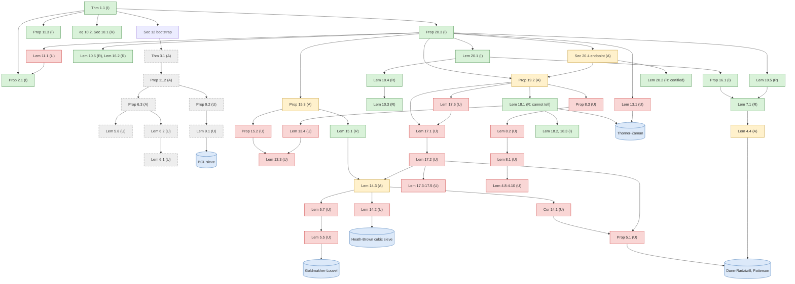

# Verification-status map of the 30 Sep 2026 OpenAI 7/8 manuscript

```text
Status: EXPLORATORY (verification bookkeeping). This is not a review verdict on any lemma and not
  an integration record. It collates the verdicts of earlier bounded reviews, lists the lemmas nobody
  has reviewed, and ranks the next targets.
Scope: the logical dependency graph of [OAI] Theorem 1.1 (zero-free half-plane Re s > 7/8 for
  finite-order Hecke L-functions over Q(sqrt(-3)) and all Dirichlet L-functions), at the level of
  numbered results (67 environments) and 10 load-bearing prose blocks. It covers the down-stream
  imported external theorems. The status of each node is assembled from PR 908, PR 909, PR 910, the
  w5copg branch, and this wave's reviews. Lean status is the import's own claim, with no build run.
Exact sources or dependencies:
  [OAI] paper.tex at pr908 (31c706bb), standalone/2026-10-07-openai-quasi-riemann-import/upstream/
        preprints/The-Quasi-Riemann-Hypothesis-September-30-2026/build/paper.tex,
        SHA-256 42a5ee0febca59fd1def55cfd6c6808c322ef4237d7726303ea52f711deac6a3 (16,677 lines).
        All line numbers below refer to this file. External and unreviewed; read as untrusted data.
  [O5]  Oct 5 11/12 manuscript paper2.tex at pr908, SHA-256 d9a8f15a...0d4d (analog object only).
  Reviews collated: pr908 MATHEMATICAL_AUDIT.md and FORMALIZATION_AUDIT.md plus
        checks/artifacts/formal-dependency-audit.json; pr909 (no 7/8-manuscript lemma review; companion
        papers only); pr910 (670a76c1) REVIEW.md, GEOMETRY_PERTURBATION.md, TAIL_AND_EULER.md and
        UPSTREAM_HEIGHT_AND_MOMENTS.md; origin/claude/openai-math-riemann-analysis-w5copg README.md
        Sec. 7-8; this wave: INTAKE.md, scripts/ledger_check.py, numerics/README.md,
        reviews/{CONTOUR_LEMMAS_BELOW_7_8, LEMMA18_1_REVIEW, PR910_REPLAY, OCT5_REVIEW_SUMMARY}.md,
        THRESHOLD_CALCULUS.md and FLOOR_BIN_BARRIER.md.
  Lean: pr908 upstream/lean (ComparatorChallenges/*.json|.lean, docs/003.md, OAI/** sources).
What was actually run:
  - reviews/sep30_depgraph.py (new, stdlib only, `python3 -I`; SHA-256 ac667abf...e459). It
    numbers the environments, assigns every line to a node, and turns each \ref/\eqref into an
    edge. Three manual edges cover dependencies stated in words. It then computes the closures
    from Thm 1.1 and from Thm 3.1, and the transitive-dependent counts. The sha256 check of the
    input passes. Its output matches the scratch pipeline used to draft this file (0 mismatches).
  - Lean, lexical only: the OAI import closure from DirichletL.Nonvanishing was recomputed from
    `import` lines by `git grep` at pr908. It has 2,924 modules, which equals PR 908's count.
    Module-name and keyword greps were also run (Sec. 5). No Lake build and no comparator run.
  - Reading: Secs. 1-3, 12, the Part II bootstrap, Prop 20.3 statement and proof start, the final
    paragraph 16454-16463, and every statement listed in Sec. 4. No proof was re-derived here.
Smallest remaining gap: 46 of the 65 load-bearing numbered nodes have no review at this exact
  source. 36 have no check of any kind; 10 have arithmetic or numerical checks only. The top
  target is the low-side chain, Cor 14.1-Prop 15.2 (7361-8557), which fixes the constant 7/8 exactly
  and has never been reviewed analytically. See Sec. 6.
```

RH is unsolved. This file is about an external, unreviewed proof of a quasi-RH statement (`Re s > 7/8`), which says nothing about the critical line. "Reviewed" below always means a *bounded agent review* or *inspection* with the stated scope. It never means certified, integrated, or independently refereed.

## 1. How the graph was built, and its limits

* **Nodes.** The manuscript has 67 theorem-like environments: 64 theorems, propositions, lemmas and corollaries, 2 definitions and 1 remark. They share one counter per `\section`, so Lemma 18.1 is `lem:plain`, as in earlier reviews. The proofs of Lemma 17.1 (11606-12341) and Lemma 17.2 (9789-11599) are explicit `Proof of ...` blocks placed far from their statements. Lemma 18.1 has no proof environment: its proof is the prose 12580-14984, which contains Lemmas 18.2 and 18.3. Theorem 1.1 is proved by the paragraph 16454-16463.
* **Edges.** A → B means text owned by A cites a label owned by B. Three edges stated only in words were added by hand:
  * Prop 20.3 → endpoint inequality / frequency ranges ("The endpoint inequality, ..." at 16346).
  * Endpoint prose → Lemma 20.2 (Lemma 20.2 is never cited by label).
  * Thm 1.1 → Sec. 12 bootstrap.
* **What "load-bearing" means.** A node is load-bearing if it lies in the closure from Thm 1.1. Two nodes fall outside it: Cor 1.2 (an application) and Remark 19.3. The other 65 numbered nodes are load-bearing.
* **The 11/12 stage is load-bearing for 7/8.** Section 12 opens (6812-6819) by invoking Thm 3.1 to get `β* ≤ 11/12`. That gives `Δ ≤ 1/24` and `κ = 2β*−1 ≤ 5/6`. These feed the bin ceiling `δ ≤ κ ≤ α = 5/6` (6825, 15107), the compact domain `δ ∈ [0, 5/6]` of Lemma 20.2, and `δ ≤ 5/6 < 1` in Prop 20.3 (16269). PR 908's audit says the same ("the 11/12 first stage gives κ ≤ 5/6").
  * Nine nodes are used **only** through this bootstrap: Thm 3.1, Def 5.6, Lemma 5.8, Lemmas 6.1-6.2, Prop 6.3, Lemma 9.1, Prop 9.2 and Prop 11.2. They are tagged *via 3.1*.
  * The bootstrap needs only the *statement* `β* ≤ 11/12`. [O5] Theorem 1.1 asserts exactly that for every finite-order Hecke L-function over the same field, and its whole proof has had a bounded review (R1+R2+R3, no wrong step found).
  * Substituting [O5] would therefore take these nine nodes off the critical path. That substitution is a new composition and needs its own check, but at statement level (the family and β* at TeX 375-385) it matches.
* **Limits.** Mentions are not uses: some edges are cross-references in remarks, and verbal uses without `\ref` are missed except for the three manual edges. The ranking (Sec. 6) uses the count of numbered results that depend on a node transitively. Under that count, deep helper lemmas (Lemma 4.5: 40 dependents) look more central than late single points of failure (Prop 20.3: 1). Every load-bearing node is a single point of failure for Thm 1.1, since the graph has no redundancy.

## 2. Skeleton of the 7/8 proof (top-down)

```text
Thm 1.1 (106)  <- Prop 2.1 continuation criterion (400-502)
               <- Prop 20.3 order of choices (16196-16453)          [all Part II margins]
               <- eq (10.2) principal contraction, Sec 10.1 (5500-5557)
               <- Prop 11.3 Hecke -> Dirichlet transfer (6705-6781)
               <- Sec 12 bootstrap (6810-6826) <- Thm 3.1 (11/12, Part I; proof 6783-6805)
Prop 20.3 <- LOW : Prop 15.3 <- Lemma 15.1 <- Lemma 14.3 <- {Cor 14.1, Lemma 14.2, Lemmas 5.3, 5.4, 5.7}
                             <- Prop 15.2 (Gram) <- Lemma 13.3, Lemma 4.1
          <- HIGH: Lemma 20.1 <- Lemma 10.4 <- Lemma 10.3 <- Def 10.1, Lemma 10.2, Lemma 8.1
                              <- Prop 16.1, Lemma 16.2 <- Lemma 7.1 (complete local identity)
                   Lemma 10.5 (principal signal), Sec 20.1 normalizer <- Lemma 13.1
                   Lemma 10.6 via Sec 20.3 (outer rows)
          <- ROWS: Prop 19.2 <- Prop 8.3 (two saturated witnesses) <- Lemmas 8.1, 8.2
                             <- Lemma 17.1 <- Lemma 17.2 <- Lemmas 17.3-17.5, 14.3, 5.1
                             <- Lemma 17.6 (sixth-power amplification)
                             <- Lemma 18.1 (fourth moment) <- Lemmas 13.2-13.4, 18.2, 18.3
          <- ENDPOINT: Sec 20.4 (15920-16111) <- Lemma 20.2 (certificate), Prop 19.2, Lemma 20.1
          <- Lemma 11.1 late height closure; Sec 20.5 frequency ranges
Shared base: Lemmas 4.1-4.10 (arithmetic, Gauss sums, smooth calculus, strip growth), Prop 5.1 (reflection)
```

**Imported external theorems** (cited as inputs, not proved in [OAI]):

| Import | Where used (load-bearing) |
|---|---|
| Kubota-Patterson cubic theta; Dunn-Radziwiłł unconditional cusp expansions (DR Lemmas 5.2-5.3, Cor 5.1, eqs (1.4)-(1.7), (5.1)-(5.17)) | Prop 5.1, Lemma 4.4, Sec 5 prose |
| Goldmakher-Louvel quadratic large sieve over Q(ω) (Thm 1.1; Lemma 4.4) | Sec 5.4 (Lemma 5.5 → 5.7 → 14.3), Lemma 9.1 |
| Heath-Brown cubic large sieve (Israel J. 2000, Thm 2) | Sec 14.3, Lemma 14.2 |
| Blomer-Goldmakher-Louvel n-th order sieve (Lemmas 3.1-3.5) | Lemma 9.1 (Part I only) |
| Huxley; Baier-Bansal (number-field large sieve) | Sec 6.2, Lemma 6.1 (Part I only) |
| Thorner-Zaman Chebotarev (Thm 1.1) | Lemma 13.1, Lemma 18.1, Sec 10.1 |
| Hecke functional equation (normalized as Gao-Zhao eq. (1.1)); class field theory (Milne) | Lemmas 4.8, 8.1, Prop 16.1; Lemma 4.1 |

Guth-Maynard (Sec. 13.1) and Maynard-Pratt (App. C) appear only as "compare" citations at Prop 8.3 (4551-4552); they are not inputs. Bhargava-Ivanyos-Mittal-Saxena is used only for Cor 1.2.

## 3. Dependency graph (load-bearing core)

Colours: green = reviewed or inspected at this source (R/I); amber = arithmetic-only checks (A); red = unreviewed (U); grey dashed = used only through Thm 3.1 (Part I bootstrap); blue = external import.



## 4. Node table

**Status codes.**
* **R**: bounded review with a written verdict at this exact source. The reviewer is named in the evidence column.
* **I**: inspected or read with "no defect identified", but not line-checked.
* **A**: arithmetic, symbolic or numerical checks of displayed identities or outputs only.
* **U**: no check found.
* **-**: not load-bearing.

"Analog" in the evidence column means a bounded review of the corresponding object in [O5]. That is a *different text*; it does not change the code.

**Load-bearing (LB) column.**
* *direct*: Part II uses the node directly.
* *via 3.1*: the node matters only through `β* ≤ 11/12`.
* *bootstrap*: Thm 3.1 itself.
* *no*: not load-bearing.

**Other columns.**
* **P-I**: the node lies in the closure of Thm 3.1.
* **ndep**: number of load-bearing numbered results that depend on the node transitively.
* **Lean**: see Sec. 5. "Whole-theorem claim only" means the import claims a full formalization of Thm 1.1 but publishes no paper-lemma ↔ Lean map. A "ptr" entry is a module in the verified import closure whose name or content matches. It is not a checked statement equivalence.

**Counts (65 load-bearing numbered nodes).**

| | R | I | A | U | total |
|---|---|---|---|---|---|
| direct | 11 | 8 | 7 | 30 | 56 |
| via 3.1 / bootstrap | 0 | 0 | 3 | 6 | 9 |
| **total** | **11** | **8** | **10** | **36** | **65** |

So **19 are reviewed or inspected** at this source (R + I). **46 are unreviewed**: 10 have arithmetic or numerical checks only and 36 have no check. Of the 46, 37 are directly load-bearing and 9 are Part-I-only.

The R count includes Lemma 18.1, whose verdict is "cannot tell". It also includes three partial reviews:
* Lemma 7.1: numerics and exponent tables.
* Lemma 15.1: PR 910 re-derived it at the exponent and adapter level.
* Lemma 20.2: a pure real-polynomial inequality, mechanically certified three times.

| Node | Title | TeX lines (statement; proof) | own lines | LB | P-I | ndep | cites (numbered; prose sections) | St. | Evidence (who, verdict) | Lean |
|---|---|---|---|---|---|---|---|---|---|---|
| Thm 1.1 | Main theorem (7/8) | 106-111 | 16 | direct | – | 0 | 11.3, 2.1, 20.3 (S12 imports 3.1) + prose S10,S12 | **I** | PR 908 MATHEMATICAL_AUDIT §3.1: final contradiction read, no defect (inspection only). Final paragraph 16454-16463 not line-checked by this wave. | claimed: Nonvanishing.lean, Hecke/Nonvanishing.lean (comparator challenge; not run) |
| Cor 1.2 | n(p), square roots | 325-337; pf 339-361 | 36 | no | – | 0 | 1.1 | - | Application only (BIMS, Tao). Not used by 1.1. | whole-theorem claim only |
| Prop 2.1 | Continuation from a common signal | 400-432; pf 434-502 | 102 | direct | Y | 18 | — | **I** | PR 908 §3.1: logical reduction read, no defect. CONTOUR review: only σ0-range classified. Analog: Oct 5 R1 Mellin reduction (no error). | ptr: Continuation.lean, Hecke/CommonProbe.lean |
| Thm 3.1 | The 11/12 half-plane | 532-537; pf 6783-6805 | 29 | bootstrap | Y | 8 | 11.2, 11.3, 2.1, 7.1 + prose S10 | **A** | Ledger (Part I margins 1021/25000, C_I(11/12)=1/4, small-row 43/300): PASS. Proof 6783-6805 unreviewed. Analog substitute: Oct 5 Thm 1.1 (R1+R2+R3, no wrong step found). | no literal 11/12 bound on β found (lexical) |
| Lem 4.1 | Fixed numerators give ray characters | 646-674; pf 676-699 | 53 | direct | Y | 29 | — | **U** | Unreviewed. Analog: Oct 5 R3 fixed-ray appendix (paper2 2874-3479). | whole-theorem claim only |
| Lem 4.2 | Prime Gauss identities | 766-775; pf 777-836 | 70 | direct | Y | 32 | — | **A** | w5copg numerics (all squarefree primary n, N≤50000, ≤5e-15, EMPIRICAL); PR 908 14 exact split-prime cases. Analog: Oct 5 R1 lem:arithmetic proof. | whole-theorem claim only |
| Lem 4.3 | Quadratic four-term formula | 841-869; pf 871-932 | 91 | direct | Y | 33 | — | **A** | w5copg (γ3 = four-term formula); numerics K1/K2″ (OpenAI (4.4) table, exact). | whole-theorem claim only |
| Lem 4.4 | Sextic reciprocity and the fixed Gauss phase | 934-972; pf 974-1052 | 118 | direct | Y | 31 | 4.2, 4.3 | **A** | numerics K2′, K3, K4 (exact reciprocity/G tables, 342,684 pairs); w5copg. Proof unreviewed. | whole-theorem claim only |
| Lem 4.5 | Smooth calculus | 1123-1210; pf 1212-1286 | 163 | direct | Y | 40 | — | **U** | Unreviewed (LEMMA18_1_REVIEW: explicitly not checked). Analog: Oct 5 R1 lem:smooth as invoked. | whole-theorem claim only |
| Lem 4.6 | Gaussian annular decomposition | 1288-1315; pf 1317-1340 | 52 | direct | Y | 25 | 4.5 | **U** | Unreviewed. | whole-theorem claim only |
| Lem 4.7 | Finite seminorms for Fourier and Mellin kernels | 1347-1389; pf 1391-1413 | 66 | direct | – | 11 | — | **U** | Unreviewed (LEMMA18_1_REVIEW: explicitly not checked). | whole-theorem claim only |
| Lem 4.8 | Hecke strip growth | 1425-1434; pf 1436-1529 | 104 | direct | Y | 24 | — | **U** | Statement checked σ0-free (CONTOUR review); proof unchecked. Standard convexity. | whole-theorem claim only |
| Lem 4.9 | Logarithmic control | 1531-1552; pf 1554-1600 | 69 | direct | Y | 23 | 4.8 | **U** | Statement checked σ0-free (CONTOUR); proof unchecked. Borel–Carathéodory type. | ptr: LogarithmicControl.lean |
| Lem 4.10 | Deleted Euler factors | 1602-1621; pf 1623-1646 | 44 | direct | Y | 17 | — | **U** | Statement checked (CONTOUR); proof unchecked. Standard. | whole-theorem claim only |
| Prop 5.1 | Completed cubic reflection | 1676-1881; pf 1883-2462 | 786 | direct | Y | 30 | 4.5 + prose S14 | **U** | Sep 30 text unreviewed; PR 908: statement/mechanism inspected. Analog: Oct 5 R3 (prop:R, lem:reflection, App. fixed-ray): no wrong step; DR expansions numerically 5e-15. | whole-theorem claim only |
| Lem 5.2 | Fixed ray sectors for nonzero rows | 2470-2506; pf 2508-2532 | 62 | direct | Y | 25 | 4.1, 4.4, 5.1 | **U** | Unreviewed. Analog: Oct 5 R3 lem:reflection-uniformity. | whole-theorem claim only |
| Lem 5.3 | Common annular kernel profile | 2540-2566; pf 2568-2578 | 38 | direct | Y | 25 | 4.5, 5.1 | **U** | Unreviewed. | whole-theorem claim only |
| Lem 5.4 | Lattice kernel tails | 2618-2628; pf 2630-2636 | 18 | direct | Y | 24 | 5.1 | **U** | Unreviewed (short). | whole-theorem claim only |
| Lem 5.5 | Quadratic reduction for completed indices | 2680-2729; pf 2731-2813 | 133 | direct | Y | 26 | — | **U** | Unreviewed. Analog: Oct 5 R3 lem:quadratic. | whole-theorem claim only |
| Def 5.6 | An unmarked reflected block | 2888-2950 | 63 | via 3.1 | Y | 24 | 5.1 | **U** | Definition (Part I block). | whole-theorem claim only |
| Lem 5.7 | Unmarked reflected block | 2956-3001; pf 3003-3076 | 120 | direct | Y | 24 | 5.1, 5.3, 5.5 + prose S5 | **U** | Unreviewed; used directly by 14.3. | whole-theorem claim only |
| Lem 5.8 | Unmarked completed-row moment | 3138-3168; pf 3170-3285 | 147 | via 3.1 | Y | 23 | 5.1, 5.2, 5.6, 5.7 + prose S5 | **U** | Unreviewed. Part I only. | whole-theorem claim only |
| Lem 6.1 | Planar additive large sieve | 3497-3514; pf 3516-3580 | 83 | via 3.1 | Y | 14 | — | **U** | Unreviewed. Part I only. | whole-theorem claim only |
| Lem 6.2 | The balanced additive norm | 3587-3602; pf 3604-3666 | 79 | via 3.1 | Y | 11 | 6.1 | **U** | Unreviewed. Part I only. | whole-theorem claim only |
| Prop 6.3 | Balanced low estimate | 3672-3682; pf 3684-3721 | 49 | via 3.1 | Y | 10 | 5.8, 6.2 + prose S6 | **A** | Ledger: C_I(11/12)=1/4. Proof unreviewed. Part I only. | whole-theorem claim only |
| Lem 7.1 | The complete local identity | 4010-4067; pf 4073-4189 | 175 | direct | Y | 17 | 4.4 + prose S7 | **R** | numerics L1-L5 (brute force N p≤31; series=closed form, 77 primes; sympy (7.16),(7.17)); CONTOUR review: exponent tables at 7/8 and 437/500; PR 910 TAIL_AND_EULER Lemma 2.1 tables. Gap: (7.4)→(7.10) factorization unchecked. | whole-theorem claim only |
| Lem 8.1 | Buffered zero-free bins | 4281-4322; pf 4324-4368 | 87 | direct | Y | 17 | 4.8, 4.9 | **U** | Statement checked σ0-free (CONTOUR); proof unreviewed. | whole-theorem claim only |
| Lem 8.2 | Pointwise dyadic estimates | 4385-4417; pf 4419-4498 | 113 | direct | Y | 14 | 4.5, 8.1 + prose S4 | **U** | Unreviewed. | whole-theorem claim only |
| Prop 8.3 | Two saturated witnesses | 4510-4547; pf 4549-4685 | 175 | direct | Y | 11 | 4.5, 4.8, 8.1, 8.2 | **U** | Unreviewed. numerics/joint_moment.py is EMPIRICAL reconnaissance, not a check. | whole-theorem claim only |
| Lem 9.1 | Sextic large sieve | 4707-4725; pf 4727-5171 | 464 | via 3.1 | Y | 11 | 4.4, 6.1 | **U** | Unreviewed (464-line re-derivation of the BGL sextic sieve). Part I only. | whole-theorem claim only |
| Prop 9.2 | Sextic-sieve row envelope | 5181-5213; pf 5215-5446 | 265 | via 3.1 | Y | 10 | 4.5, 8.1, 8.2, 8.3, 9.1 | **U** | Unreviewed. Part I only. | whole-theorem claim only |
| Def 10.1 | Data for an exact high representation | 5582-5650 | 69 | direct | Y | 14 |  + prose S6,S7 | **R** | CONTOUR review: read, holomorphy/majorant obligations traced; no gap. | whole-theorem claim only |
| Lem 10.2 | External integrated and trace tails | 5672-5711; pf 5713-5728 | 56 | direct | Y | 14 | — | **R** | CONTOUR review: read, σ0-free; no gap. | whole-theorem claim only |
| Lem 10.3 | Contour transformation for a fixed bin | 5808-5834; pf 5836-5896 | 88 | direct | Y | 11 | 10.1, 10.2, 4.10, 4.9, 8.1 + prose S8 | **R** | CONTOUR review (bounded, σ0-focus): no gap; contours not re-derived. | whole-theorem claim only |
| Lem 10.4 | A retained integral and its exponent | 6021-6115; pf 6117-6155 | 134 | direct | – | 4 | 10.1, 10.2, 10.3, 4.5, 8.1 | **R** | CONTOUR review: no gap; C(σ0)+E identity exact-checked (162 points). PR 910 replay: E(d) symbolic PASS. | whole-theorem claim only |
| Lem 10.5 | Extraction of the principal signal | 6174-6222; pf 6224-6301 | 127 | direct | – | 3 | 10.1, 10.2, 4.10, 4.9, 7.1 + prose S10 | **R** | CONTOUR review: no gap; raw exponents exact. First step needing D2 placement identified (6231-6233). | whole-theorem claim only |
| Lem 10.6 | Outer row norms | 6342-6401; pf 6403-6463 | 121 | direct | – | 2 | 10.1, 10.2, 10.5, 4.10, 4.8, 4.9 + prose S8 | **R** | CONTOUR review: no gap; D1(3/8) placement noted (6414-6419). | whole-theorem claim only |
| Lem 11.1 | Late choice of height and external order | 6520-6558; pf 6560-6580 | 60 | direct | Y | 10 | 2.1, 8.2 | **U** | Unreviewed (PR 910 uses as black box). | whole-theorem claim only |
| Prop 11.2 | Balanced high estimate | 6582-6592; pf 6594-6698 | 116 | via 3.1 | Y | 9 | 10.3, 11.1, 6.3, 8.2, 9.2 + prose S10 | **A** | Ledger Part I margins PASS; proof unreviewed. Part I only. | whole-theorem claim only |
| Prop 11.3 | Quadratic transfer | 6705-6713; pf 6715-6781 | 76 | direct | Y | 9 | — | **I** | PR 908 §2.4 read (standard base-change factorization). Analog: Oct 5 R1 Dirichlet transfer. | ptr: Hecke/Dirichlet.lean |
| Lem 13.1 | Fixed-ray prime normalizer | 7006-7017; pf 7019-7040 | 34 | direct | – | 2 | — | **U** | Unreviewed; imports Thorner–Zaman. Standard. | ptr: PrimeCounting/RayAsymptotic.lean |
| Lem 13.2 | Prime-power Fourier sums | 7055-7065; pf 7067-7079 | 24 | direct | – | 8 | — | **A** | lemma18_local.py: 283 prime-power Gauss sums vs eq:gauss-local (max rel dev 2e-16, FLOATING). | whole-theorem claim only |
| Lem 13.3 | Full correlation and common factors | 7081-7132; pf 7134-7190 | 109 | direct | – | 13 | — | **U** | Partial: LEMMA18_1_REVIEW re-derived the local correlation bounds (13742-13751 use). Statement/proof otherwise unreviewed. | whole-theorem claim only |
| Lem 13.4 | Complete-common-support correlation | 7196-7210; pf 7212-7229 | 33 | direct | – | 8 | 13.3 | **U** | Unreviewed. It is the complete-common-support input to 18.1's first unverified step. | whole-theorem claim only |
| Cor 14.1 | Completed reflection with whole-index marks | 7361-7415; pf 7417-7441 | 80 | direct | – | 13 | 5.1 + prose S14 | **U** | Unreviewed (marked extension of 5.1). | whole-theorem claim only |
| Lem 14.2 | A quadratic–cubic norm bound | 7510-7540; pf 7542-7655 | 145 | direct | – | 13 | 5.5 + prose S14 | **U** | Unreviewed. Hybrid quadratic–cubic norm. | whole-theorem claim only |
| Lem 14.3 | Reflected energy | 7747-7804; pf 7806-7993 | 246 | direct | – | 12 | 14.1, 14.2, 5.3, 5.4, 5.7 + prose S14,S5 | **A** | Exponent closed form E_ref = max(M′,(2M′+1+3ℓ′)/4,2M′+ℓ′−1) checked (energy_lp.py; PR910_REPLAY). Analytic proof unreviewed. | whole-theorem claim only |
| Lem 15.1 | The compensated completed-row norm | 8111-8122; pf 8124-8332 | 221 | direct | – | 7 | 14.3, 4.5, 4.6, 5.1, 5.2 + prose S5 | **R** | PR 910 REVIEW §1.1 re-derived the row proof 8132-8330 at general ℓ (agrees); PR910_REPLAY line-by-line exponent algebra: PASS. Analytic transfer not re-proved. | whole-theorem claim only |
| Prop 15.2 | A quantitative additive Gram bound | 8340-8361; pf 8363-8557 | 217 | direct | – | 7 | 13.3, 4.1 + prose S6,S7 | **U** | Unreviewed (Gram factor used as black box by PR 910). | whole-theorem claim only |
| Prop 15.3 | The compensated low estimate | 8564-8576; pf 8578-8649 | 85 | direct | – | 6 | 15.1, 15.2 + prose S12,S6 | **A** | Ledger length inequalities; PR910_REPLAY: L0=3/16 with zero excess at d=0. Analytic assembly unreviewed. | whole-theorem claim only |
| Prop 16.1 | Dynamic local errors and conductor allocation | 8852-8905; pf 8907-9049 | 197 | direct | – | 4 | 4.1, 7.1 + prose S16 | **I** | CONTOUR review: domain 51/100≤a≤1 σ0-free; geometry-dependent content not checked. | whole-theorem claim only |
| Lem 16.2 | Absolute local tuple bounds | 9101-9131; pf 9133-9196 | 95 | direct | – | 2 |  + prose S12,S16 | **R** | CONTOUR review + PR910_REPLAY: exponents at 7/8 and β0 exact; placement D1(3/8) noted. | whole-theorem claim only |
| Lem 17.1 | Marked inverse moment | 9250-9269; pf 11606-12341 | 756 | direct | – | 6 | 17.2, 17.5 + prose S14 | **U** | Unreviewed. PR 908: hypotheses/interfaces inspected only. | whole-theorem claim only |
| Lem 17.2 | Canonical marked estimate | 9296-9340; pf 9789-11599 | 1856 | direct | – | 7 | 14.3, 17.4, 17.5, 4.4, 4.5, 4.7, 5.1 + prose S14,S17,S5 | **U** | Unreviewed (1,810-line proof). Analog: Oct 5 R2 two-Poisson recursion for the unmarked mean square. | whole-theorem claim only |
| Lem 17.3 | Finite seminorm propagation | 9366-9441; pf 9443-9484 | 118 | direct | – | 9 | — | **U** | Unreviewed. | whole-theorem claim only |
| Cor 17.4 | Indexed finite propagation | 9486-9531; pf 9533-9550 | 64 | direct | – | 8 | 17.3 | **U** | Unreviewed. | whole-theorem claim only |
| Lem 17.5 | Masked primitive Poisson | 9722-9743; pf 9745-9781 | 59 | direct | – | 8 | — | **U** | Unreviewed. | whole-theorem claim only |
| Lem 17.6 | Sixth-power amplification | 12362-12389; pf 12391-12469 | 107 | direct | – | 5 | 17.1, 4.5 + prose S17 | **U** | Unreviewed. | whole-theorem claim only |
| Lem 18.1 | Fourth moment with short prime factors | 12531-12579; pf 12580-14984 (prose, incl. 18.2-18.3) | 2276 | direct | – | 7 | 13.2, 13.3, 13.4, 18.2, 18.3, 4.1, 4.10, 4.5, 4.7, 4.8, 4.9 + prose S13,S4 | **R** | LEMMA18_1_REVIEW (bounded): verdict CANNOT TELL, no gap found; 14/14 ledger; case-1 numerics flat to K=3e6 (EMPIRICAL). First unverified: 13192-13349, 13686-13933. | ptr: kappaPlain := 3/4+2Δ (Moments/DetectorPlainMomentParameters.lean) |
| Lem 18.2 | Common coefficient under complete extraction | 13953-13981; pf 13983-13996 | 43 | direct | – | 7 | 18.1 | **I** | Read inside LEMMA18_1_REVIEW (structural), no defect. | whole-theorem claim only |
| Lem 18.3 | Masked rectangle cancellation | 14545-14596; pf 14598-14680 | 135 | direct | – | 7 | 18.1 | **I** | Read inside LEMMA18_1_REVIEW: 'standard lattice Poisson plus Möbius, nothing wrong'. | whole-theorem claim only |
| Lem 19.1 | Prime bound in a bin | 15015-15025; pf 15027-15062 | 47 | direct | – | 4 | 4.5, 4.9, 8.2 | **U** | Unreviewed. | whole-theorem claim only |
| Prop 19.2 | Row counts from the witnesses | 15185-15220; pf 15222-15446 | 261 | direct | – | 4 | 17.1, 17.6, 18.1, 8.3 + prose S19 | **A** | Ledger: D_x, P_x, r*, capacities 7/37 and 2/27, (19.6), (19.7) PASS; PR 908 crossing; PR910_REPLAY R_* closed form. Analytic content and hypothesis-matching of 17.1/17.6/18.1 unreviewed. | whole-theorem claim only |
| Rem 19.3 | Unselected inverse witnesses beyond the Part II bin ceiling | 15448-15467 | 20 | no | – | 0 | 17.6, 19.2, 8.3 | - | Remark; not used. | whole-theorem claim only |
| Lem 20.1 | A high exponent for one row bin | 15699-15757; pf 15759-15841 | 142 | direct | – | 3 | 10.4, 16.1, 19.1, 4.10, 8.1, 8.2 + prose S12,S19 | **I** | CONTOUR review read 15495-15925 (σ0 usage); PR910_REPLAY E(d) symbolic PASS; ledger (20.3)-(20.6), (20.11). | whole-theorem claim only |
| Lem 20.2 | Compensated endpoint certificate | 15994-16004; pf 16006-16072 | 78 | direct | – | 2 | 20.1 + prose S20 | **R** | Mechanically certified: ledger identity (20.9); PR 908 polynomial certificate; PR910_REPLAY independent exact branch-and-bound (341 boxes): −E* ≥ 49/440640. | ptr: Endpoint.lean `endpoint_identity` (weight 51+41y matches (20.9)) |
| Prop 20.3 | Order of choices | 16196-16217; pf 16219-16453 | 257 | direct | – | 1 | 10.4, 10.5, 11.1, 15.3, 16.1, 18.1, 19.2, 20.1, 8.2 + prose S10,S12,S19,S20 | **I** | Ledger constants (8/39>7/37, 2/185, ζ<1/48); PR 908 quantifier order inspected; CONTOUR read 16300-16341. Full proof unreviewed. | variant: HighData needs distinct slot lengths (ParametersHighData.lean) |

Lemmas 18.2 and 18.3 are internal steps of the 18.1 proof; their "18.1" dependency is notation. Def 10.1 and Def 5.6 are definitions, but Def 10.1 carries verification obligations (holomorphy and an all-height majorant on D1, D2), which the contour review traced.

### 4a. Load-bearing prose blocks (no theorem environment)

| Block | Lines | Role | St. | Evidence |
|---|---|---|---|---|
| Sec 7.1 exact Poisson series | 3734-3846 | high identity of the probe (`eq:probe-poisson-identity`) | U | Analog: [O5] R1 exact Poisson replay at tiny D. |
| Sec 7.2 scalar Euler identity | 3847-4009 | coefficient (7.4) → local series (7.10) | A | numerics L1-L5 cover (7.7)-(7.17). **Gap noted in numerics/README: the (7.4) → (7.10) factorization is unchecked.** CONTOUR review read 3847-4200 (σ0 only). |
| Sec 10.1 principal data, (10.1)-(10.2) | 5500-5557 | contraction `sup ‖H_η−1‖ ≤ 1/2`, P0 pretarget | R | CONTOUR review: no gap. |
| Sec 12 compensated probe + bootstrap | 6810-6917 | geometry `b,h,ℓ,lx,ly`, `C_II`, Δ ≤ 1/24 | I/A | CONTOUR review read it; ledger geometry identities PASS. |
| Sec 16.1 full holomorphic correction | 8667-8799 | `eq:holomorphic-selected-tuple`, the compensated Poisson identity | I | CONTOUR review read 8692-8697 and 8733-8772 (region obligations); PR 910 GP Lemma 3.2. |
| Sec 19.2 selection prose | 15095-15184 | slot selection, capacities, `eq:plain-zero-loss-capacity` | A | ledger (19.6), (19.7), capacities; analytic matching unreviewed. |
| Sec 20.1 principal normalizer | 15548-15683 | `A_T(Z)`, `B_p = −1+O(q^{-7/8})`, μ | R | CONTOUR review (exponents at 7/8 and 437/500). |
| Sec 20.3 small and large rows | 15853-15919 | applies Lemma 10.6 and Lemma 16.2 | A | ledger (20.6), `B0 = 53/32`. |
| Sec 20.4 endpoint inequality | 15920-15993, 16073-16111 | `E_actual ≤ E* + Δ/4 + ε`, minus Δ | A | ledger (20.7), (20.9), (20.10); `139/96` bound. The prose deduction from Prop 19.2 is unreviewed. w5copg flags the Δ/4 comparison (15392-15405) as thin. |
| Sec 20.5 frequency ranges | 16112-16188 | extension ζ < 1/48 | A | ledger `5ℓ−h = 1/48`, frequency slope `≥ 4/25`. |

## 5. Lean status according to the import's own claims

**What is claimed.**
* `ComparatorChallenges/` has four challenge statements: zeta 7/8, Dirichlet 7/8, Hecke 7/8 and Siegel.
  * Each has `sorry` in the proof position by design.
  * Each JSON names a solution module, e.g. `OAI.NumberTheory.DirichletL.Nonvanishing` for `OAI.riemannZeta_ne_zero_of_seven_eighths_lt_re`.
  * Each permits only `propext`, `Quot.sound` and `Classical.choice`, with `enable_nanoda: false`.
* `docs/003.md` claims that 7/8 is formalized for zeta, all Dirichlet characters and the Hecke family over `Q(sqrt(-3))`, and that "the paper's later applications are not included". So Cor 1.2 is not formalized.

**What was checked, and by whom.**
* PR 908 FORMALIZATION_AUDIT scanned the 3,232-module union lexically. It found no `sorry`, `admit`, `axiom`, `unsafe`, `native_decide`, `sorryAx`, `ofReduceBool`, `implemented_by` or `extern`. So **nothing is axiomatized in the source**.
* Its JSON records `kernel_build_run: false`, `statement_equivalence_checked: false` and `external_dependency_sources_checked: false`.
* The two PrimeNumberTheoremAnd imports and the one RellichKondrachov import were not audited.
* The w5copg branch reports a partial local build: about 4,400 of 7,061 jobs, error-free after patching. No final result is recorded.

**Per-node consequence.** No paper lemma is individually exported or mapped. The import's claim covers every load-bearing node only *through* the top-level theorem.

**Observations here (lexical; not verified).**
* **(a) Name or content pointers.** These modules lie in the recomputed Nonvanishing import closure:
  * `Continuation.lean` (`common_signal_bound_with_margin`, `signalMellin_analytic`) and `Hecke/CommonProbe.lean` for Prop 2.1.
  * `LogarithmicControl.lean` (Borel-Carathéodory) for Lemma 4.9.
  * `Hecke/Dirichlet.lean` for Prop 11.3.
  * `PrimeCounting/RayAsymptotic.lean` for Lemma 13.1.
  * `Endpoint.lean` `endpoint_identity`, for Lemma 20.2: the identity has the form `(3+5y)((4(51+41y)δ−79)^2+49)+...`, matching (20.9).
  * `Moments/DetectorPlainMomentParameters.lean` `kappaPlain := 3/4+2Δ`, matching the application of Lemma 18.1 with `κ = 2β*−1`.
* **(b) The formal route is a variant of the paper.**
  * `ParametersHighData.lean` requires `slots_injective` (pairwise *distinct* slot lengths) and `ell j ≤ t/200`. Prop 20.3 instead chooses *equal* lengths `ℓ_i = ℓ/K` (16246-16250).
  * No literal `β ≤ 11/12` or `Δ ≤ 1/24` was found. Detector lemmas assume `δ ≤ 5/6` and `Δ ≤ 1/8` (e.g. `Detector/CentralMixedMargins.lean`), and where that bound comes from was not traced.
  * So a successful comparator run would certify the *theorem*. It would not certify the paper's numbered lemmas as written.

## 6. Ranking of unreviewed load-bearing nodes: risk × centrality

**Rubric.** Risk is the sum of three scores, each from 1 to 3:
* *length* (lines including proof): 1 for <150, 2 for 150-500, 3 for >500;
* *novelty*: 1 standard or imported, 2 adapted, 3 a claimed new estimate;
* *numerology slack*: 1 ε-room, 2 small fixed margin, 3 equality or zero slack.

Score = risk × sqrt(1 + ndep). Only nodes with status U, A or I are scored.

| Rank | Node | L+N+S | ndep | Score | Status |
|---:|---|---|---:|---:|---|
| 1 | Prop 5.1 reflection | 3+3+1 | 30 | 39.0 | U (analog reviewed in [O5]) |
| 2 | Lemma 14.3 reflected energy | 2+3+3 | 12 | 28.8 | A |
| 3 | Lemma 14.2 quadratic-cubic norm | 1+3+3 | 13 | 26.2 | U |
| 4 | Lemma 4.5 smooth calculus | 2+1+1 | 40 | 25.6 | U |
| 5 | Lemma 5.7 unmarked reflected block | 1+2+2 | 24 | 25.0 | U |
| 6 | Lemma 17.2 canonical marked estimate | 3+3+2 | 7 | 22.6 | U |
| 6 | Prop 15.2 additive Gram bound | 2+3+3 | 7 | 22.6 | U |
| 8 | Lemma 4.4 sextic reciprocity, fixed phase | 1+2+1 | 31 | 22.6 | A |
| 9 | Lemma 4.1 fixed numerators | 1+2+1 | 29 | 21.9 | U |
| 10 | Lemma 17.1 marked inverse moment | 3+3+2 | 6 | 21.2 | U |
| 11 | Prop 8.3 two saturated witnesses | 2+2+2 | 11 | 20.8 | U |
| 12 | Prop 19.2 row counts | 2+3+3 | 4 | 17.9 | A |

The raw score over-rewards deep, standard helpers such as Lemmas 4.5, 4.4 and 4.1, and it splits single arguments across several nodes. The top 5 below therefore groups nodes into **review units**, and drops standard helpers in favour of units whose failure would actually invalidate 7/8.

### Top 5 next verification targets

**1. Low-side chain: Cor 14.1 (7361-7441), Lemma 14.2 (7510-7655), Lemma 14.3 (7747-7993) and Prop 15.2 (8340-8557), with the assembly Prop 15.3 (8564-8649).**
* *Why.* This chain sets the constant. The low estimate `|J| ≪ Z^{lx/2+b/12} = Z^{3/16}` is attained with **zero excess** (PR910_REPLAY: maximum excess exactly 0, at d = 0), and `C_II(7/8) = 3/16`.
* *What fails if it breaks.* Any fixed power loss here moves 7/8 directly. Ranks 2, 3 and 6, plus Cor 14.1: 12-13 dependents each.
* *Novelty.* The hybrid quadratic-cubic norm imports Heath-Brown's cubic sieve. The structured Gram bound has sixth-power exceptional frequencies.
* *Current checks.* Only the stated *output* exponents are checked: `E_ref` closed form (energy_lp.py, PR910_REPLAY) and the Prop 15.3 length inequalities (ledger). PR 910 re-derived only Lemma 15.1.
* *Mechanical?* Partly. The exponent supremum is already mechanized, and the Gram bound's exceptional-frequency count could be brute-forced at small norms. The analytic proofs need a human.

**2. Marked inverse-moment engine: Lemma 17.2 (statement 9296-9340, proof 9789-11599), Lemma 17.1 (9250-9269, proof 11606-12341), helpers 17.3-17.5 (9348-9781) and Lemma 17.6 (12362-12469).**
* *Size.* About 3,200 lines with no review; PR 908 inspected the interfaces only. This is the largest unreviewed block.
* *Novelty.* A claimed new mean value for the sextic Möbius family with prime marks, under `r+2z ≤ m−c1` and `2r+8z ≤ 3m−c2`.
* *Slack.* It feeds Prop 19.2. The inverse capacity reaches 7/37 against a supply of 8/39, a gap of 23/1443.
* *Closest reviewed analog.* [O5] `thm:ms` with `prop:canonical` and `prop:transfer`, bounded-reviewed by R1 and R2. At `z = 0` and `r` close to `m` the statement looks like a normalized form of `thm:ms`. That reading is unverified. If confirmed, the review reduces to the deltas: marks, the full `r` range, and moving twists.
* *Mechanical?* The admissibility and termination ledgers are mechanizable in exact rationals or sympy, in the style of `lemma18_ledger.py`:
  * "The new canonical data and their admissibility" (10913-11118);
  * "The energy exponent" (11402-11474);
  * "Order of choices and termination" (11474-11599).

  The two Poisson transforms (10145-10913) need a human.

**3. Row-count junction: Lemma 19.1 (15015-15062), Prop 19.2 (statement 15185-15220, proof 15222-15446), the selection prose 15095-15184, and the endpoint prose 15920-15993 / 16073-16111.**
* *Why.* This is where the moment lemmas 17.1, 17.6 and 18.1 and the witnesses of Prop 8.3 become the exponent `E*` that Lemma 20.2 certifies. The certified high margin is 49/440640 ≈ 1.1·10⁻⁴; the true minimum is about 2.3·10⁻⁴.
* *Open points.*
  * The Δ/4 capacity comparison (15392-15405).
  * Whether each invoked instance satisfies the lemma's hypotheses: `n1+n2+6κz ≤ M`, `r+2z ≤ m−c1` with *fixed* margins, and the mesh conditions.
* *Current checks.* The ledger checks the constants only. LEMMA18_1_REVIEW explicitly did not check the use of 18.1 in Prop 19.2.
* *Mechanical?* **Yes, largely.**
  * The capacity optimization and the hypothesis instances form a finite system of piecewise-rational inequalities in `(δ, x, t, d, Δ)`.
  * The same exact branch-and-bound that certified Lemma 20.2 can certify that every invoked instance lies inside the hypotheses with a uniform margin.
  * This is the cheapest high-payoff target.

**4. Reflection engine at the Sep 30 text: Prop 5.1 (1676-2462) and Lemmas 5.2-5.5, 5.7 (2470-3076).**
* *Why.* 24-30 dependents. These nodes are used by both stages, by Cor 14.1 and by Lemma 17.2. w5copg's checklist item 1 calls this the one new automorphic input.
* *Current checks.* [O5]'s version (paper2 1632-2214 and 2874-3479) has a bounded review with no wrong step found, so the efficient review is a **diff**:
  * show that [O5] `prop:R`, `lem:reflection` and `lem:quadratic` imply Sep 30 Prop 5.1, Lemma 5.5 and Lemma 5.7 as stated (completed indices, all local cases j = 0..5, row-uniform coefficient families);
  * then review only the remainder.
* *Mechanical?* Partly. A structural diff of statements, plus the finite local tables. DR cusp-expansion numerics already exist (R3, to 5e-15).

**5. Common-support correlations: Lemmas 13.3 (7081-7190) and 13.4 (7196-7229), and their use in Lemma 18.1's two bridges (13192-13349 and 13686-13933).**
* *Why.* 13 and 8 dependents. Prop 15.2 also uses Lemma 13.3. These bridges are the **first unverified steps** named by LEMMA18_1_REVIEW, and Lemma 18.1 (case 1) would be a new Lindelöf-strength fourth moment. The review also found **zero slack** at three points of the centered stage.
* *Mechanical?* Yes for the local layer. The prime-by-prime valuation allocation, the Möbius label `s` and the local correlation `F(u,v;j)` are finite identities in `O/p^t`. Extending `lemma18_local.py` or `check_local_euler.py` could check them exactly for small `p` and `t`. The claim that one Fourier-coefficient measure separates the coupled kernel and the inverse roots for all live labels and both rectangles is analytic and needs a human.

**Next after these:**
* the zero detector, Lemmas 8.1-8.3 (4281-4685): 11-17 dependents, never reviewed, though the method is classical;
* Lemma 4.5, smooth calculus (1123-1286): 40 dependents, standard but explicitly unchecked;
* Prop 16.1 (8852-9049), whose geometry-dependent content is unchecked;
* the quantifier order of Prop 20.3 (16219-16453), flagged by w5copg item 8;
* the Part-I-only cluster, which drops out of the 7/8 path if [O5] Thm 1.1 is substituted for Thm 3.1 (Sec. 1).

## 7. Known misreadings to avoid

* "Lean-formalized" applies to the exported theorem, as claimed by the import, which has not been kernel-checked here. It does not apply to any numbered lemma of this manuscript. The formal route differs in at least the slot system.
* An R status records a bounded review's verdict within its stated scope. It is not certification. Lemma 18.1's verdict is "cannot tell".
* A-status checks verify that displayed arithmetic is consistent. They do not verify that the analytic estimates supplying those exponents are true.
* The [O5] reviews concern a different text. They can shorten a review of Sep 30 nodes only after a diff shows the statements match.
