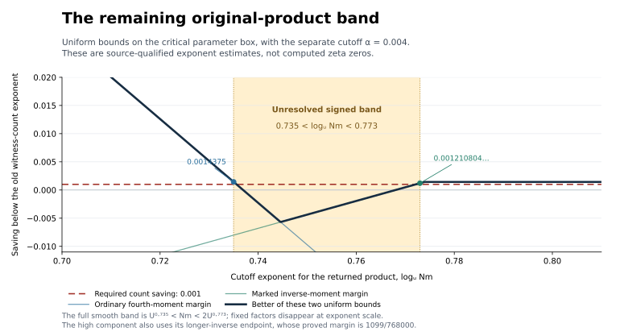

# Fourth pass: a thinner native target, paid HLC triangles and sharper roots

**Research status: new component theorems and exact reductions; RH and a
new unconditional zero-free region remain unproved.** The analytic native
estimates below are deductions within the explicitly pinned external
framework. The finite determinant identities are proved directly. The
HLC integer-path results retain their stated source geometry and weights.
An internal independent-agent review is not external peer review or
formal verification of the imported framework.

This continuation is additive to
`3a07737bb7b802a5671acaa22a8f86e6b0acbd40` on
`research/hlc-zero-free-transfer-20261025`, in
[draft PR #1022](https://github.com/GettysburgResearch/riemann/pull/1022).
All earlier passes and their mathematical freeze remain intact. Exact
publication SHAs and remote preservation checks are recorded in the
publication record accompanying this directory.

## 1. What changed mathematically

| Result | Earlier state | Fourth-pass deduction | Scope |
|---|---|---|---|
| Coherent reduced-ratio head | Controlled through `U^(7/9)` | Controlled through `U^(101/100)` with more than `1/1000` squared-mean saving on `1.16<=r<=1.17` | Imported finite-order Eisenstein framework |
| Buffered witness head | Component estimates did not exclude a near-full ratio head on each row | Head through `D/U^.01` has amplitude at most `U^(-1/800+epsilon) D^(delta/2)` | Same actual buffered bin and shared frequency window |
| Combining original-far and ratio-head bounds | Their overlap could not be assumed harmless | A three-Mellin coefficient formula proves the overlap bound and an exact four-term identity | All original signs, masks and support retained |
| Remaining native arithmetic | A broad middle/product or large-divisor expression | One original primal band `U^.735<Nm<2U^.773`, only on a narrow zero/amplitude box | Complementary counts paid by marked moments |
| HLC line returns | A single conditioned dirty edge is an isometry | Exact complete odd/even return formulas; three steps remove the radial mean-zero component | Complete finite determinant bridge |
| Immediate HLC memory returns | A possible local no-mixing pattern | A largest-group two-edge return forces the whole unordered list and integer position to backtrack | Actual source full good-state test |
| Actual three-edge bridges | Finite-field cancellation did not count integer candidates | A divisor parametrization over both the integers and the Eisenstein integers, with root-measure bounds and both resonances retained | Fixed endpoint and determinant data |
| A closed HLC triangle family | The raw normalization offered no per-edge `1/Y` factor | Correct original weights and a gcd average give a `Y^(-1) log^2(2Y)` bound for one specified path family | Common shared lists, three distinct unshared products |
| Both endpoint prime lists | The first paid class required the lists to return | A closure congruence pays all common-shared-list three-edge position returns, including different endpoint lists | Actual raw source root pairing, with its endpoint vector |
| Arithmetic root transfer | Source error `S^5 H^(-1/100)` | Error `S^2 H^(-1/4+epsilon)` from a self-contained elementary argument; `S^2 H^(-1/2+epsilon)` with the classical Weil--Salié bound | Absolute discrepancy for prescribed lines and parity |
| Varying ratio shells | Potential multiple-scale gain | Simultaneous continuum-scale witness localization, with an exact repeated primal coefficient | Useful localization; no claimed orthogonality |

The first four rows are developed in [MIDDLE_JOINT.md](MIDDLE_JOINT.md),
[COHERENT_IDENTITY.md](COHERENT_IDENTITY.md), and
[DETECTOR_LOCALIZATION.md](DETECTOR_LOCALIZATION.md). The HLC results
are in [HLC_PATH_CANCELLATION.md](HLC_PATH_CANCELLATION.md).
[ATTEMPT_AUDIT.md](ATTEMPT_AUDIT.md) records the additional route tests,
including the rejected normalization and the valid simultaneous-shell
statement.

## 2. The strongest current native target

Let `Nu` be comparable to `U`, `D=U^r`, `1.16<=r<=1.17`, and let
`psi_u` be the original natural finite-order character in its compatible
physical-row class. Put

$$
 \alpha_* =\frac1{250},\qquad
 A_*(m)=\sum_{ab=m}\mu_E(a)\mu_E(b)
     w_0(Na/U^{\alpha_*})
     w_0\!\left(Nb/(2D/U^{\alpha_*})\right).
$$

For the fixed smooth cutoffs and licensed detector test `V`, define

$$
 T_u=-D^{-1/2}\sum_{m,c}A_*(m)\psi_u(mc)V(NmNc/D)
 \left[\chi(Nm/U^{.773})-\chi(Nm/U^{.735})\right].
 \tag{1}
$$

This is a literal part of an exact identity for the original inverse.
It has the original Möbius signs and character, not a surrogate
coefficient sequence. Its remaining ordinary factor has log-length
between `.387` and `.435`, up to fixed-scale errors. The only classes
needing a new bound are

$$
 \frac{473}{1024}\le\delta\le\frac{487}{1024},\qquad
 \frac{49}{100}\le x=\frac g\delta\le\frac12,
 \qquad \frac{29}{25}\le r\le\frac{117}{100}.
 \tag{2}
$$

Here delta describes an auxiliary row's buffered zero parameter;
it is not the real part of the target zeta zero. The parameter g is
the compatible physical prime-amplitude mean from the source consumer.
The finite-ray coefficient class, common masks, excluded inducing
characters, disjoint prime supports and rowwise profile restrictions
are all retained in the detailed notes.

The low and high complementary components have exact uniform margins
below the old inverse witness-count exponent `e_0(r)-delta r`, where
`e_0(r)=(1+5r)/6`:

| Paid component / endpoint | Exact margin | Decimal |
|---|---:|---:|
| Low returned product, ordinary fourth moment | `23/16000` | `0.0014375` |
| High product, inverse length below one | `371959/307200000` | `0.001210804036...` |
| High product, inverse length above one | `1099/768000` | `0.001430989583...` |

All exceed the requested `1/1000` count saving. The finite slot mesh,
strict capacities, buffered frequency losses and detector losses fit
inside the displayed positive reserves.



The figure is an illustration of the proved rational formulas. It is
not zero data or evidence that actual rows saturate a bound. The
acceptance checks use exact rational arithmetic; the plotting script
uses floating point only for rendering.

### The precise open hypothesis

The unpaid estimate is a large-value count for (1), on (2):

$$
 \#\left\{u:\ |T_u|\ge c_1 U^{\delta r/2-\omega/2}\right\}
 \ll_\epsilon U^{(1+5r)/6-\delta r-1/1000+\epsilon},
 \tag{W_thin}
$$

for the fixed positive witness constant and the source's licensed
profiles, with the preliminary loss omega sufficiently small.
`DETECTOR_LOCALIZATION.md`, Section 7, gives the exact threshold and
all uniformity conditions. This hypothesis is **not proved here**.

If `(W_thin)` is proved, the unchanged third-pass consumer and the new
exact coverage of its complementary amplitude range imply

$$
                L_E(s,\eta)\ne0
                \qquad(\operatorname{Re}s>0.8748856),
$$

and, by the same source's quadratic base-change factorization, the
corresponding conditional statement for Dirichlet L-functions and
zeta. This implication also depends on the imported analytic premises.
The number `0.8748856` is a conditional target, not a newly established
zero-free boundary.

### Why the large-divisor form does not provide a second inverse

Exact reflection represents (1), up to a same-bin pointwise error
`O(U^(-1/800+epsilon)D^(delta/2))`, by labels satisfying

$$
 \frac{D}{2U^{.783}}<Nk<\frac{8D}{U^{.735}},\qquad
 Nd<8U^{.01},\qquad
 D/U^{.01}<NkNm<8D.
$$

These are useful arithmetic restrictions. They do not create an
independent Möbius cancellation: already at `d=1`, the exact allocation
has `k=g m_0` and `mu(k)mu(g)mu(m_0)=1`. Applying the native inverse
moment to the displayed `mu(k)` alone would discard the compensating
signs. The new note proves this identity and keeps the original band
as the simplest statement of the open problem.

The existing two marked resources also leave an exact positive gap
after optimizing the asymmetric cutoff. At their rational contact
`delta=47/100`, `g=47/200`, `r=6994/6007`, an additional saving eta
separates the admissible low and high thresholds by

$$
 \alpha+\frac{\eta}{\delta-g}
            +\frac{\eta}{2\delta-8g/9}>0.
$$

This identifies what those resources do not prove. It is not an
impossibility theorem for the arithmetic problem.

### An exact signed off-diagonal formulation

[OFF_DIAGONAL_TRANSFER.md](OFF_DIAGONAL_TRANSFER.md) goes beyond the
spike-count statement. Collecting the full-column coefficient of (1)
gives `lambda(n)=sum_(m|n) A_*(m) W_mid(m)`. The entire locus where
the two columns have the same sixth-power-free core has squared-mean
contribution `O(U D^epsilon)`, including unequal column pairs and all
natural zero masks. It is already smaller than the target budget.

For the remaining arithmetic, with `n_i=m_i c_i`, the actual
determinant coordinates are

$$
 P=(m_1,c_2),\qquad Q=(m_2,c_1),\qquad
 \det(P,Q)=n_1-n_2=h\in3\mathcal O_E,\quad Nh\le8D.
$$

Both vector contents must be extracted before a primitive-state
operator can be used. Extracting a prime from the long first Mobius
factor then gives the exact affine equation

$$
                  (a_1dc_1)p-(a_2c_2)b_2=h.
$$

The note keeps every remaining sign, character conjugation, gcd mask
and smooth weight in a full signed aggregate `T_U`, and proves
`J=Delta-T_U/(D log U)`. A one-sided lower bound for this precise
aggregate is a stronger sufficient version of `(W_thin)`. That bound
is open. This identifies the field, shifts and twists that a combined
HLC argument must actually address. It does not replace the field
shift by a rational norm difference.

## 3. What the supplied HLC paper contributes

The supplied paper, Lü--Wang--Wu,
[arXiv:2610.20242v1](https://arxiv.org/abs/2610.20242v1), studies
Möbius cancellation on shifted primes. Its arithmetic path and memory
construction is relevant because the current native problem also needs
signed cancellation that is lost in a full operator-norm majorant.
Its fixed-shift conclusion is not the uniform twisted ideal-family
estimate `(W_thin)`.

The new finite bridge theorem gives an exact mechanism. For a complete
determinant walk over F_p returning to one recorded projective line,
the centered conditional radial operator has norm

$$
 1\quad\text{after two steps},\qquad
 0\quad\text{after three steps},\qquad
 \frac{p}{p^2-p+1}\quad\text{after four steps}.
$$

The complete odd/even formulas, zero-determinant normalization and
intermediate-projector error are proved in the HLC note. These are
complete-residue formulas; an integer source path is not automatically
distributed according to that law.

Using the actual full source good-state test, an immediate return of
a memory prime from the largest prime group forces the entire
unordered list and integer position to return. The two-step obstruction
is therefore an identifiable exact backtrack. A separate real-phase
union bound makes the full-list separation test power-good for suitable
polynomial prime bands, under explicit cardinality assumptions.

Two further tasks remain in a combined argument: sum backtracks with
their genuine memory weights, and compare the longer integer returns
with the relevant averaged bridge. The original raw kernel has factor
`d_0/D`, **without an extra `1/Y`**. A proposed saving obtained by
inserting that extra factor was caught in independent review and
rejected. No later result uses it.

### Root averaging and arithmetic bridges

[HLC_ROOT_AVERAGING.md](HLC_ROOT_AVERAGING.md) proves a further
positive result for the actual omitted-list cofactors. Averaging the
moving dirty center and its recorded line **once** gives an exact CRT
formula. For different cofactor events with arc lengths `ell_i`, their
joint probability is at most `product_i(ell_i+1/p_i)`. The source's
actual root change of measure is paid with the explicit constant 2176.
For comparable primes and dirty windows of size `1/p`, the probability
of two candidate omissions is `O(m^2/p^2)` for a fixed family of m
omissions. Conditioning on the preceding history requires its true
surviving mass; that step is not silently omitted.

The same note gives an exact Eisenstein Haar/CRT version, with residue
norms and the correct projective-line factor. It supplies a
field-compatible averaging identity. It does not construct a Haar root
law for the native inverse detector.

[THREE_EDGE_INTEGER_BRIDGE.md](THREE_EDGE_INTEGER_BRIDGE.md) counts
actual arithmetic bridges. In a unimodular basis write the fixed
endpoint as `(A,B)` and fix three nonzero determinants `j_0,j_1,j_2`.
Let `N=B j_1+j_0 j_2`. When `B,N` are nonzero, each bridge is determined
by a signed divisor of N, so there are at most `2 tau(|N|)` integer
candidates. The actual unwrapped root measure is at most

$$
             \min\{1,4080\tau(|N|)/|j_0|\}.
$$

Over the Eisenstein integers there are at most `6 tau_E((N))`
candidates, and the analogous complex-root area has an inverse
`N_E(j_0)` bound. Parallel endpoints and immediate unit-proportional
returns are explicitly separated. For closed integer triangles,
congruence counting gives an exact **multiplicity** integral
`W gcd(j_0,j_2)/|j_0|` at the global root, which is the input to the
next result.

### A genuine restricted HLC triangle payment

[CLOSED_TRIANGLE_WEIGHT.md](CLOSED_TRIANGLE_WEIGHT.md)
uses those counts in the source's original state measure. The path
family has the same shared lists D at all three edges, and three
pairwise prime-disjoint unshared products a,b,c in `[Y,4Y]`.
Its active complete products are `Db,Da,Dc,Db`. One line is averaged
for each used prime, yielding at most `1/(Dabc)` for that fixed path.
The orbit measure and all three symmetrization factors are retained.

The root-averaged absolute contribution of this specific raw,
list-diagonal, three-edge family is

$$
 \ll \|\eta\|_\infty^6 (J+1)^{-2K}
         \left(\prod_i V_i^{-4}\right)
                      \frac{\log^2(2Y)}{Y}.
$$

The saving comes from the exact gcd-weighted candidate count and the
once-only line weights. It does not come from adding a fictitious
factor to a raw edge. Two-edge backtracks, unequal shared lists, other
return patterns, signed major-arc terms and the whole target pairing
are outside this theorem.

For fixed J,K the note also states the explicit original-root
discrepancy budget from the source's Appendix A, equation (A.5).
If the total upper prime-band exponent is beta and the minimum root
coordinate scale is at least `x^delta`, its conservative aggregate
error exponent is `(7J+19) beta-delta/100`. Small fixed polynomial
bands can therefore give an actual fixed-power estimate for this
restricted class. The original growing-J hierarchy is not covered by
that fixed-J consequence. The complete HLC theorem and the native
thin-band moment remain additional problems.

### Both endpoint lists and a stronger discrete transfer

[COMMON_D_TRIANGLE_EXTENSION.md](COMMON_D_TRIANGLE_EXTENSION.md)
extends the bound to the **entire common-shared-list three-edge raw
position return**. The endpoint position returns to `(1,0)` while the
initial and final complete prime lists may differ. Reducing the actual
determinants modulo a repeated prime excludes the two other
nonadjacent repetition patterns. If t is the product of the endpoint
primes that do return, write `b=t b'`, `d=t d'`. Integer closure forces

$$
 \gcd(|b-a|,|c-d|)\mid b'-d'.
$$

That extra congruence compensates for summing the second endpoint
list. The exact bound, with `H_Y=1+log(3Y)` and `W=255/16`, is

$$
 \frac{W\|\eta\|_\infty^6}{Y}(J+1)^{-2K}
 \left(\prod_iV_i^{-4}\right)
 \left[48H_Y^2+288H_Y
       \left\{\prod_i(1+V_i)-\prod_iV_i\right\}\right].
$$

The proof retains both coordinates of the original root vector and
averages each used prime's line once. It does not impose equality of
the endpoint lists to obtain this conclusion.

[ROOT_COUNT_REFINEMENT.md](ROOT_COUNT_REFINEMENT.md) supplies a
stronger arithmetic transfer. For coordinate scales A,B and
`H=min(A,B)`, it proves that the normalized discrepancy for one
prescribed matrix class modulo a squarefree S is

$$
 O_\epsilon(H^{\kappa-1+\epsilon}),
 \qquad \kappa=\frac34\ \text{or}\ \frac12.
$$

This is an absolute error, uniform in S; it need not be small relative
to the individual matrix-class main term. Summing the exact allowed
classes for prescribed projective lines and odd root coordinates gives

$$
 \frac{|I_1||I_2||I_3|}
      {3\zeta(2)\prod_{p\mid S}(p+1)}
       +O_\epsilon(S^2H^{\kappa-1+\epsilon}).
$$

For `kappa=3/4`, the note reproduces the elementary fourth-moment
Kloosterman argument and proves the rest directly. For `kappa=1/2`,
it explicitly imports the classical Weil--Salié bound. The two
improvements come from retaining the frequency gcd in a convergent
Fourier sum and retaining `(u,S)` when summing the actual residue
progression. No claim of priority for the classical methods or their
root-counting consequences is made.

For the full common-D triangle class this changes the conservative
aggregate discrepancy exponent to

$$
                  (4J+13)\beta-(1-\kappa)\delta.
$$

For example, take fixed `J=K=1`, `H>=x^(1/4)`, and prime band
`[x^(1/800),x^(1/400)]`. Already the elementary version yields

$$
 T_{\rm common}^{\rm arith}
       \ll_\epsilon x^{-1/800+\epsilon}+x^{-1/50+\epsilon}.
$$

This is a genuine fixed-power estimate for the specified original
raw path class. The scale x here is the HLC root parameter; it is not
identified with the native detector's U. The changing-shared-list
classes, two-edge contractions, centered comparison, surrounding
histories and native Eisenstein coefficient transfer remain open.

## 4. Sources, reproducibility and review

The external analytic source is pinned to
[`openai/math@1581d4c`](https://github.com/openai/math/tree/1581d4cbdd69a0faf34b2089614fe2a814316a6a),
file `preprints/The-Quasi-Riemann-Hypothesis-September-30-2026/build/paper.tex`,
Git blob `268c4e3206d460c617d3d2129742a72b831b3def`, SHA256
`42a5ee0febca59fd1def55cfd6c6808c322ef4237d7726303ea52f711deac6a3`.
The companion inputs are Xu--Sang
[2610.17675v2](https://arxiv.org/html/2610.17675v2) and
[2610.15291v2](https://arxiv.org/html/2610.15291v2).
Their complete proofs are explicit premises of our native deductions,
not independently certified by this pass.

The HLC PDF has SHA256
`32ef255566d4f3611d2d89c3a5f3db94c792883cc713d77a7f9d33b163f55e88`.
The third-pass conditional certificate is replayed from its actual
pinned Python source, SHA256
`c611bedacf374e4ee58f19d2f52e09e07e8933d092f20947be1a01cc10d2349f`.
Its report-writing section is not executed, preserving prior bytes.

Each mathematical note has an independent internal review bound to its
exact file hashes; publication review also binds the committed versions.
The exact finite checkers retain their predicates under Python `-O`.
They test signed identities, masks, coefficient allocations, support,
finite determinant operators, rational exponent margins and the complete
128-cell Bernstein certificate for `x<=.49`. They do not prove the
external analytic inputs, the open thin-band count, RH, or the claimed
zero-free conclusion.

Replay all ten checker programs from the repository root with:

```bash
python -I -S -B -O standalone/2026-10-25-hlc-zero-free-transfer/fourth-pass/run_checks.py
```

The runner launches each checker in its own isolated optimized Python
process, records its source hash and output in [CHECKS.json](CHECKS.json),
and verifies that all third-pass files retain their original bytes.
[SOURCE_PINS.json](SOURCE_PINS.json) records the imports and scope;
[MANIFEST.json](MANIFEST.json) records the mathematical payload hashes.
The checkers exercise finite identities and exact scalar ledgers.
The asymptotic root-count refinement is supported by its written
Fourier and progression proof, rather than extrapolated from the tests.

The continuation did not merge a PR or change `main`. The final
publication record gives the checked branch head and preservation
evidence.
