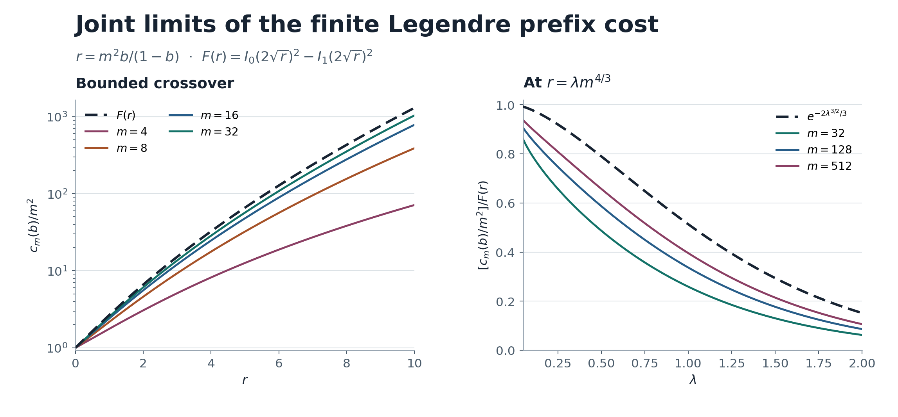

# Uniform finite-prefix regimes and a sharp relative-matching boundary

Accepted the joint finite-cost results below after reading three independently written proofs and independently reconstructing the coefficient normalization, Gaussian derivative estimate, endpoint integration and critical exponent. The methods are classical Legendre/Bessel asymptotics; no publication novelty is claimed. The starting finite Gram identity is OBS-PREFIX-CLOSED. There is no arithmetic moving-prefix conclusion.

Let m→∞,0≤b<1,r=m²b/(1−b), and

    Φ(r)=I_0(2sqrt r)²−I_1(2sqrt r)².

Uniformly for r in every fixed[0,R], c_m(b)/m²=Φ(r)+O_R(1/m). The value at0 is exactly1. With r*=m(m−1)b/(1−b), the sharper normalization is

    (c_m(b)−m²)/[m(m−1)]=Φ(r*)−1+O_R(m^(-2)).

Along every joint sequence m→∞ and m sqrt b→∞,

    c_m(b)~(1−b)²/(8πb)
       ×[(1+sqrt b)/(1−sqrt b)]^(2m−1).          (A)

It permits b→0 or1 and has relative error O(1/[m min(u,1)]) when m min(u,1) exceeds an absolute threshold, u=2atanh(sqrt b). Constants are absolute in this statement. The b=0 endpoint belongs to the bounded regime, not formula(A).

## Independent reconstruction of the two estimates

Put F_m(t)=P_(m−1)(1+2t/m²). Its coefficient of t^k/(k!)² is Π_{j=1}^k[1−1/m−j(j−1)/m²] for k<m and0 otherwise. Every factor is in[0,1]. The defect is at most(k+k³)/m, also for omitted terms. Summing the factorially decaying majorant and its derivative proves uniform C¹ convergence to I_0(2sqrt t) with O_R(1/m) error. Since c_m/m²=1+∫_0^rF′_m(t)²dt, the Bessel identity follows from I′_0=I_1,I′_1=I_0−I_1/x. Under the natural scale m(m−1), the product defects instead sum to O(k³/[m(m−1)]); this proves the sharper statement. Full explicit constants H(R),J(R),J_3(R) are in the proponent proof equations1–2.

For(A), n=m−1 and P_n(cosh v)=e^(nv)J_n(q), q=1−e^(−2v),

    J_n(q)=π^(-1)∫_0^π[1−q sin²(θ/2)]^n dθ.

Uniformly for nq large, J_n(q)=[πnq]^(-1/2)[1+O(1/(nq))]. The Taylor phase error is bounded by C nq θ^4 near0 with Gaussian decay exp(−c nq θ²); the complementary interval is exponentially small. For the derivative, differentiate the exact positive-base integral before estimating it. Its additional factor has modulus≤1 and differs from1 by O(θ²) near0, uniformly in v>0. Equivalently bound q′∂_qJ_n=O(n(nq)^(-3/2)) with0≤q′≤2. Thus differentiating an unproved asymptotic is unnecessary, including as v→0 or∞.

It follows that

    2P′_n(cosh v)² sinh v
      = [n/π] e^((2n+1)v)/sinh²v
          ×[1+O(1/(nq(v)))].

On v∈[u/2,u], q(v) is comparable from below to min(u,1). The logarithmic derivative of sinh^(-2)v is bounded by C/min(u,1). Endpoint Laplace integration is therefore uniform when n min(u,1)→∞ and gives e^((2n+1)u)/(2πsinh²u). The earlier interval is bounded by2(cosh(u/2)−1)P′_n(cosh(u/2))² using positive Taylor coefficients. Its ratio to the endpoint term is O(nu e^(−nu)) for u≤1 and O(n e^(−(n−1/2)u)) for u≥1. The additive m² is negligible by the same estimates. Conversion sinh²u=4b/(1−b)² yields(A), with no missing fixed-b restriction.

## Exact boundary for relative Bessel matching

For m,r→∞, set z=sqrt r/m. The preceding result and Φ(r)~e^(4sqrt r)/(8πr) give

    [c_m(b)/m²]/Φ(r)
      = exp[(4m−2)asinh z−4sqrt r]/(1+z²)
          ×[1+O(1/min(m,sqrt r))].              (B)

The identities are exact before asymptotics: b=r/(m²+r), u=2asinh z, and(1−b)²/(bm²)=1/[r(1+z²)]. The large-r Bessel constant may be derived without subtracting close asymptotic series by Φ(r)=1+2∫_0^{2sqrt r}I_1(v)²dv/v and positive endpoint Laplace integration.

For r=o(m^(4/3)), the ratio in(B) tends1; bounded r follows directly from the compact estimate. At r/m^(4/3)→α∈(0,∞), Taylor expansion asinh z=z−z³/6+O(z^5) instead gives the limit exp(−2α^(3/2)/3). For r/m^(4/3)→∞ the ratio tends0, using z−asinh z≥c min(z³,z). These facts identify a precise failure of unrestricted relative Bessel matching, not of the underlying finite cost or any RH statement.

The director inspected the plotted figure; the generator also cross-checks its positive-convolution evaluations against independent Jacobi-derivative quadrature. Finite numerical agreement corroborates normalization; the analytic proof supplies the limits.

Evidence: effective_cluster62_prefix_joint.md; joint_prefix_skeptic62.md; witness62_joint_prefix.md; exact finite controls and55-digit diagnostics in the cited scripts. Classical special-function antecedents are acknowledged; a source-priority investigation is still needed before any novelty claim. Next precise question is whether the *arithmetic* prefix error can be bounded uniformly in a regime compatible with these finite scales. Nothing in these finite limits supplies that estimate.
