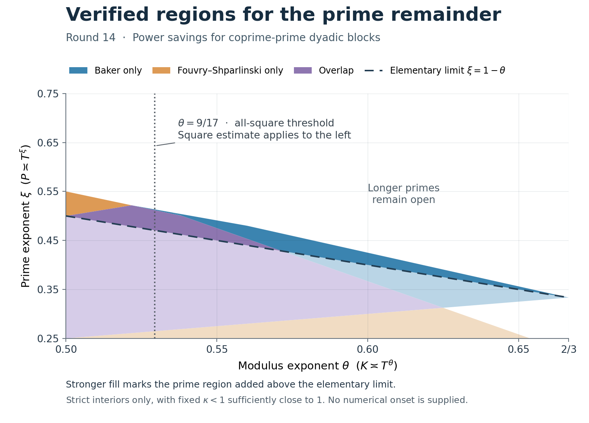
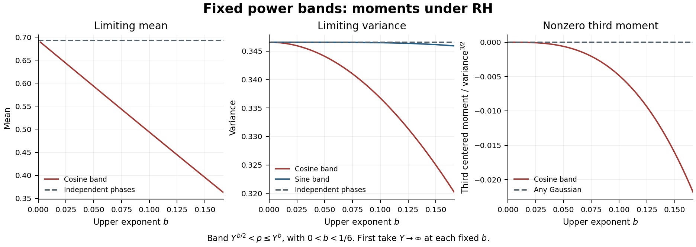

# Current mathematical synthesis

The 1,000-work research program remains unfinished. The archive distinguishes source access, complete readings, scoped proof verification, and whole-work audits. This checkpoint contains no proof or disproof of RH, new zero-free or zero-density exponent, or established publication novelty.

| Evidence state | Actual |
|---|---:|
| Provider metadata records | 5,203 |
| Selected source records | 1,010 |
| Selected full texts accessed | 965 |
| Selected primary-source excerpts only | 13 |
| Complete substantive readings | 131 |
| Complete paper-wide Level2/3 audits | 0 / 9 |
| Scoped independently adjudicated claim groups | 123 |
| Theorem/conjecture/exercise records | 489 |
| Connection records | 97 |
| Graph nodes / edges | 2,691 / 2,658 |

# Round 17 — sharp test-space boundaries and bounded arithmetic countermodels

Research cutoff: 18 November 2026 UTC. This checkpoint contains **1,010 selected works, 965 accessed full texts, 13 additional excerpt-only sources, 131 complete substantive readings, nine whole-work Level 3 audits and 123 scoped adjudicated groups**. Its structured archive has 489 theorem, conjecture and exercise records, 97 connections, and 2,691 graph nodes with 2,658 edges. One further catalogued work is deferred. The 5,203 provider matches are an overlapping discovery pool, not additional reviewed works.

The principal results are precise boundaries for a Mellin explicit-formula test space and countermodels for an arithmetic inference from progression norms. Their proofs have separate advocate, skeptic and director records, with fresh independent checkpoint reviews. Publication novelty has not been established. No proof or disproof of RH, improved zero-free region or improved zero-density exponent is claimed. The thousand-work reading program remains unfinished: 879 selected works still have Level 0 coverage.

## The universal signed and absolute thresholds are different

For a test f on (0,infinity), write h(s)=integral f(x)x^(s-1)dx and F(u)=exp(u/2)f(exp u). Fix 0<epsilon<1/4 and consider tests with some value-decay margin delta>epsilon, so f(x)=O(x^delta) at zero and O(x^(-1-delta)) at infinity. The logarithmic strip norm is

```text
N_p²=integral_(-epsilon)^(1+epsilon) integral_R
       sqrt(1+t²) log^p(e+abs(t)) abs(h(beta+it))² dt d beta.
```

For the literal local class in the pinned Bombieri–Lagarias manuscript, the following are universal guarantees, rather than necessary conditions for each individual test. That local class permits finitely many exceptional points with finite one-sided limits of both f and f′ and midpoint values for f. For the positive statements one may instead assume continuity and local H^1 regularity of F near u=0.

| Norm exponent | Ordinary symmetric height formula | Absolute zero sampling |
|---|---|---|
| p>3 | Guaranteed | Guaranteed, with a quantitative tail estimate |
| 0<=p<=3 | Guaranteed | A universal guarantee fails |
| p<0 | A universal guarantee fails, even for a smooth test | A universal guarantee fails |

The symmetric cutoff is sum over abs(Im rho)<=T, with multiplicities and every endpoint height. It is not a height subsequence or an averaged summation convention. The critical p=0 positive proof uses uniform sharp Fourier inversion and a folded completed-function contour. A separate Selberg proof gives convergence on each half-height axis for p>1; the smaller exponents above are statements about symmetric summation.

The absolute threshold uses holomorphic area mean value, local zero counting and a weighted cell estimate. At p=3 a real smooth source-admissible test has finite norm and divergent absolute zero trace. Its signed symmetric sum nevertheless converges by the critical theorem. This compatibility result prevents one summation mode from being silently substituted for the other.

[Critical positive theorem and source hypotheses](../audits/adversarial_reviews/director_signed_mellin_round16.md) · [Absolute threshold and smooth endpoint witness](../audits/adversarial_reviews/director_critical_endpoint_round15.md).

## One smooth test defeats every strict logarithmic weakening

The new counterexample is stronger than failure of a proof estimate. On one fixed strip there is **one real smooth test**, vanishing near zero and one and satisfying f(x)=O(x^(-3/2)), such that N_(-q) is finite for every fixed q>0. All its prime-power samples f(n) vanish, as do f(1/n) for n>=1. Its pole and compensated archimedean terms are absolutely finite. Yet its signed symmetric zero sums have a subsequence tending to negative infinity and another bounded subsequence.

The construction places shrinking one-sided oscillatory packets immediately after escaped prime logarithms. For a fixed prime center, a packet with width W=log^A(T)/T and carrier T, with 0<A<q, has weakened squared norm bounded by a constant times

```text
W sqrt(T) + T W/log^q(T),
```

which tends to zero. Its sharp inverse at the prime center grows as log(TW)/(2pi), up to its fixed amplitude and tilt. That one arithmetic atom gives the large negative contribution to the finite zero contour. Other prime-power centers remain separated from the shrinking support, and the gamma functional is uniformly controlled in the weakened norm because the packets vanish near the logarithmic origin.

At stage j choose q_j=1/j and A_j=q_j/2 before choosing its enormous carrier. Make the new norm summable, dominate all earlier packet traces at the new witness height, and make its contribution tiny at the finitely many protected earlier heights. For each fixed q>0 the stage norms are eventually dominated by the q_j norms. This gives one witness for all strict logarithmic weakenings without any uniform bound as q decreases to zero. Protecting a later height at which each finite prefix has settled gives the bounded subsequence.

The same test belongs to every polynomial strip space with weight (1+t²)^s for s<1/2. Its critical norm is infinite, consistently with the positive theorem. The weaker norms diverge as q decreases to zero.

At each fixed prime-power argument, Fourier inversion of this final smooth function converges correctly. The failed step is passing that limit through the **infinite** weighted prime sum. This isolates a concrete exchange-of-limits obstruction despite strong value decay, interior smoothness, strip analyticity and an absolutely defined arithmetic target. A vanishing upper-bound argument at p=0 and a counterexample at every strict weakening now fit together.

[Complete proof and independent reviews](../audits/adversarial_reviews/director_negative_mellin_round17.md) · [Fresh checkpoint audit](../audits/adversarial_reviews/checkpoint14_negative_math_final_review.md) · `OBS-MELLIN-ALL-NEGATIVE-LOG-SIGNED-DIVERGENCE` · `THM-MELLIN-EXACT-SIGNED-LOG-BOUNDARY`.

These statements concern the stated norm scale and local class. A compact jump test from the original arithmetic criterion belongs to a different valid summation argument. The examples do not invalidate that criterion or Weil positivity. Luecking's general Bergman embedding explains the ambient absolute-sampling threshold; Weil's original contour and later variation formulations are acknowledged in the bounded provenance comparisons. No priority claim follows from the archive's reconstruction.

## Common, positive and bounded data still leave a moving phase uncontrolled

The remaining long-prime fourth-moment reduction needs a prescribed additive Fourier mode. Earlier work showed that unrelated residue rows can satisfy two strong norm budgets while their projection is too large. The current round removes the assumption that those rows may be chosen independently: the countermodels come from one sequence, so their complete residue rows have exact common-divisor compatibility.

Fix 1/2<theta<2/3, K comparable to T^theta and an integer P comparable to KT. Use a narrow relative prime band whose entire fourth-power coefficient support S lies in [K,2K), including repeated factors. It has size comparable to K/log^4 K and coefficients 1<=c_k<=24. There exist sequences of exact mass P on the integer interval [P,2P) with either

- real values in [1/2,3/2], or
- integer values in {0,1,2}.

For their residue counts B_(k,u), both satisfy

```text
sum_(k≤2K) sum_(u mod k) abs(B_(k,u)−P/k)² = O(PK),
sum_(k≤2K) max_(u mod k) abs(B_(k,u)−P/k) = O(K sqrt(P)).
```

The latter has every fixed logarithmic saving relative to P. On unit residues the same orders hold about each row's induced unit mean. Nevertheless their real unit-centered projection

```text
sum_(k in S) (c_k/k) sum_((n,k)=1) b(n)
       [cos(2pi n/k)−mu(k)/phi(k)]
```

is positive and at least a constant times K sqrt(T)/log^4 T. It exceeds T log^4 T by a divergent factor. Thus common-sequence consistency, positivity, bounded weights and these two discrepancy budgets alone do not supply the desired mode.

The bounded construction combines a cosine sum over the full modulus shell with a short positive convolution. The classical second-derivative estimate bounds that cosine sum by O(sqrt(T)); scaling it gives the pointwise cap. The convolution suppresses the low-denominator multiplicities in the pooled residue variance while retaining the moving frequencies. A finite rational-frequency Gram estimate identifies a positive diagonal on every fourth-power modulus, including repeated-prime factors. Its strict error margin uses theta<2/3. Independent adjacent-integer rounding and a small exact-mass repair preserve the cap, the variance order and the positive projection.

The centering distinction is decisive. These estimates use **P/k or the induced unit-row mean**. A prime-supported measure in this long interval is simultaneously supported on units of the band moduli and has reference mean P/phi(k). The construction does not meet that different variance specification. It does not give a lower bound for actual primes or the full smoothed C_* sum. A bounded pointwise cap has now been shown insufficient for the displayed ordinary-integer budgets; the sieve profile and prime-model unit baseline remain available arithmetic information.

[Bounded construction, source estimate and exact scope](../audits/adversarial_reviews/director_bounded_common_checkpoint14.md) · [Fresh independent audit](../audits/adversarial_reviews/checkpoint14_bounded_math_final_review.md) · [Earlier larger-signal common-sequence construction](../audits/adversarial_reviews/director_common_sequence_round17.md).

## What has been checked but remains separate from the admitted claims

A further rough-support campaign shows that excluding all the band primes preserves a useful phase-energy scale and permits a positive rough-supported sequence with a large phase. It has **not** established the P/phi(k)-centered progression variance bound. Masking after convolution destroys the multiplier identity used above. A direct sieve error estimate falls short; failure of that upper estimate is not a lower bound on the true error. These partial calculations and independent review are retained as pending research, rather than combined into an unsupported stronger counterexample.

Von Mangoldt's 1895 German paper, printed pp.255–305, received two complete independent 51-page readings and is now Level 1. They reconstruct the count with its historical O(log² h) error, grouped height tails, midpoint values and equation (64). A global reading of a uniform-convergence sentence on p.293 needs qualification; compact-x uniformity suffices for the subsequent fixed-x proof. This remains a conditional domain interpretation in the reading reports, not a new verified author-error finding. Whole-work Level 3 adjudication of these 51 pages remains pending. Riemann's first-print whole audit and the known Genocchi correction retain their earlier precise scope.

The findings ledger remains at 59, with 17 version-specific verified groups. No new author-error entry is added by this round.

## A clean continuation point

The highest-value next arithmetic task is to formulate and prove, or refute, a variance statement with the **actual prime-model unit baseline** while preserving the moving Fourier mode. The bounded ordinary-integer counterexample identifies exactly why the displayed norm budgets alone are insufficient. The separately proved rough-support phase estimate identifies a partial ingredient, not the missing variance result.

For the analytic test-space results, the next task is an expert comparison with the precise published function-space literature and a small formalization of the packet estimate or finite Fourier identities. The program has documented complete proofs and bounded provenance searches, not established publication novelty. Numerical positivity work should use the appropriate absolute-tail certificate rather than infer it from signed convergence alone.

For the corpus, complete the whole-source adjudication of von Mangoldt and continue the highest-priority unread dependencies before expanding the metadata pool. The [one-day guide](../START_HERE.md), [twenty-five ranked tasks](top_25_research_opportunities.md) and [executable continuation](../CONTINUATION.md) identify the current statements, exact source pins and pending work. The archive is a reusable research checkpoint, not a completed thousand-paper audit or a claimed resolution of RH.

# Previous Round 16 synthesis — historical snapshot

This report records Round 16. Use Round 17 and the current ledgers for the latest claims, source decisions, and corpus counts.

# Round 16 — signed convergence at critical regularity and a whole audit of Riemann

Cutoff: 18 November 2026 UTC. The live archive contains **1,010 selected works, 965 accessed full texts, 13 additional excerpt-only sources, 130 complete readings, nine whole-work Level 3 audits and 120 scoped adjudicated groups**. There are 482 theorem, conjecture and exercise records, 95 connections, and 2,680 graph nodes with 2,631 edges. The catalogue includes one further deferred supporting work. The findings ledger remains at 59 findings, including 17 independently witnessed version-specific error groups; this round adds no author-error finding.

The main mathematical outcome resolves the signed convergence question left open in the dated Round 15 synthesis. The ordinary symmetric explicit formula holds at the critical Mellin strip H^{1/2} norm, even though absolute sampling can fail under a substantially stronger logarithmic weight. A separate continuous cusp shows why the local condition at one matters. The whole-source audit of Riemann's ten-page first print is complete, with its original claims, later proofs and known historical corrections kept distinct. An adjacent Bergman embedding paper was selected and completely read. No RH resolution, improved zero-free or zero-density exponent, or established publication novelty is claimed.

## Signed and absolute sums have different regularity requirements

Let f be continuous on (0,infinity), with f(x)=O(x^delta) at zero and O(x^(-1-delta)) at infinity. Set F(u)=exp(u/2)f(exp u), and let h be its Mellin transform. Assume F belongs to H^1 near u=0 and, for 0<epsilon<delta,

```text
N_0²=integral_(-epsilon)^(1+epsilon) integral_R
          sqrt(1+t²) abs(h(beta+it))² dt d beta < infinity.
```

Then the ordinary inclusive symmetric sum over the nontrivial zeta zeros, counted with multiplicity, converges unconditionally to the compensated Guinand–Weil formula:

```text
lim_(T→infinity) sum_(abs(Im rho)≤T) h(rho)
 =h(0)+h(1)−sum_n Lambda(n)[f(n)+f(1/n)/n]
  −(log pi+EulerGamma)f(1)
  −integral_1^infinity
    [f(x)+f(1/x)/x−2f(1)/x²] x/(x²−1) dx.
```

The prime and archimedean terms are ordinary absolutely convergent expressions. The zero sum need not converge absolutely. The same theorem applies with any stronger weight sqrt(1+t²)log^p(e+abs(t)), p>=0.

The manuscript's literal local condition (A) already gives the needed local regularity when this critical norm is finite. Both f and f′ have finite one-sided limits at its finitely many exceptional points, and f has midpoint values. The central Fourier trace lies in H^{1/2}, whose Gagliardo seminorm rules out genuine jumps. Continuity together with the locally bounded one-sided derivatives then gives local H^1. This implication retains the derivative part of the printed hypothesis; merely saying piecewise differentiable would be insufficient.

Consequently the earlier real smooth p=3 example has a **convergent signed symmetric sum and a divergent absolute zero sum**. The distinction is a proved compatibility result on the actual zeros, not an analogy with a random spectrum.

## The endpoint step is uniform sharp Fourier inversion

Holomorphic mean value controls the weighted vertical traces uniformly on an inner strip, including their high-frequency tails. For each such line the physical function F_beta(u)=exp(beta u)f(exp u) is continuous and exponentially decaying. Compare sharp Fourier inversion with a Gaussian approximate identity. The difference multiplier has uniformly bounded squared norm against dt/sqrt(1+t²). Splitting into a fixed low-frequency range and a small weighted high-frequency tail makes the difference tend uniformly to zero. Thus the sharp inverse itself converges uniformly in the physical point and the line.

A shorter Fejér comparison gives the same endpoint fact: the difference from the sharp multiplier is abs(t)/T on abs(t)<=T and zero elsewhere, with squared inverse-weight norm at most one. Neither argument assumes absolute Fourier integrability at the endpoint.

Fold the completed-function logarithmic-derivative contour onto Re s=a>1. The folded test is h(a+it)+h(1-a-it), with a plus sign. The right-edge zeta logarithmic derivative has an absolutely convergent Dirichlet series. Uniform sharp inversion now permits its limit to pass through the prime series. Good-height horizontal bounds and the local zero count restore **every** height, including zero ordinates. The spectral sum is not Cesàro averaged and is not restricted to an admissible subsequence.

The gamma part needs separate treatment. Its Stirling expansion has both a logarithmic term and different constant values on the two height half-axes. Split the physical function near zero, where local H^1 gives an absolute logarithmic transform integral. Away from zero divide by iu; its transform is a primitive with weighted L^2 bounds and a vanishing logarithmic boundary. This proves the required conditional gamma convergence. Compact cutoff and mollification identify the exact compensated formula while preserving a uniform value envelope. Only the gamma functional is claimed continuous in norm plus local H^1; the prime approximation also uses that envelope.

An independent Selberg route remains valuable. The uniform near-line density estimate and the second moment of S(T) give absolute convergence of the off-line projection and counting-remainder corrections for p>1. This route establishes separate convergence on each half-height axis. The critical p=0 contour result above asserts symmetric convergence. Those modes are not silently identified.

[Complete statement, source passages and three proof reviews](../audits/adversarial_reviews/director_signed_mellin_round16.md) · `THM-MELLIN-CRITICAL-STRIP-SYMMETRIC-EXPLICIT-FORMULA` · `LEM-MELLIN-SELBERG-PROJECTION-AND-COUNT-REMAINDER`.

## Removing local regularity can make both sides diverge

A distinct continuous real compactly supported test has finite p=3 norm but raw symmetric sums tending to positive infinity. In frequency, take a positive even profile comparable to 1/[abs(t)log²(abs(t))loglog(abs(t))]. It is L^1 and weighted L^2, but its logarithmic integral diverges. A positive-definite smooth compact physical multiplier preserves the weighted norm and produces a nonnegative central transform with the same lower tail.

The Selberg projection and count-remainder pieces converge, while the smooth logarithmic zero density diverges positively. A separate folded-contour calculation confirms the sign. Fourier inversion and Tonelli also show the matching divergence of the local compensated archimedean term. The physical test is smooth away from x=1 but lacks the finite derivative behavior required by (A) there. This is a boundary example for the general continuous class, not a further error attributed to the manuscript.

The broader lesson is specific: a global strip norm and endpoint values control different operations from the local subtraction at one. A finite norm does not automatically license every singular integral or every ordering of zero terms.

## The first-print Riemann audit is complete

PAPER-S001 is the ninth whole-work Level 3 audit. Two agents read and reconstructed all ten actual German first-print pages, and the director read those pages alongside the complete Wilkins translation. The original print controls differences among manifestations. The audit covers both continuation arguments, the theta kernels, zero count forecast, paired product, prime-power transform, midpoint inversion, branches, ordered zero series, Möbius inversion and the final empirical claims.

The product has a concise modern reconstruction: G(w)=Xi(sqrt(w)), defined by the even Taylor series, has order exactly 1/2. Genus-zero Hadamard factorization gives the paired product without RH or a zero-count asymptotic. This supplies a missing proof ingredient in the original growth paragraph; it is not credited as an 1859 proof of Hadamard's later theorem.

Product normalization must be carried into inversion. Evaluating at the modern completed-function value xi_*(0)=1/2 gives the arithmetic constant **-log 2**, replacing the first print's +log Xi(0). Genocchi already derived that correction in 1860, pp.57–58, equation (11); the director inspected the original. The 1892 collected note records it too. The related centered-contour shift is the same correction, not another discovery.

The ordered logarithmic-integral series requires a later von Mangoldt midpoint formula and a summable O(abs(Im rho)^(-2)) remainder. Distributional inversion alone does not supply pointwise raw convergence. The known branch convention is continuation with log(x^rho)=rho log x. A new principal logarithm of the exponentiated number would change the terms. Local zero counts identify height order with the memoir's magnitude order.

The first print's missing sum and simple-pole sign are visibly repaired in the 1892 edition. The Wilkins intermediate theta-limit discrepancy belongs to those transcriptions; the original limits and all final theta formulas are correct. No new author-error flags are added. The root-reality assertion remains conjectural. Finite spectral differentiation and historical tables do not establish a square-root prime-counting error or a permanent sign for li(x)-pi(x).

[Whole-memoir adjudication, exact source hashes and page ledger](../audits/adversarial_reviews/director_riemann1859_whole_round16.md) · `THM-RIEMANN1859-MODERN-GENUS-ZERO-PAIRED-PRODUCT` · `THM-RIEMANN1859-MODERN-ORDERED-J0-FORMULA`.

## A general predecessor and two finite arithmetic constants

Daniel H. Luecking's 1986 seven-page paper, *Multipliers of Bergman spaces into Lebesgue spaces*, was admitted as a source-backed H-family dependency and completely read by two independent agents. It remains Level 1. Its exact embedding criterion, transferred to the strip, explains the ambient absolute-sampling thresholds: the cell condition is sum_j N_j²/w(j)<infinity. It supplies neither the physically constrained smooth witness nor the signed criterion by itself. The theorem, original proof and strip transfer are recorded with their actual hypotheses. [Primary publication](https://doi.org/10.1017/S001309150001748X) · [Source and comparison](../audits/adversarial_reviews/prime146_mellin_trace_prior_art.md).

Weil's 1952 text already contains the folded contour and ordinary cutoff framework. Its later final-formula test class adds derivative decay. The critical criterion here assembles a different sufficient interface from classical ingredients; no novelty of the method or priority of the combined statement has been established. The [bounded signed-criterion comparison](../audits/adversarial_reviews/analytic156_signed_critical_provenance.md) states which original texts and formulations were checked and which remained unavailable.

The explicit Gonek input ledger also advances. For positive integer derivative orders mu,nu, M=mu+nu and L=log z, the log-power divisor convolution has the beta-integral main term, with error at most

```text
[min(mu,nu)+1/e+mu^mu nu^nu/M^M] z L^M.
```

Centered floor summation and unimodality prove this for every real z>1, including integer cutoffs. A convenient rational (1,1) bound 9zL²/4 combines with the earlier explicit Abel estimate to give the finite Lemma 8 remainder x[(19/4)log³x+(229/4)log²x+90log x] for x>1 and real abs(delta)<=1/2. Zero derivative orders have separate endpoint bounds. These finite constants do not provide a full contour or weighted-tail onset.

[Proofs, conventions and exact finite application](../audits/adversarial_reviews/director_gonek_constants_round16.md) · `LEM-GONEK-EXPLICIT-POSITIVE-DERIVATIVE-CONVOLUTION`.

## Next work and remaining coverage

The long-prime moving-phase target from Round 15 is still an arithmetic priority. Padded factorability is available; a fixed-residue theorem still does not supply the required simultaneous Fourier mode. Testing how much common-sequence compatibility strengthens the phase-blind norm budgets is a concrete next campaign. The logarithmically weaker signed strip classes are a separate next-round investigation; no sharpness claim below the critical weight is part of this checkpoint.

For analysis, instantiate usable local zero-count constants and certified trace tails for an actual positivity test, and compare the signed criterion with the precise existing variation classes. For the historical program, audit the later von Mangoldt ordered-limit proof completely. For numerical derivative tails, continue the explicit ledger through the gamma and contour steps. The [twenty-five ranked tasks](top_25_research_opportunities.md) retain the broader approximation, geometry, spectral and random-matrix programs.

The thousand-work mission is unfinished: 880 selected works still have only Level 0 coverage. Whole-source audit, scoped theorem verification, bibliographic discovery and physical access remain separate counts. The archive has accumulated precise reusable mathematical interfaces and negative examples; it has not replaced the remaining source work with invented summaries.

# Previous Round 15 synthesis — historical snapshot

This report records Round 15. Use Round 17 and the current ledgers for the latest claims, source decisions, and corpus counts.

# Round 15 — test-function boundaries, spectral signs and moving prime phases

Literature search cutoff: 18 November 2026 UTC. The archive now contains **1,009 selected works, 964 accessed full texts, 13 additional excerpt-only sources, 129 complete substantive readings, eight whole-work Level 3 audits, and 117 scoped adjudicated claim groups**. Its 473 theorem, conjecture and exercise records and 93 connections are separate from those paper counts. The catalogue has 1,010 works including one deferred supporting record. The 5,203 provider metadata matches are an overlapping discovery pool, not 5,203 reviewed works.

This round establishes a sharp boundary for one family of absolute zero-sampling estimates, supplies a smooth counterexample to an overly broad auxiliary explicit formula in a precisely pinned manuscript, and corrects a misleading inference in our own long-prime investigation. It also completes the whole-work audit of Gonek's 1984 derivative-moment paper and verifies two local spectral formula problems by exact witnesses. These are reusable mathematical deductions and version-specific repairs. Publication novelty has not been established. No proof or disproof of RH or new zero-free or zero-density exponent is claimed.

## A smooth test can defeat the stated raw height limit

The twelve-page author manuscript of Bombieri–Lagarias, *Complements to Li's Criterion*, pp.5–6, permits a piecewise continuously differentiable test with finite one-sided limits for both f and f′ at its finitely many exceptional interior points, and midpoint values for f. Its endpoint value decay is f(x)=O(x^delta) at zero and O(x^(-1-delta)) at infinity. It does not impose corresponding derivative decay at the endpoints. Its zero side is the raw symmetric height limit of the Mellin values h(rho), counted with multiplicity.

A fixed real smooth witness satisfies every printed local and value condition while that height limit fails. In logarithmic coordinates use disjoint bumps at integers j, amplitudes exp(-(1/2+delta)j), and suitably separated cosine carriers Gamma_j. Unconditional Riemann–von Mangoldt counting supplies arbitrarily high cells containing enough zeros. Choose each carrier so that its matching bump is positive on its cell, past bumps are negligible there, and its own transform is small on every earlier cell. Future constraints are summable. The final real part is greater than exp(-(1+delta)j)/5 on at least j exp((1+delta)j) zeros in the j-th cell. The symmetric height increments exceed 2j/5 and fail the Cauchy criterion.

This is an actual existence construction on the zeta zero multiset, without RH or any assumption about critical-line proportions. Its right-hand arithmetic and archimedean terms all converge absolutely. The obstruction is exactly the manuscript's stipulated raw summation mode. It does not transfer to the fixed compact jump tests used in the main arithmetic theorem, and it does not invalidate the generalized multiset criterion.

The same manuscript's finite equality (3.5), p.8, needs the positive term -(n/2)log(1-epsilon²). At n=1 and epsilon=2/3 the missing term is (1/2)log(9/5); the cutoff 3/2 is not a prime power. The correction is O_n(epsilon²) and disappears in the limiting theorem. A separate classical midpoint argument justifies the compact tests. An uninspected publisher PDF receives neither finding: both are pinned specifically to author-manuscript SHA-256 `cd13c8560f961c68e21256e5ba107bdd08fa7f34ce1e2cffbd4b63a16e8d48e0`.

[Complete construction, source scope and finite repair](../audits/adversarial_reviews/director_mellin_explicit_formula_round15.md) · `OBS-BL-RAW-HEIGHT-SMOOTH-COUNTEREXAMPLE` · `LEM-BL-FINITE-CUTOFF-COMPENSATOR`.

## Sufficient repairs and a sharp logarithmic boundary

Let h(s) be the Mellin transform of a continuous test with the preceding value decay. Integrate its weighted squared modulus over beta in [-epsilon,1+epsilon], where 0<epsilon<delta, and all real heights t. The following strip weights give absolute zero sampling and the ordinary compensated explicit formula:

| Strip weight | Condition | Absolute zero-tail bound, apart from fixed constants |
|---|---|---|
| (1+t²)^s | s>1/2 | N_s T^(1/2-s) log(2+T) |
| sqrt(1+t²) log^p(e+abs(t)) | p>3 | N_p log^((3-p)/2)(2+T) |

Holomorphic disk mean value controls the values on each height cell, including off-line zeros. Local zero counting and Cauchy–Schwarz then give the trace and tail. The director note records explicit constants in terms of any certified local zero-count constant. The norm also controls the interior Fourier trace. The first class gives a Hölder modulus at x=1; the second gives the Dini modulus O(N_p log^((1-p)/2)(e/abs(u))) in logarithmic coordinates. Cutoff, mollification and dominated convergence therefore justify the entire formula, including its archimedean singularity. No separate central-line trace assumption is silently added.

The logarithmic class is strictly larger than all the fixed s>1/2 polynomial classes, even among smooth source-admissible functions. A lacunary disjoint-packet example has finite logarithmic norm and infinite norm for every heavier polynomial weight. This example has a valid absolutely convergent explicit formula; it is different from the raw-height counterexample above.

The endpoint investigation goes further. **At p=3 there is a real smooth source-admissible function with finite strip norm but divergent absolute sum over the actual zeros.** Insert finite integer-carrier blocks in each disjoint spatial bump. In an enormous union of dyadic shells, use amplitudes lambda_j/[n(log n)²]. If S_j is the harmonic sum of the shell indices, choose S_j>=exp(4j) and lambda_j=exp(j/2)/S_j. Almost orthogonality of weighted integer translates makes the packet norm at most C exp(5j/4)/sqrt(S_j), which is summable for every choice of carrier signs. The function is O(x^(-4)) and vanishes near one.

Give the carriers independent symmetric signs. Every actual zero in each shell has a nearby integer carrier with a uniform Mellin-modulus lower bound. Dyadic zero counting forces a positive expected absolute contribution per block. Complex Rademacher moment inequalities and a second Paley–Zygmund argument convert this divergent expectation into a positive probability of an infinite absolute sum. Changing finitely many signs adds compact smooth tests with summable zero traces, so a tail zero–one argument even gives divergence for almost every sign choice.

This proves the threshold p>3 sharp **for a universal absolute-sampling guarantee in this norm scale**; the same witness applies to p<=3. It does not establish failure of signed symmetric height convergence at p=3. That weaker convergence question remains an explicit research problem. The construction is rigorous but uses impractically large carrier blocks; it is not a numerical test generator.

[Endpoint proof and three independent reviews](../audits/adversarial_reviews/director_critical_endpoint_round15.md) · `OBS-MELLIN-CRITICAL-LOG-ENDPOINT-ABSOLUTE-DIVERGENCE`.

A bounded primary-source comparison identifies a direct general predecessor: Luecking's 1986 Bergman embedding criterion, Theorem p.126, yields the same ambient analytic-strip thresholds after a conformal change and insertion of local zero counts. The archive's elementary proof supplies its displayed constants and explicit-formula bridge; the smooth real inverse-Mellin witness has additional physical constraints. A transcription of Weil's 1952 original text also retains decay of both the function and its derivative, clarifying the source of the missing endpoint control. Neither observation establishes priority for the specialized witness. [Exact predecessor, derivation, classical test spaces and search limits](../audits/adversarial_reviews/prime146_mellin_trace_prior_art.md) · [Luecking primary publication](https://doi.org/10.1017/S001309150001748X).

## Enlarging the factorability level repairs our earlier inference

The remaining genuine long primes in the signed C_* fourth-moment reduction still require cancellation in a moving additive Fourier mode. Two advances identify precisely which shortcuts remain available.

First, phase-blind progression norms alone do not imply the required projection estimate. On actual supported squarefree four-prime moduli k≈K, put P=KT and choose S≈K/log^4T rows. A centered cosine residue array with amplitude sqrt(P/S) has nonnegative row masses, arbitrarily strong fixed logarithmic savings in the sum of maximum errors, and total squared error of order PK. Nevertheless its required real projection is (12+o(1))sqrt(PS), too large for T log^4T when K≈T^(4b), b>1/8.

The rows have incompatible common-divisor CRT marginals. They therefore cannot come from one common prime sequence. This counterexample rules out an inference from the specified norm budgets and row conditions alone; it does not rule out estimates that exploit genuine cross-modulus arithmetic compatibility.

Second, our earlier unadmitted inference from a failure at the minimal support level to an obstruction to Pascadi's theorem was too broad. There is an exact positive theorem. For a nonempty finite prime band with largest prime p_*, the normalized coefficients of D(s)^m/m! are r-way 1-bounded well-factorable at level Q **if and only if**

```text
Q >= p_*^(m+r-1),     integers m,r >= 1.
```

For every real split Q=product Q_i, allocate the m prime slots among the factors using the capacities floor(log_(p_*)Q_i). The normalized prime-polynomial coefficients are bounded by one. A suitably chosen split below the threshold cannot represent the nonzero coefficient at p_*^m. This also proves exact necessity; complex cancellation cannot create a missing supported product. Completely multiplicative bounded twists preserve the upper bound, and preserve the lower bound when nonzero at p_*.

For m=4,r=3, padding to Y^(6b) fits the fixed-residue 5/8 range at the longest prime scale Y^(1+4b) whenever b<5/28, including every b<1/6 used here. A sharp dyadic restriction is not automatically factorable, and smaller modulus blocks need a separate exponent check. Most importantly, a fixed-residue theorem with a residue-dependent constant does not supply the simultaneous moving Fourier mode. That is the remaining mismatch, rather than failure of the full coefficient's factorability.

A concrete sufficient open estimate is

```text
sum_(k≈K,h≈D) abs(sum_(p≈P,(p,k)=1)
 (log p)^3 p^(-it) [e(-hp/k)-mu(q)/phi(q)])^2
 <= C T^(2-eta) K/D,       q=k/gcd(k,h), DP≈KT,
```

uniformly for abs(t)<=T^epsilon and some fixed eta>0. Cauchy–Schwarz costs T^epsilon sqrt(D/K), and Mellin separation of the taper costs T^(1-kappa). The strict inequality 1-kappa+epsilon<eta/2 would complete this sufficient step. It remains unproved for the genuine primes. All previous partial prime regions and the separate square threshold theta<9/17 retain their strict hypotheses.

[Full derivation, corrected failed inference and primary theorem comparison](../audits/adversarial_reviews/director_long_prime_round15.md) · `THM-PRIME-PRODUCT-EXACT-PADDED-FACTORABILITY` · `OPEN-CSTAR-LONG-PRIME-MOVING-PHASE-SQUARE`.

## Gonek's whole-work audit and an explicit input constant

Gonek's nineteen-page 1984 journal paper is the eighth whole-work Level 3 audit. The independently reconstructed shifted derivative theorem is unconditional in its actual fixed derivative orders and real shift window. Its conversion to derivative-square averages on the zeros uses RH. Multiplicities are retained; simplicity is not assumed. The leading derivative-square coefficient is T log^4T/(24pi), giving the corresponding strict weighted-tail leading coefficient.

Three local printed displays need repairs: the odd-order sign in an introductory continuous comparison; the extracted constant in an auxiliary stationary phase; and the reciprocal gap normalization in the final gap proof. The main discrete theorem already has the proper sign. A bulk-interval covering argument repairs the gap proof's use of shrinking initial arcs. An independently replayed exact rational certificate encloses its gap integral at 1.9 strictly below one. The main theorem and three corollaries survive; the findings do not label the entire argument invalid.

A modern unconditional PNT input makes one substitution explicit. Targeted reading of Fiori–Jaskari v2 gives, for r(u)=abs(psi(u)-u)/u,

```text
r(u) <= 4,
integral_1^infinity r(u) du/u <= 386015/19602 < 20.
```

Abel summation consequently bounds the difference between the von Mangoldt log convolution and its integral by 31(log x)^m+20m(log x)^(m-1), for real abs(delta)<=1/2. The second term is omitted when m=0. A displayed complex-shift variant keeps the finite-interval factor exp(abs(Im delta)log x) before extending the remaining integral. These constants apply to one step of Lemma 8, not to the whole contour argument or a practical derivative-tail onset.

[Gonek whole audit](../audits/adversarial_reviews/director_gonek_whole_round15.md) · [Exact gap certificate](../experiments/code/director_gonek_gap_round15.py) · [Explicit Abel transfer and source limits](../audits/adversarial_reviews/director_explicit_abel_round15.md).

## Two spectral formulas fail exact local tests

The complete v6 reading of Lagarias's Morse paper remains Level 1. Scoped independent reconstructions and actual publisher-page comparisons establish two narrow auxiliary findings in both the inspected v6 and journal versions.

The printed nonzero-shift family is equal to its Schwarz reflection. It therefore has equal moduli where the strict Hermite–Biehler inequality is asserted, already at h=1/2,z=i. Replacing its coefficient -i by +1 gives a compatible reconstruction with the separately defined zero-shift limit. That is our reconstruction, not an author-issued correction.

The explicit quotient called Herglotz in (6.2) has value **-i/(2e)** at u=0,z=i, contradicting its stated positive-imaginary convention. This invariant witness survives any relabeling of the real components. With the stated E=A-iB convention, the positive quotient is +B/A. A Green-identity reconstruction verifies the corrected sign. The main fixed-boundary Morse spectrum, Whittaker zeros and Appendix B energy-variable Weyl function are unaffected by these tests.

[Exact witnesses, both source hashes, independent reviews and theorem impact](../audits/adversarial_reviews/director_morse_scoped_round15.md). No whole-work Level 3 promotion or arithmetic operator construction is implied.

## What the new 2026 dependencies do and do not supply

Two source-backed dependencies were selected. Fiori–Jaskari, arXiv:2609.23222v2, has targeted Level 0 coverage of the unconditional absolute PNT bound used above; the entire fifty-page argument and its numerical optimization have not been audited. Conditional half-plane examples remain conditional.

Inumaru–Sugiyama, arXiv:2610.41394v1, received two complete independent thirty-page readings and remains Level 1. Its fixed-character continuous weighted second-moment density theorem uses compact Fourier support abs(u)<sigma/(sigma+1), fixed sigma in [1/2,1], and entire tests at complex ordinates. Its unconditional support-limited theorem is separate from the GRH appendix result. It is neither the discrete derivative-weighted zero law studied here nor a supply of the long-prime estimate. Small proof-level qualifications remain in its reading reports rather than being elevated to public author-error findings.

The third work added to the complete-reading count is the Bombieri–Lagarias author manuscript. Whole-work source reading, scoped proof checking and full adversarial audit continue to be counted separately.

## What a research team should work on first

The strongest new cross-paper interaction is the PNT-to-Abel transfer, whose output exactly matches one Gonek hypothesis. The new trace theorems and endpoint counterexample give a reusable analytic interface for positivity tests. The exact padded factorability result removes a false obstruction while leaving a sharply stated phase-sensitive arithmetic target. These lower the cost of deciding the next mathematical step; none supplies the last missing implication to RH.

The recurring barriers are control uniform in a growing parameter, summability before exchanging limits, positivity on a complete test space rather than finitely many examples, spectral sign and domain conventions, and arithmetic compatibility lost by abstract norm bounds. Historical transitions in the archive run from Riemann's analytic continuation and explicit formula through quantitative zero estimates, equivalent positivity and approximation criteria, finite-field purity, and statistical/spectral models. The current deductions reinforce the need to retain the exact bridge between those frameworks. A shared vocabulary or similar formula is insufficient.

The most useful immediate tasks are: decide signed symmetric convergence in the critical p=3 class; instantiate an explicit local zero-count constant and evaluate a usable trace tail for a positivity test; exploit genuine common-sequence compatibility in the moving prime phase; and complete numerical constants through the remaining Gonek contour steps. The [ranked twenty-five problems](top_25_research_opportunities.md) place these alongside the continuing approximation, geometry, spectral and random-matrix programs.

Known failed tests are retained: raw explicit-formula convergence under value decay alone; the implication from two phase-blind norm budgets to the required projection; and our minimal-level factorability exclusion. The endpoint absolute counterexample closes one research question while preserving its distinct signed counterpart. No new finding is called a historical discovery without a completed prior-art comparison.

The thousand-work mission remains unfinished: 880 selected works still have Level 0 coverage, and only eight have whole-work Level 3 audits. The original-language Riemann reconstruction and further analytic campaigns continue beyond this checkpoint. The persistent continuation guide and source manifests identify exact remaining work rather than replacing unread papers with summaries.

# Previous Round 14 synthesis — historical snapshot

This report records Round 14. Use Round 17 and the current ledgers for the latest claims, source decisions, and corpus counts.

# Round 14 — partial arithmetic cancellation and finite positivity certificates

Literature cutoff: 18 November 2026 UTC. The current catalogue has 1,007 selected works, 962 accessed full texts, 13 additional excerpt-only sources, 126 complete substantive readings, seven whole-work Level 3 audits, and 108 scoped adjudicated claim groups. It contains 461 theorem, conjecture and exercise records and 88 connections. Six source-specific proof dependencies were added; no additional complete reading or whole-work audit is claimed. No proof or disproof of RH, improved zero-free or zero-density exponent, or established publication novelty is reported.

The principal advance in this round is a collection of unconditional estimates for pieces of the explicit arithmetic obstacle isolated in Round 13. All square factors can now be removed in a strict range, and averaged inverse-prime theorems remove further prime ranges. The remaining long-prime sum is still open. A separate campaign makes the random-matrix positivity obstruction finite and quantitative, while giving positive finite approximations to the exact determinant factors.

## What remains of the fourth-moment problem

Recall D(s)=sum p^(−s) over Y^a<p≤Y^b, with 0<a<b and 1/8<b<1/6. Under RH, the symmetric strict derivative-square zero tail has an exact fourth-cosine reduction: the mixed 3+1 and 2+2 arms are already covered, and only the pure 4+0 arm remains. Its sufficient missing estimate is

```text
Re sum_(k≤Y^(4b)) (c_k/k) sum_m C_*(m) w_T(2πm/k)
 [e(−m/k)−mu(k/gcd(m,k))/phi(k/gcd(m,k))]
   =o(T log^4 T),
C_*=d_2*(Lambda log²), T comparable to Y.
```

Here c_k are the bounded coefficients of D^4 and w_T has two smooth transitions of width H=T^kappa, with kappa fixed below one and sufficiently close to one. The Round 13 continuous-moment, smooth-saddle, divisor-removal and strict-tail arguments are inputs. The estimates below concern this signed arithmetic sum itself and are unconditional. Their transfer to the weighted-zero statistic still uses RH.

Opening the Mangoldt factor nu=p^j gives a centered divisor twist at the exact modulus q=k/gcd(k,nu). Modulus one cancels; the divisor variable need not be coprime to q. Two independent proofs give a short-factor saving when nu/gcd(k,nu)^2 is less than H²/(kT) by a fixed power. A separate weak pointwise bound, obtained after choosing the taper near the height scale, removes every factor sharing a prime with k and every power p^j with j≥3. The latter aggregate is O(Y^theta T^(1/3+epsilon)log^C T), theta=4b<2/3. These estimates keep every gcd case and every logarithmic weight.

Genuine primes and squares had remained after that first reduction. A primary theorem of Ghosh, checked in the actual 1981 thesis, bounds quadratic Mangoldt prefixes at an exact reduced rational phase. Swapping the square base and the divisor variable, then using bounded variation of the taper, gives the block estimate

```text
T^epsilon (KT/X) [K^(−1/4)+X^(−1/8)+K^(1/4)X^(−1/2)]
```

for k≈K and square base p≈X. Its combination with the small-base estimate removes the **entire square stratum** with a power saving for

```text
1/2<theta<9/17, or 1/8<b<9/68.
```

The endpoint is excluded. This does not remove the genuine primes. It is an incremental estimate for a precise remainder, rather than a new full fourth-moment formula.

## Two verified regions for the remaining prime factors

For a coprime genuine prime p, ordinary divisor Voronoi summation transforms the remaining divisor variables. The main integral cancels exactly under unit-numerator averaging. The two dual phases are e(±l inverse(p)/k). This matches published estimates of Baker and Fouvry–Shparlinski over all integer moduli.

There are two points where an informal transfer would fail. First, an average of fixed-endpoint prime estimates does not give a free separate endpoint maximum for every modulus. The proof instead bounds the common weight and derivative, and integrates the source estimate at common endpoints. Second, the dual length grows with p. A uniform Bessel envelope, including its first prime derivative, has total mass O(T^epsilon delta^(−5/2)), delta=H/T, with no power loss in the dual length. The factor U^(−1), U=KP/T, cancels the density of dual indices. Nonunit indices are reduced by d=gcd(k,l), q=k/d; published bounds or a triangle estimate cover every resulting modulus.

Consequently, at K≈T^theta and P≈T^xi, 1/2<theta<2/3, coprime-prime blocks save a power in either open region:

```text
Baker:
 theta/2<xi<theta,
 (11/10)theta+(4/5)xi<1,
 theta+(11/12)xi<1.

Fouvry–Shparlinski:
 0<xi<(3/2)theta,
 (13/10)theta+(3/5)xi<1,
 (13/12)theta+(5/6)xi<1.
```

No least-prime-factor cutoff on the dual indices is needed in this gcd-resolved argument. The constants are uniform on compact subsets after choosing a fixed taper for those margins. At theta=0.60 the Baker region reaches xi<0.425, beyond the earlier limiting short-factor exponent 0.40. At theta=0.51 the second region reaches xi<0.537 and includes P>K. These are strict interior asymptotic bounds, with no effective numerical onset supplied.



The figure uses exact rational polygon clipping. Its [code](../experiments/code/geometry118_prime_region_plot.py), [machine-readable inequalities and hashes](../experiments/results/prime_regions_round14.json), and [vector export](../experiments/results/prime_regions_round14.svg) reproduce byte-for-byte. The director replayed and inspected it. The plotted boundaries show limiting inequalities; the theorems apply to their strict interiors.

An independent route using Korolev's homogeneous 2018 inverse-prime theorem controls a local band near P=T^(1−theta) for theta<10/17. Its primary length range and the extra vertical loss from prime partial summation were checked. It is weaker than the averaged construction in relevant overlaps and supplies a useful separate interface. The later inhomogeneous theorem with two unit coefficients cannot be substituted by setting one coefficient to zero.

Longer primes outside these regions remain, potentially up to a constant multiple of KT. The verified pieces do not imply the full sufficient estimate. A useful next result would bound their signed aggregate, preserving the Gauss or inverse phases and the four-prime structure of c_k.

[Director arithmetic proof and source passages](../audits/adversarial_reviews/director_arithmetic_strata_round14.md) · `LEM-CSTAR-ALL-PRIME-SQUARES-BELOW-9-17` · `LEM-CSTAR-GCD-RESOLVED-INVERSE-PRIME-WINDOWS`.

## A precise obstacle to applying one transform to the entire sequence

The character-twisted Dirichlet series for C_* is L(s,chi)²(−L'/L)''. At a simple zero rho it has residue −2L'(rho,chi)². At multiple zeros of order at least two the potential singularity is removable. A contour shift treating the full sequence as an ordinary divisor/Eisenstein twist would therefore miss zero residues. Freezing the prime factor before applying the divisor formula is a valid different operation.

This identifies a concrete limit of a tempting shortcut. It does not estimate the residue sum, assume Dirichlet GRH, or prove that another transform is impossible. The progression-distribution theorems inspected so far also require their actual residue and factorability hypotheses; products of four large primes do not automatically give the phase-weighted input required here.

## How late can positivity fail in a formal moment sequence?

The all-rank obstruction from Round 13 gave a positive real zero of the formal cosine continuation M(z). A quantitative Cauchy argument now gives an explicit finite witness. With 0<t_*≤1/d a zero, R=2/d and B≥1 bounding |M| on |z|=R, take

```text
L=ceil(log_2(8B(B+1))).
```

The degree-L Taylor polynomials of exp(±t_*x/2) have a strictly negative two-by-two formal moment determinant. Thus a negative polynomial square exists using raw moments only through degree 2L. The director note gives an explicit, conservative B in the rank and band parameters. The construction does not assume this high degree lies in the true moment window.

At rank one, sigma²=log(b/a)/2, the formal generating function is exp(sigma²z²/2)(1−dz). Its degree-L moment form is congruent to I−(d/sigma²)T_L, where T_L is the Hermite Jacobi matrix with adjacent entries sigma sqrt(k). The least negative witness order is exactly the first L for which the largest zero of the probabilists' He_(L+1) strictly exceeds sigma/d. Equality gives singular positive semidefiniteness, not a negative square.

For a=b/2 and b→0 the least witness degree is (log 2)/(2b²)+O(1/b), while the first raw-moment discrepancy is on the scale 1/b. A discrepancy in a moment and a failure of a finite positivity test can therefore occur at quite different degrees. This is a useful obstruction to a proposed finite test strategy, without contradicting the actual intrinsic law.

Two exact rational fixtures check the strict threshold. For exp(z²/2)(1−z/2), the cubic 2x³+9x²+6x−3 has formal square expectation −30, and every lower-order principal minor is nonnegative. At the rescaled equality fixture, the order-two form is singular and a cubic has value −27. The code, direct coefficient calculations and all principal minors were independently replayed. No numerical eigenvalue approximation is used in these certificates.

## The exact determinant factors remain positive and computable

The Petrov factorization has a different positive behavior. For real Laplace parameter z, its oblique tail splits into the ordinary ambient tail plus a J-dimensional complement. Their determinant quotient is exactly a positive J-by-J Schur determinant, evaluable with finite matrices. If M=U*L^(−*)L^(−1)U for the finite triangular factor L and deleted-mode basis U, then

```text
L_obl/L_n=det[M^(−1/2)(U*A_n^(−1)U)M^(−1/2)],
det Gamma(z)/det Gamma(0)=det M.
```

The quotient lies between exp(−H_N z²/4) and one. The Gram and complementary determinants have two-sided exponential bounds uniform in matrix size at a fixed band and bounded real z. In particular the exact mass-removed complementary determinant stays bounded below by a positive constant at the zero of the formal polynomial. No exact factor needs to lose positivity there.

There is a corrected continuum Gram with independent compound-Poisson shifts p,q: integrate the two shifted Legendre profiles from max(p,q) to one, and set the entry to zero if either shift exceeds one. This true cutoff differs from the oriented formal interval. It explains the quadratic discrepancy already witnessed in Round 13. A weighted Fourier estimate also gives factorial convergence when the infinite Hankel operator is truncated after a prescribed number of bandwidth blocks. Empty bands are handled directly by identity factors.

These results give a controlled finite route to the exact factors. They should be used to study higher frequency chambers, rather than continuing a finite polynomial beyond its proved range.

[Director quantitative proof](../audits/adversarial_reviews/director_quantitative_rmt_round14.md) · `THM-ROOTED-CUE-RANK-ONE-HERMITE-WITNESS` · `LEM-PETROV-ROOTED-CUE-FINITE-SCHUR-TAIL`.

## What was established and what should happen next

The most valuable reconstructed connections are divisor Voronoi with the averaged inverse-prime bounds, the quadratic prime theorem with exact gcd reduction, and the formal positivity obstruction with finite Hermite forms. They meet matching domains and quantified error budgets, rather than sharing only terminology. Independent reviewers checked their source hypotheses and central estimates. Their publication priority remains unresolved.

The recurring obstacles are phase cancellation, genuine cutoffs, common-endpoint uniformity and the difference between a finite coefficient formula and an actual law. No new alleged author error is added in this round. The earlier version-specific findings remain separately documented. The historical source-wide adjudications of Riemann, Gonek and von Mangoldt still require director work; their complete readings are not counted again.

The first research task is a bound for the remaining long primes, with a precise phase-sensitive statement. Next are higher-rank least witness orders, higher intrinsic frequency chambers and certified evaluation of the positive exact factors. The [25 current problems](top_25_research_opportunities.md) specify additional tasks. New working attempts, including limits of phase-blind progression bounds, remain separate until reviewed and integrated.

The six new dependencies are Baker, Blomer–Harcos–Michel, Ghosh's doctoral thesis, Ren, Korolev and Fouvry–Shparlinski. Five full PDFs are retained privately. Korolev's actual journal passages were read through the remote primary reader; no local byte hash is invented. Ren's two manifestations count as one work and retain the provider-candidate crosswalk. The archive now has 881 selected Level 0 works, 119 at Level 1 and seven at Level 3. Reading and reconstructing that large unfinished corpus remains part of the mission; the selected count does not indicate completion.

# Previous Round 13 synthesis — historical snapshot

This report records Round 13. Use Round 17 and the current ledgers for the latest claims, source decisions, and corpus counts.

# Round 13 — an explicit fourth-moment obstacle and checked limits of extrapolation

Literature cutoff: 18 November 2026 UTC. This remains an active research checkpoint. The archive contains 1,001 selected works, 956 accessed full texts, 13 additional excerpt-only sources, 126 complete substantive readings, seven version-pinned whole-work Level 3 audits, and 103 scoped adjudicated claim groups. The catalogue has 1,002 canonical identities including one deferred supporting work. The theorem ledger has 449 claims and exercises, and the connection ledger has 85 records. These counts measure different kinds of work; most selected works still require complete reading. There is no proof or disproof of RH, improved zero-free or zero-density exponent, or established claim of publication novelty.

The most useful new arithmetic output is a reduction of one fourth-moment extension to one explicit signed sum. The reduction survives three independent reconstructions. The sum has not been bounded as required. The strongest negative output is that the same all-order formal extrapolation fails positivity at every fixed integer root-tilt rank. Exact finite and source-based checks explain why that failure does not contradict the valid low-moment formulas or the full intrinsic random-matrix law.

## A concrete arithmetic problem replaces a broad analogy

Assume RH. Fix 0<a<b with 1/8<b<1/6 and let D(s) be the sum of p^(-s) over Y^a<p≤Y^b. Expectations here use the established symmetric strict derivative-square weighted zero tail. Put W=Re D, H0=log(b/a), d=b−a and m_j=(b^j−a^j)/j. The 3+1 and 2+2 terms of W^4 are already within the source shifted-moment range because their longest side is at most Y^(3b)<sqrt(Y). A sixth absolute moment is also controlled. Only the pure term Re E D^4 is missing.

The exact difference from the formal fourth cosine coefficient is one eighth of the pure-arm difference, up to o(1). Its pure-arm target is

```text
4! [z^4] exp(H0 z) [(1−d z)^4+2m3 z(1−d z)+3m2² z²].
```

A one-sided continuous shifted moment against a bounded-coefficient polynomial of length y≤T^theta, theta<1, has error bounded by T^epsilon times [(yT)^(1/2)+y^(1/4)T^(3/4)]. Thus that continuous estimate does not impose the half-power obstruction. An independently checked smooth contour construction also removes the reflected saddle error: a compact comparable-height cutoff w_T with two transitions of width H=T^kappa works for (1+theta)/2<kappa<1. This is a smooth saddle theorem; it does not improve the source's hard arithmetic cutoff. Sharp zero-sum endpoints are recovered separately after differentiation.

Write c_k for the coefficients of D^4, theta=4b and C_*=d_2*(Lambda log²). The remaining sufficient estimate is

```text
Re sum_(k≤Y^(4b)) (c_k/k) sum_(m≥1) C_*(m) w_T(2πm/k)
 [exp(−2πim/k)−mu(k/gcd(m,k))/phi(k/gcd(m,k))]
   = o(T log^4 T),  T comparable to Y.
```

The bracket is the additive phase minus its average over all unit numerators modulo k. It includes noncoprime m and the modulus-one case exactly. Fully differentiating the source's three shifted factors first produces the coefficient of −zeta'^3/zeta and an elementary divisor-logarithm term. Both Poisson summation with a smooth hyperbola split and an independent Hurwitz–Mellin argument remove all two-factor divisor derivatives with arbitrary power saving. The identity

```text
−zeta'^3/zeta = (1/2)[−zeta² (zeta'/zeta)''
                           +zeta zeta'''−3zeta' zeta'']
```

then leaves one half of the displayed C_* sum. The arbitrary saving applies to these discarded divisor terms; the contour and saddle errors retain their own proved bounds. No cancellation estimate for C_* follows from its nonnegative coefficients. Absolute values over character expansions discard precisely the Gauss phases that may be needed. This is a publishable-problem candidate with an exact sufficient condition, rather than an asserted new fourth-moment theorem. Publication priority remains to be checked.

[Director proof and full hypotheses](../audits/adversarial_reviews/director_pure_fourth_round13.md) · [Independent fixed-sequence adjudication](../audits/adversarial_reviews/uniform99_fixed_sequence_adjudication.md) · `OPEN-HLZ-PURE-FOURTH-CSTAR-CANCELLATION`.

## The intrinsic model has a larger window, then explicit corrections

For the globally derivative-square tilted rooted CUE model, the limiting joint cosine–sine moments of total degree r agree with coefficients of

```text
exp(H0 z_c+H0(z_c²+z_s²)/4)
 [(1−d z_c)^4+2m3 z_c(1−d z_c)−3m2² z_s²]
```

when rb≤1. The separate arithmetic source window is rb<1/2 under RH. Neither the model's larger range nor numerical agreement extends the arithmetic theorem.

At the first intrinsic crossing, (r−1)b≤1<rb, the cosine raw-moment correction is strictly negative and equals −2^(1−r) times the integral of 2−4t+2t³ over x_i in [a,b], t=sum x_i>1, with measure product dx_i/x_i. Mixed cosine–sine directions can have a different sign or vanish. The finite N=40 calculation with modes 9,10,11 gives the exact fourth discrepancy −3384187/302541624000. A continuum enclosure for band (0.22,0.28), near −1.116093794622113479066e−5, has an independently checked exact rational width below 2.63e−27. Numerical certificates verify the specified calculation, not an arithmetic transfer or convergence rate.

For every fixed integer rank J≥1, the finite-window cosine coefficients have a Gaussian-exponential factor times a determinant polynomial of degree at most J². Its all-order extrapolation has a positive real zero and cannot be a probability moment sequence. For J≥3, a two-by-two principal minor at z=1/d is −20(m3/d)²; continuity forces an earlier zero. Finite polynomial-square witnesses exist, although this checkpoint does not give a useful uniform degree. The first-crossing cosine correction has alternating rank sign (−1)^(J+1). These statements apply to the formal extension and intrinsic model in their stated ranges.

[Exact windows, boundary cases and adversarial checks](../audits/adversarial_reviews/director_cue_windows_round13.md).

## An exact 2026 determinant identity rules out a tempting shortcut

Petrov's arXiv:2605.24976v1 Theorem 4.4 applies directly to the finite polynomial-tilted Toeplitz numerator. It factors that numerator into a Gram determinant and an oblique-tail Fredholm determinant, with explicit normalization. Both factors are strictly positive on the real Laplace axis. The tail contributes at order two even inside the valid moment window, so the normalized Gram alone cannot be the formal complementary polynomial.

For N=4,J=2 and frequency 2 the normalized Gram and complementary determinant have quadratic coefficients 33/800 and −3/200 respectively, a gap of exactly 9/160. The optional fixed-tail chart in Proposition 4.6 can become singular at a positive parameter while the theorem's factors stay positive. This rejects an incorrect identification; it finds no error in Petrov. A useful next problem is uniform control of the full tail quotient, retaining both factors and higher frequency corrections.

[Version-pinned source comparison and exact replay](../audits/adversarial_reviews/director_petrov_round13.md).

## Tightness has a sharp universal threshold, with classical antecedents

Suppose grid-node pth increment moments satisfy C min(h^a+epsilon_n,A_n h^b), with p,a,b>1, A_n≥1 and epsilon_n→0. With tight initial marginals, the polygons are universally tight if A_n epsilon_n^(b−1)→0. A randomly located shrinking spike shows that this is sharp as a guarantee over all grids and laws. It is not a necessary condition for each individual process or every prescribed grid.

The proof gives a quantitative two-scale modulus, requires no lower mesh-spacing bound, and caps interpolation exponents at p. Passing to step processes still requires vanishing mesh or jumps, or an exact composition with a suitable converging clock. Clock convergence alone does not compare unrelated interpolations. For the arithmetic envelope A=L² and epsilon=L^(−M), the universal threshold is M>2; the direct exponent is 2M/(M+2). A locally compiled Lean theorem checks only the elementary M=6 scalar implication from two assumed inequalities. It does not formalize the probabilistic or arithmetic inputs.

Garsia–Rodemich's 1974 reproduction of GRR and Billingsley's 1968 tightness and random-triangle passages are now source-pinned dependencies. Their classical mechanism takes precedence over any claim of novelty for this reformulation. Independent review also caught an incorrect exponent in an internal GRR gauge derivation; that derivation was corrected before integration. The separate dyadic proof was unaffected.

[Exact quantifiers, corrected proof and Lean scope](../audits/adversarial_reviews/director_two_scale_round13.md).

## Source audits changed both counts and a theorem's hypotheses

Báez-Duarte's February and May deposits and 2003 Lincei paper are manifestations of one work. A contemporary author self-citation and the primary texts support the merge. Both deposits, numbering and historical references remain traceable. The seven-page journal proof has a whole-work Level 3 adjudication with explicit local normalization and range repairs; its principal criterion and rate conclusion survive. Merging identities lowers work counts rather than padding the target.

Hughes–Rudnick's 2002 journal note now has the seventh whole-work Level 3 audit. Its printed averaging class permits a fixed positive bandlimited weight

```text
w(u)=sum_(j≥1) 2^(−j) b(u−exp(4^j)),
```

where b is a normalized nonnegative bandlimited Schwartz function. This weight has infinite first logarithmic moment. A positive-integral test gives a zero statistic growing as (integral f/log T) log(1+|tau|)+O(1), so the printed averaged first moment is infinite for every fixed T>1. The exact repair for moments through m is integral f=0 or finite integral w log^m(2+|u|). The oscillatory prime moment result survives on the printed weight class; its variance has no extra missing factor. A provisional factor-two allegation was withdrawn after checking the actual rendered source.

This is a narrowly versioned missing-hypothesis finding, independently witnessed and repaired. The ledger now has 52 findings, ten groups flagged for witnessed version-specific false assertions; these are neither ten erroneous papers nor ten failed main theorems. Complete readings of Gonek (1984) and von Mangoldt (1905) were added, but their whole-work adjudications and several original-source issues remain pending. The original Riemann memoir also remains at complete-reading scope pending director adjudication.

[Báez-Duarte audit](../audits/adversarial_reviews/director_baez_whole_round13.md) · [Hughes–Rudnick audit and repair](../audits/adversarial_reviews/director_hughes_rudnick_whole_round13.md).

## What this changes in the research program

The historical transition from Riemann's transform and explicit formula to positivity, spectral and probabilistic frameworks is documented in earlier numbered reports. This round adds a practical lesson: a finite formula can be mathematically correct yet become incompatible with positivity when extrapolated. Analytic support, integrability and uniform limiting arguments recur across apparently different programs. They should be recorded as explicit missing lemmas rather than absorbed into an analogy.

The nearest concrete progress identified here is an incremental weighted fourth moment, not an all-or-nothing RH proof. Its remaining signed sum now has one fixed coefficient sequence and exact modulus structure. The most useful neglected material remains proof passages, alternative manifestations and classical modulus tools whose hypotheses can be compared precisely; no forgotten route to RH was established. The strongest independently reconstructed deductions are the C_* reduction, all-rank extrapolation obstruction, first-chamber corrections and sharp universal tightness statement. Their priority remains unresolved.

Several plausible ideas failed: discarding the tilted Fredholm tail, treating a finite moment surrogate as a full probability law, inferring tightness from clock convergence alone, and deriving a source variance error from a text-extraction omission. These failures have explicit witnesses or corrected proof steps. No unresolved allegation about an author is elevated to a verified finding.

For a team starting tomorrow, the first tasks are to attack the signed C_* estimate with its Gauss phases intact; quantify higher intrinsic frequency corrections while keeping the exact determinant factors; and audit the number-theoretic interfaces needed for effective bounds. The [25 research problems](top_25_research_opportunities.md) and [continuation instructions](../CONTINUATION.md) give further tasks. New strata estimates and finite Hankel-degree bounds developed during release preparation remain in separately reviewed working notes, outside this checkpoint's canonical claim ledger until director integration.

The 5,203 provider metadata candidates have not all been deduplicated or relevance-reviewed; 56 lexical exclusions and the curated selection decisions are distinct records. Selection scale has been reached, but 875 selected works remain at bibliographic or targeted-reading Level 0. Completion means substantially improving that evidence state and the mathematical results, not adding more entries. The current archive is an executable checkpoint of that unfinished program.

# Previous Round 12 synthesis — historical snapshot

This report records Round 12. Use Round 17 and the current ledgers for the latest claims, source decisions, and corpus counts.

# Round 12 — a finite-moment barrier and a process limit

18 November 2026 UTC. This report updates the preceding Round 11 snapshot. The current corpus contains 999 selected works, 125 complete substantive readings, and five whole-work Level 3 audits. Selection, source access, complete reading and proof verification remain distinct. The 1,000-work substantive-reading and deep-audit program remains unfinished. No proof or disproof of RH, publication novelty, or new zero-density exponent is claimed.

## What the new calculations establish

The main advance is a precise distinction between three regimes of the derivative-weighted prime phases. Cumulative sums can have Gaussian limits. Fixed positive polynomial bands have non-Gaussian features and persistent cross-band dependence. Shrinking exponent bands have a Brownian process limit, with a proof that controls every scale of prime-subset mass. A complete comparison law has been constructed inside the corresponding random matrix model, while its arithmetic identification remains open.

The arithmetic probability throughout this report samples strict two-sided zero ordinates |γ|>Y with masses proportional to |ζ′(1/2+iγ)|²/(1/4+γ²), assuming RH. Multiple zeros have zero weight. The matrix model uses a global joint Haar-matrix/root-label derivative-square tilt, including one deterministic selected root after rotation. Changing either probability convention changes the question.

## A tempting all-order moment formula cannot be a probability law

Fix 0<a<b and let W_Y be the sum of cos(γ log p)/√p over Y^a<p≤Y^b. For each fixed integer r satisfying rb<1/2, the limiting raw moment is r! times the coefficient of z^r in

```text
M_form(z)=exp(H z+H z²/4) [(1−d z)^4+q z(1−d z)],
H=log(b/a), d=b−a, q=(2/3)(b³−a³).
```

The formula comes from the actual shifted quadratic theorem applied to aggregate Dirichlet polynomials. Its distinct-prime kernel has total degree four; the new four-prime interaction has coefficient 24. Only opposite-sign repeated-prime pairs survive, giving the Gaussian pairing factor. The remainder is estimated on the full aggregate before its main term is expanded.

This formula supplies finitely many moments at a fixed positive b. Extending it unchanged to every order is impossible: M_form(1/d)=0, but a positive probability's finite exponential moment is strictly positive. The proof of this obstruction checks the missing analytic point. The formal coefficients have an explicit signed Gaussian-polynomial inverse; its absolute even moments dominate any hypothetical positive same-moment law. Monotone convergence of cosh therefore gives every finite exponential moment, forcing that law's MGF to equal M_form.

There is also a finite certificate. On [a,b]=[1/20,1/10], a degree-70 Hermite polynomial has normalized formal squared expectation

```text
−0.0011820826117612421070700877… < −0.00118.
```

Two exact coefficient methods and independent 160-, 192- and 256-bit interval calculations verify its sign. It uses formal moments through order 140. The source window for that band supplies only orders 0–4; all tests inside the legitimate window remain positive. Thus this is an obstruction to extrapolation, not a contradiction of the source or of a possible true law with different higher moments. It specifies why additional frequency-chamber terms or another characteristic-function estimate are mathematically necessary. [Full adjudication](../audits/adversarial_reviews/director_band_laws_round12.md) · [Independent finite certificate](../experiments/results/director_round12_formal_gram.json)

Classical mock-Gaussian moment theorems and polynomial-normal transform results are relevant antecedents. The source search did not establish priority for the particular formula or obstruction. The archive preserves the exact prior-art passages and the limits of that search.

## Zero covariance misses polynomial-band dependence

For bounded real Riemann-integrable weights supported in a common [a,b]⊂(0,1/6), let C_f and S_g be the cosine and sine prime sums with those weights. Their mixed third cumulant satisfies

```text
lim κ(C_f,S_g,S_h)
 =12 [∫ f(x)(x²−2)dx] [∫ g(y)y dy] [∫ h(z)z dz].
```

The signed primary-source calculation and an independent derivative-rooted CUE projection calculation give the same kernel. All odd-sine entries vanish by reflection, so this completes the centered third tensor. For an unweighted common band, Δ_j=b^j−a^j, the new entry is (Δ₃−6Δ₁)Δ₂². On [1/20,1/10] it is exactly −21537/1280000000.

Cosine and sine have exact zero covariance. Nevertheless, for nonnegative weights with positive integrals, the mixed cubic is negative, even if the cosine and sine supports are disjoint. Uniform fourth moments pass this cubic to every weak subsequential limit. Such a limit cannot have independent cosine and sine components. Pointwise nonzero weights supported only on null sets do not imply strict negativity; an independent review caught and corrected that quantifier. The result does not decide the sine marginal or the existence of a full arithmetic vector limit. [Signed tensor and dependence proof](../audits/adversarial_reviews/director_joint_process_round12.md)

## A Brownian limit on shrinking exponent bands

Fix 0<r₀<1 and let b=b(Y)→0 while b logY→∞. Define

```text
X_Y(r)=Σ_(Y^(r₀b)<p≤Y^(rb)) [cos(γlogp)/√p−1/p], r₀≤r≤1.
```

Under RH, X_Y converges in D([r₀,1]) with J₁ topology to standard Brownian motion at time (1/2)log(r/r₀). The scalar consequence is a finite-variance Gaussian limit for any shrinking band with a/b→r∈(0,1) and a logY→∞. All fixed scalar moments converge.

The important proof ingredient is a fourth-moment bound for every prime subset of reciprocal mass h. The shifted aggregate theorem gives h²+L^−M, where L=logY. This alone does not give tightness: a singleton can have h² smaller than every fixed logarithmic saving. A separate analytic sampling argument supplies L²h². It applies disk orthogonality to ζ(s)D_I(s)² at the zeros and combines the classical continuous fourth moment of ζ with an elementary eighth moment of the prime polynomial. Multiplicity-counting disk overlaps cost only a logarithm.

The minimum of those bounds is O(h^(3/2)), uniformly at every scale. Interpolation at exact reciprocal-prime times then gives an all-time modulus. The clock approaches (1/2)log(r/r₀), jumps vanish, and the fixed-dimensional Gaussian projections identify the path limit. A full-range O(h²) bound remains unproved and is unnecessary here. Effective cutoff moduli and the audited effective aggregate input give an in-principle conditional onset; no numerical onset was calculated. [Complete proof and independent audit](../audits/adversarial_reviews/director_joint_process_round12.md)

This method is reusable: combine a sharp asymptotic with a size-independent remainder and a coarser estimate with exact local mass, then change bounds at the scale where their errors balance. A failed demand for an unnecessarily strong fourth bound has therefore become useful negative knowledge.

## The complete random matrix candidate law

For every fixed 0<a<b<∞, the globally derivative-square tilted rooted CUE Fourier band has a full limiting law and convergence of every fixed moment. Its free-point projection is the unit-density sine projection with the two Fourier modes corresponding to 1 and s−1/2 on [0,1] removed. One deterministic root is reinserted in the statistic.

The test function is f(u)=−∫_a^b cos(2πxu)dx/x. The centered statistic is defined by an L² limit of centered finite windows. Its absolute point sum diverges almost surely, so its summation convention matters. The characteristic function is a Hilbert–Schmidt regularized determinant with an explicit, absolutely convergent second-order trace correction. Local kernel convergence and uniform O(1/R) squared tail bounds prove the noncompact limit. Projection exponential bounds give convergence of all fixed moments. The finite-N calculation through N=2000 and dense exact small cases checks the implementation; it is not an arithmetic experiment or a certified convergence rate. [Law, determinant and source lineage](../audits/adversarial_reviews/director_band_laws_round12.md)

The arithmetic low moments now match this candidate through the full third tensor in their proved ranges. That is an explicit mathematical interface, but not a full law transfer. The next task is an estimate for the arithmetic characteristic function or a genuinely higher-support formula, with constants and hypotheses that reach beyond a finite moment window.

## Source fidelity and whole-work progress

Li's complete nine-page 1997 journal-typeset manifestation is now the fifth whole-work Level 3 audit. Both main positivity criteria survive reconstruction. A nonvanishing-symbol slip and a missing positive complex-place normalization factor have exact witnesses and local repairs. The Q(i) Jacobi-theta example gives true coefficient 4 versus the printed 2/π. The source came from a public mirror; current publisher-byte identity remains unverified. An initially suspected coefficient-sign error was withdrawn after checking the different Taylor centers. [Complete adjudication](../audits/adversarial_reviews/director_li_whole_round12.md)

Báez-Duarte's original strengthening and the complete HLZ article have newly recorded Level 1 readings. Their deeper source findings remain pending whole-work adjudication; this does not undo the separately verified scoped theorems. The original German Riemann pages and von Mangoldt's 1905 source have also been recovered and independently read at their stated scopes. Riemann's whole-work promotion remains pending. Earlier historical and translation qualifications are preserved without attributing translation-only defects to the original author.

The newly selected Hughes–Rudnick source has a complete Level 1 reading and a separately investigated averaging-weight tail question. The archive retains the two reviews and proposed repair as pending director adjudication. It is not counted as a verified source-error group. Primary antecedents for the CUE/Palm law and the 1905 zero-count improvement were added after exact source-hash and duplicate checks. The eight new dependencies are useful inputs, rather than additions made to force an exact round corpus count.

## What a new team should attempt next

The Round 11 report's historical transitions, operator obstructions, unconditional Hardy enclosure 0.61649875288731141829<C₂<1.075561, and broader frontier questions remain in force. This update adds the explicit full-model law, finite-moment obstruction, signed tensor and two-scale tightness method. None supplies the missing arithmetic positivity, trace realization, or quantitative approximation tail needed for RH.

A team should first replay the independent signed kernel and Hermite certificates, then reconstruct the two-scale subset bound. It should next derive the first arithmetic frequency-chamber correction beyond the finite window, or prove a bounded-test comparison with the explicit compensated DPP law. In parallel, it should complete the pending whole-work source adjudications and expand complete readings beyond the present 125. The durable ledgers and continuation commands specify exactly which work has been completed and which has not.

# Previous Round 11 synthesis — historical snapshot

This report records Round 11. Use Round 17 and the current ledgers for the latest claims, source decisions, and corpus counts.

# A cumulative Gaussian law and non-Gaussian arithmetic bands

18 November 2026. The strongest new deductions in this checkpoint distinguish two fluctuation regimes for a specific derivative-weighted distribution of zeta zeros. Cumulative prime sums have a Gaussian limit over a substantially larger cutoff range. Fixed bands between two positive powers of the height have an explicitly negative third centered moment, which excludes Gaussian weak limits. Their means, covariance and cosine cubic match a precisely specified rooted random-matrix model.

These arithmetic conclusions assume RH and use matched published shifted-moment inputs. They are not progress toward proving RH by themselves. Publication priority is unestablished. The archive also now has an unconditional practical derivative-series enclosure, an exact integer finite-spectrum certificate, and a fourth complete version-pinned source audit. The coverage table distinguishes the nearly thousand selected works from the much smaller number read completely.

## The exact sampling measure

Draw a signed ordinate gamma with |gamma|>Y with probability proportional to

```text
|zeta'(1/2+i gamma)|² / (1/4+gamma²).
```

Both signs are included and multiple zeros have zero mass. All arithmetic results in the next sections use this measure under RH. They concern one weighted zero, not ordinary zero counting or neighboring spacings. The distinct multiplicity-weighted real-line law studied in the preceding checkpoint is summarized later.

## Cumulative sums really do become Gaussian

For a prime cutoff P put

```text
W_P = sum_(p<=P) cos(gamma log p)/sqrt p,
H_P = sum_(p<=P) 1/p,
V_P = (1/2) sum_(p<=P) (1/p−1/p²).
```

Under RH, if P(Y) tends to infinity with log P=o(log Y), every fixed moment of (W_P-H_P)/sqrt(V_P) tends to the standard Gaussian moment. For each fixed 0<theta<1/2, the same standardized statistic at P=Y^theta converges weakly to N(0,1). Moments through order2k also converge when k theta<1/2. No endpoint theta=1/2 or all-order assertion at fixed positive theta is included.

The mathematical improvement comes from applying Heap–Li–Zhao's shifted quadratic formula to the full Dirichlet polynomials BEFORE expanding the arithmetic main term. Coefficients of D(s)^j, with D(s)=sum p^(-s), are bounded by j!. Fixed positive padding on divisor-closed supports makes polarization meet the theorem's coefficient hypotheses. This avoids multiplying an arbitrary log-saving error by exponentially many individual-character coefficients. A near-power low cutoff and an upper-band Lp bound handle the fixed polynomial range. [Precise statement and proof architecture](../audits/adversarial_reviews/director_polynomial_bands_round11.md)

The earlier fixed-dimensional array criterion and Brownian process remain useful for more general weights. With L=log Y, b=log L and H=log b, the process

```text
sqrt(2/H) sum_(p<=exp(b^u)) [cos(gamma log p)/sqrt p−1/p]
```

converges under RH to Brownian motion on each fixed [u0,1], including u0=0, in the Skorokhod J1 topology. Its proof supplies a uniform fourth-moment bound for every subset of primes p<=log Y, proportional to the square of its reciprocal-prime mass. An exact clock interpolation and an all-time modulus establish tightness. Finite-dimensional convergence alone would not suffice. Effective conditional bounded-Lipschitz onset exists for computable fixed parameters, but no numerical threshold was computed. Vassaux's continuous-height Brownian theorem and Fazzari's weighted prime moments are genuine antecedents with different observables or measures. [Joint and functional adjudication](../audits/adversarial_reviews/director_joint_brownian_round11.md)

## Fixed polynomial bands are different

Fix 0<a<b<1/4 and let Delta_j=b^j-a^j. For the unnormalized cosine and sine sums over Y^a<p<=Y^b, under the same law,

```text
mean_cos -> log(b/a)−4Delta_1+(2/3)Delta_3,
var_cos  -> (1/2)log(b/a)−4Delta_1²+4Delta_1 Delta_3−(4/9)Delta_3²,
mean_sin = 0,
var_sin  -> (1/2)log(b/a)−(3/2)Delta_2²,
cov_cos_sin = 0.
```

The variances are below the independent Poisson-circle model values. The covariance correction for general cosine tests is the rank-two kernel

```text
C(x,y)=−4xy+6x³y+6xy³−4x³y³,
```

integrated against dx/x dy/y. The sine correction is the rank-one kernel-6x²y². The full covariance remains positive; a direct factorization supplies a positive operator lower bound. Product frequencies require support below Y^(2b), explaining the strict b<1/4 restriction.

For 0<a<b<1/6 the centered cosine third moment tends to

```text
−8Delta_1³+24Delta_1²Delta_3−8Delta_1Delta_3²+(16/27)Delta_3³ < 0.
```

For [a,b]=[1/20,1/10], the exact value is -818904257/864000000000. The calculation includes the repeated-prime contribution(3/2)H times the mean; that term cancels the corresponding second-moment diagonal after centering. Uniform fourth moments make the cubic powers uniformly integrable. Therefore no subsequence of this correctly centered band can converge weakly to a Gaussian. This conclusion concerns a finite-variance band and is compatible with the divergent-variance cumulative Gaussian theorem.



Independent symbolic extractions from HLZ, including different shift directions and phase allocations, agree. Separate director replays reproduce the kernels and the rational cubic witness. The aggregate remainder, strict tail boundary, distinct and repeated primes, and fourth-moment bound are separate checked parts of the proof. The absence of a complete band law is an actual remaining problem. [Adjudication and source equations](../audits/adversarial_reviews/director_polynomial_bands_round11.md) · [Third independent reconstruction](../audits/adversarial_reviews/analytic76_hlz_third_skeptic.md)

## A precise random-matrix connection

In Hughes–Keating–O'Connell's derivative-square rooted CUE, normalize the JOINT law of a Haar unitary and a uniform root label by the derivative-square weight. After rotation to the selected root1, the other N-1 eigenvalues have density Vandermonde-squared times product|1-z|^4. This is different from retaining an unweighted Haar matrix and normalizing root weights separately inside it.

The resulting determinantal projection is the space of polynomials of degree<=N with value and derivative zero at1. It is the full Fourier projection with two modes removed: the constant coefficient vector and the centered linear vector. Its exact shift and covariance traces give the same arithmetic band means and covariance, and the same centered COSINE third moment. A joint third-moment tensor has not been calculated.

The comparison uses the negative Fourier-band statistic with weights1/k, includes the deterministic root, and identifies k/N with log p/log Y. The two harmonic measures converge to dx/x. This is a mathematical match of explicit kernels, not a thematic analogy. It does not transfer the complete model distribution to arithmetic. Separate completed candidate proofs identify the intrinsic CUE limiting law and shrinking-band Gaussian crossover; those await director integration in the next checkpoint. [Primary model and independent trace derivation](../audits/adversarial_reviews/weighted73_rooted_cue_band_match.md)

The next precise question is whether the arithmetic band converges to that compensated determinantal linear statistic. The known moment formula allows only finitely many orders at a fixed positive exponent. A full law needs an additional uniform high-order or characteristic-function estimate. Matching a few moments, even exactly, cannot replace it.

## A better unconditional numerical certificate

For Q2(s)=2*2^(-s)-1, let C2 be the two-sign sum |zeta'(rho)Q2(rho)|²/|rho|² over distinct critical-line zeros. The whole series is now rigorously enclosed by

```text
0.61649875288731141829 < C2 < 1.075561.
```

This is unconditional for that critical-line series. The finite partial through10000 exhausts an independent all-zero count of10142 positive simple zeros. No new census was run. The remaining tail is below0.45906151 by one global vector-variation estimate for a cutoff times Q2Z/t, weighted Hilbert bounds and a complete infinite geometric remainder. Rational parameter choices, signed cubic endpoint terms and192-bit replay are recorded. The search proves no optimality.

Under RH this is the tapered prime-array limit. The conditional quartic splice near0.65339 remains observational, with its numerical error constants unallocated. A one-percent enclosure would follow from a future complete finite package at2.8 million of width below0.00025 and the existing analytic tail there; that package was not computed. Coefficient-series tails must not be substituted for the distinct finite-length approximation remainder. [Proof, independent audit and pins](../audits/adversarial_reviews/director_global_hardy_round11.md)

## Exact finite certificates and a structural obstruction

For a monic integral q-reciprocal polynomial P of degree d with no zero root, write t_n=sum alpha^n. Its roots all have modulus sqrt(q) exactly when the INTEGER matrix

```text
K_ij=q^min(i,j)*t_|i−j|,  0<=i,j<d,
```

is positive semidefinite. Newton identities and exact rational elimination give a polynomial-bit algorithm using traces through d-1. Negative inertia counts DISTINCT off-circle reciprocal-conjugate pairs; multiplicities affect positive weights and nullity. Pure repeated roots can give a singular matrix. Individual short power tests and nonnegative leading minors alone are insufficient.

This is an arithmetic specialization of Heinig–Rost's documented classical power-sum Toeplitz criterion, with a Vandermonde proof and exact edge-case computations. The earlier astronomical single-power progression is a different certificate. Neither construction supplies a global compatible trace for classical zeta. [Proof and antecedent](../audits/adversarial_reviews/director_integer_trace_round11.md)

Deninger's complete eight-page preprint is now independently audited, with a separate full journal comparison. A quaternionic Artin constituent with odd central order cannot occur with the required multiplicity in the complexification of a real equivariant space. Actual Q8 fields give the obstruction. Thus an ordinary-real functorial cohomology covering those fields and satisfying the central Artin axiom is impossible. An isolated spectral realization over Q remains outside the conclusion. The proposed positive quaternionic star that would imply RH is still conjectural; existing height positivity on a subspace does not construct it on every spectral component. [Whole-work audit](../audits/adversarial_reviews/director_deninger_whole_round11.md)

## What the wider investigation has learned

The historical conceptual transitions remain: Riemann's explicit formulas and analytic continuation; zero-free arguments and the prime number theorem; critical-line and mean-value methods; finite-field cohomological purity; positive equivalent criteria; spectral and random-matrix models; and increasingly precise computational and formal interfaces. The archive traces these through actual sources, while acknowledging that most selected works have only targeted readings. The original memoir's claimed and proved portions require historical interpretation, not a modern expectation of a complete RH proof.

The best near-term targets are explicit interfaces: stronger shifted-moment uniformity, the arithmetic band law, practical error constants, signed correlation estimates and weighted-tail tightness. These offer meaningful incremental theorems. The archive gives no basis for predicting that any strategy is close to resolving RH.

Older methods worth reconsidering include Selberg's logarithmic taper, classical trace forms and the quaternionic alternative to naive real descent. The strongest new-to-this-investigation interaction is the exact aggregate-moment, non-Gaussian-band and rooted-CUE chain. Classical antecedents and bounded priority searches remain attached to it. Independent reconstruction is not automatic publication novelty.

Repeated obstacles are changes of sampling measure, support growth before error summation, misplaced normalization, missing positivity on an entire spectral space, arithmetic mass escape, and uncontrolled orders of limits. Negative knowledge now includes the failed independent-phase model at fixed polynomial scale and the impossibility of a Gaussian band limit even after correcting its mean and variance. An apparent HLZ decay error was withdrawn after the original subscript was read correctly as an iterated logarithm. That episode is preserved as a reason to inspect typeset sources before alleging an error.

Credible version-specific source issues remain local and explicit. The new Suzuki compensated-drift sign witness changes only deterministic translation and leaves the screw kernel intact. Earlier central regularization, Lagarias auxiliary displays and Manzur–Noor covariance phases retain their scopes and valid main results. Complete agent reviews of Riemann, Li, Báez-Duarte and HLZ have recovered primary editions and additional qualifications; their corpus-level promotions and findings remain pending director adjudication. No public author assessment follows from an unadjudicated review. [New drift adjudication](../audits/adversarial_reviews/director_suzuki_drift_round11.md)

The program independently established the conditional deductions and finite certificates described above. It did not prove RH or improve the best zero-density, zero-free or critical-line exponents. Failed tests, source-access limits and corrected internal extractions remain in the archive. The [25 current problems](top_25_research_opportunities.md) give explicit next steps.

A new team should first rerun the three arithmetic kernel calculations, inspect the aggregate coefficient padding and sharp continuous-moment replacement, and verify the cubic uniform-integrability step. Then it should attack the full band characteristic function or a practical approximation error budget, while an independent group completes the pending whole-work source adjudications. Broader bibliography and complete readings must continue as distinct tracked tasks.

Earlier numbered reports preserve historical checkpoints. Use the current masters and registry for current counts, promotion scope, and proof status.
