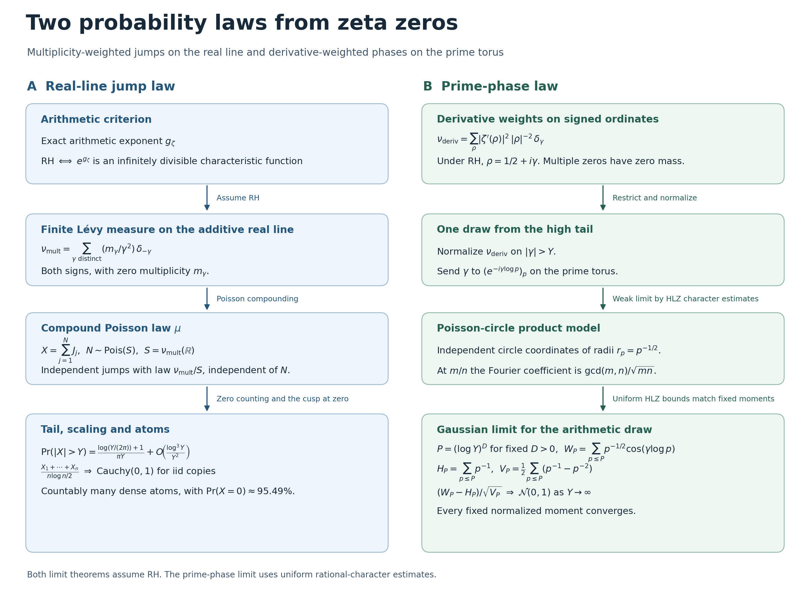

# Two probability laws, a normalization repair and finite-test barriers

18 November 2026. The most useful advances in this round are a conditional arithmetic prime-phase central limit theorem, a detailed real-line probability law attached to the classical RH criterion, and an exact explanation of how a central zero becomes a Gaussian component. The source archive now also has a read-only SQLite index and individual source-derived paper views. The quantitative evidence states are reported separately in the current coverage table.

No RH resolution, new zero-free region, improved zero-density exponent or improved critical-line proportion is claimed. The conditional results keep their RH or GRH assumptions. Publication priority is unassessed; the arithmetic CLT is a method-of-moments corollary of the separately reconstructed uniform twisted-moment input. The independent literature comparison identifies close prior results and the exact difference in sampling measures.



## A weighted arithmetic central limit theorem

Assume RH. On ordinates with |gamma|>Y, use probability proportional to |zeta'(1/2+i gamma)|²/(1/4+gamma²), including both signs. Multiple zeros have zero mass. Fix D>0, put P=(log Y)^D, and define

```text
H_P = sum_(p<=P) 1/p
V_P = (1/2) sum_(p<=P) (1/p−1/p²)
W_P(gamma) = sum_(p<=P) cos(gamma log p)/sqrt p.
```

Then W_P/H_P tends to1 in probability, with a bound O_(D,epsilon)(1/H_P) for deviations larger than epsilon, and

```text
(W_P−H_P)/sqrt(V_P) converges to N(0,1).
```

Every fixed normalized moment converges. Reflection makes this same real statistic have the same law using positive ordinates alone. The theorem concerns one derivative-weighted high ordinate, not ordinary zero counting or neighboring spacings.

The substantive hypothesis match is Heap–Li–Zhao's complex-shift formula plus its uniformly controlled coefficient family. For each fixed moment order, raw prime-sum powers expand into positive Fourier coefficients at rational frequencies. The refined reduced-rational error sums against the model moment, instead of losing the sum of all absolute coefficients. After centering, every fixed moment matches independent Poisson-circle variables. Gaussian determinacy finishes the proof. A covariance estimate alone would not justify this step. [Adjudication](../audits/adversarial_reviews/director_prime_phase_clt_round10.md) · [Proof](../audits/adversarial_reviews/analytic64_euler_tilt_concentration.md) · [Independent audit](../audits/adversarial_reviews/uniform64_euler_phase_clt_skeptic.md)

At fixed sigma>1/2, the comparison product measure is the normalized squared-modulus random Euler-product tilt of Haar. At sigma=1/2 it becomes singular to Haar: the same W_P/H_P tends almost surely to1 under the critical Poisson product and to0 under Haar. An explicit variance-summable martingale proves the separation. This is a precise boundary change of measure, with an arithmetic corollary after the source hypotheses are matched.

The scalar onset is now effective in principle. The primitive-character error has an explicit support factor a(kq). Deleting one prime of the possible exceptional conductor removes that error; restoring a single centered summand costs O(H_P^(-1/2)). The full fixed statistic is restored at every prefix BEFORE tail integration, so the deleted prime may change with height. A finite smoothing argument then gives a computable conditional Kolmogorov threshold for computable fixed D and tolerance. No numerical threshold was calculated. The unrestricted individual-character theorem retains its ineffective boundary. [Effective scalar adjudication](../audits/adversarial_reviews/director_effective_scalar_clt_round10.md)

The priority search found related continuous weighted prime-sum moments in Fazzari, ordinary-counted zero moments in Çiçek, the same derivative-squared prefix character in Bui–Gonek–Milinovich, and an off-line tilted random-model limit in Najnudel–Wei. None is relabeled as this exact result without a range and weight comparison. The bounded search found no identical statement but does not establish publication novelty. [Primary theorem comparison](../audits/adversarial_reviews/analytic64_prime_phase_clt_priority.md)

## The other law has heavy tails and dense atoms

Nakamura–Suzuki's arithmetic exponent g_zeta gives an infinitely divisible characteristic function exp(g_zeta) exactly when RH holds. Under RH its finite Lévy measure is

```text
nu = sum_(signed distinct gamma) (m_gamma/gamma²) delta_(-gamma).
```

This uses multiplicities rather than derivative weights. The resulting random variable is a Poisson number of independent signed-zero jumps on the real line. The program's second complete Level3 audit checks every formula, lemma, theorem, appendix and reference role in the pinned five-page arXiv version. The original publisher proof text remains outside that version-specific audit. [Whole-work adjudication](../audits/adversarial_reviews/director_nakamura_whole_round10.md)

Riemann–von Mangoldt counting and a direct compound-Poisson sandwich yield, under RH,

```text
P(|X|>Y) = [log(Y/(2pi))+1]/(pi Y) + O(log³Y/Y²).
```

Positive absolute moments are finite precisely for 0<p<1. The ordinary mean does not exist. The atom set is a countable dense additive group, while the topological support is all of R. Those facts coexist: dense support does not imply a probability density.

The total jump intensity is S=xi''(1/2)/xi(1/2), evaluated as approximately 0.04620998623083794. Opposite jumps can cancel, so the atom at zero is larger than exp(−S). With a complete small-height zero list and an explicit remaining-mass cap, independent Arb calculations certify

```text
0.95487677454644730 < P(X=0) < 0.95490529007639706.
```

These are conditional probability bounds. The analytic ratio and finite zero computations themselves are unconditional. The proof distinguishes the two stages and does not use the derivative-weighted C_2 constant in place of S. [Tail, atom and support proof](../audits/adversarial_reviews/director_probability_tail_round10.md)

The exact arithmetic formula also gives the unconditional cusp

```text
g_zeta(t) = −|t|log(1/|t|)/2
            +(log(2pi)+gamma_E−1)|t|/2−7t²/8+O(|t|³).
```

Under RH, iid sums normalized by n log n/2 tend to standard Cauchy. An explicit off-axis model has the same formal local scaling limit but is not a global characteristic function. The probability premise in Lévy's continuity theorem cannot be inferred from the limiting shape.

The real-line compound Poisson law and the derivative-weighted prime-torus law remain distinct even after mapping both to prime phases. The former has an identity atom and Fourier coefficients bounded below by exp(−2S). The latter has continuous one-prime marginals and coefficients tending to zero along large prime powers. Sharing the word Poisson does not supply a theorem between them.

## A central zero requires regularization and a chosen height

The separate six-page Selberg-class extension prints an ordinary logarithmic derivative at the center while explicitly allowing a central zero. That value is undefined. Its retained central Hadamard factor and its own weight18 example give an exact witness. Replacing the drift by the regular part after subtracting m0/(s−1/2) restores the intended criterion. The full transform still needs the central pole; removing it would lose the Gaussian variance. This is an exact auxiliary-definition issue in the checked preprint. The journal wording was not obtained. [Versioned source adjudication](../audits/adversarial_reviews/director_central_drift_round10.md)

There is a further normalization issue. The printed Selberg axioms permit vertical translates of an entire nonprincipal Dirichlet L-function. Shifting L(s,chi4) by an actual certified critical-zero ordinate gives a degree-one function with a central zero, unconditionally. The original degree-one classification includes these shifts. Primitivity does not remove them; a canonical-height normalization is the missing restriction in the degree discussion. The canonical arithmetic examples retain their usual significance.

Tracking the shift gives a useful positive result. With delta the distance of a zero from the chosen center, the corrected exponent contains

```text
m [exp(−i delta t)−1+i delta t]/delta²  →  −m t²/2.
```

Under GRH this is the centered Poisson variable −delta[Poisson(m/delta²)−m/delta²] converging to N(0,m). The divergent drift cancels before the limit. The whole laws are weakly continuous through the crossing. A finite canonical Lévy measure includes the crossing mass at zero, and the compensated drift stays continuous. Static central Gaussian factors and the general Poisson limit have clear precedents; the exact moving-zero bridge is separately derived and its publication priority remains unresolved. [Bridge and scope](../audits/adversarial_reviews/director_vertical_diffusion_round10.md) · [Antecedent comparison](../audits/adversarial_reviews/uniform64_vertical_diffusion_priority.md)

The source's three low-weight forms also have a direct analytic real-zero argument. Their split Mellin integrands are positive above y=1, so the completed L-function has the strict sign of the real displacement from the center. Its central zero is simple and it has no other real completed zero. This does not say that the uncompleted L-function lacks its trivial zeros, and it does not prove GRH.

## What finite positivity can and cannot certify

The bounded-grid countermodel is stronger than an arbitrary finite matrix example. For every fixed diameter H, it passes EVERY finite grid of that diameter, of any cardinality, for EVERY positive exponential power. It still has a remote off-axis quartet. Added simple real zeros give the smooth Riemann–von Mangoldt count up to O(1), while preserving the transform and the first two cusp coefficients. All symmetries and the order-one growth scale are correct. The model omits the actual Euler product and global arithmetic formula. [Construction and independent reconstruction](../audits/adversarial_reviews/director_bounded_positivity_round10.md)

A finite Frobenius spectrum behaves differently. A fixed compatible reciprocal trace is pure exactly when all two-term power tests hold, and an explicit integral degree bound gives a finite cutoff. An algebraic norm supplies a modulus gap; simultaneous phase recurrence then forces a violating positive trace. The finite progression is computable but can be astronomically large. Testing every prime extension degree alone fails for the integral reciprocal polynomial(X^4+32)(X^4+8). These statements do not produce the missing infinite global trace for classical zeta. [Finite criterion and exact counterexample](../audits/adversarial_reviews/director_finite_trace_round10.md)

These results distinguish finite algebraic certificates, infinite analytic positivity and arithmetic information. The required bridge must be proved for an actual proposed model; it is not supplied by matching a vocabulary or a few asymptotic formulas.

## Effectivity improved, with a visible remaining cost

A sequence of independently checked Hardy estimates now gives the unconditional critical-line series enclosure

```text
0.61649875288731141829 < C_2 < 2.35771.
```

The finite sum exhausts every nontrivial zero through height 10000: 10142 positive simple critical zeros match the independent all-zero multiplicity count. The full 160-bit run was replayed independently; the director reran the shared smaller prefixes at 192 bits. The remaining infinite tail is bounded analytically, without RH or a spacing assumption.

The key improvement is to apply two-sided variation to both components of G(t)=Z(t)Q_2(1/2+it). This preserves the sparse arithmetic coefficient cancellations instead of replacing |Q_2|² by its maximum. Centered frequencies and exact local Hilbert gaps, including the first-tail-even exception, give the certified tail below 1.741202 beyond 10000. Thin relative blocks also give the unconditional limsup Y*tail(Y)/log^4Y<=1/(4sqrt15). RH identifies this critical-line series with the tapered-array limit and gives the smaller exact leading coefficient 1/(12pi). [Proof, independent reconstruction and code](../audits/adversarial_reviews/director_weighted_rolle_round10.md)

The complete quartic density has also been computed by two independent Laurent expansions and matched to a direct parity kernel. For Q_2, no primitive nonprincipal conductor survives at all. A sharp fixed-ratio product approximate functional equation closes a smoothing issue and gives the RH-conditional tail remainder O_epsilon(Y^(-9/8+epsilon)). Its constants are unallocated. Partial sums plus the quartic main term are approximately 0.6534648947 at400,0.6534615142 at1000 and0.6533938577 at10000. These are observations rather than certified enclosures. The deliberately wrong three-times-untwisted tail produces substantially different totals. [Full polynomial and error audit](../audits/adversarial_reviews/director_q2_quartic_round10.md)

A practical certificate remains a concrete research problem: allocate the sharp shifted-moment error constants, or further sharpen the unconditional weighted variation bound. The finite-length prime-array remainder is a separate estimate; a bound for the coefficient series tail cannot replace it.

## A third complete source audit: Lagarias's criterion

Both independent reviewers and the director reconstructed all nine pages of arXiv:math/0008177v2. The RH equivalence survives. The imported Robin criterion and positive oscillation were matched to their original French journal pages; all finite cases through 5041 and all 22 nontrivial colossally abundant table entries were replayed independently. A later author manuscript corrects a malformed integral display. Both accessible manuscripts retain an incorrect sign in a Mertens coefficient and an overly rounded strict Robin constant, witnessed explicitly at n=12. These auxiliary displays do not enter the equivalence proof. A fixed-parameter CA tie needs an endpoint qualification; the aggregate set interpretation remains valid. The journal text was inaccessible, so no wording or correction claim is assigned to it. [Whole-source adjudication and exact versions](../audits/adversarial_reviews/director_lagarias_whole_round10.md)

## What the program actually learned

The historical progression remains explicit formulas and zero-free estimates, mean values and critical-line work, geometric purity over finite fields, positive equivalent criteria, random-matrix and spectral models, and modern quantitative/formal/computational interfaces. The archive now adds a precise distinction between two probabilistic zero measures and a source-grounded boundary Euler tilt. Its historical narrative is still incomplete because many major works have only targeted readings.

Near-term progress is best pursued through explicit analytic interfaces: practical scalar phase thresholds, certified derivative-tail bounds, arithmetic signed moments and weighted-tail tightness. None establishes that RH is close to resolution. Spectral and geometric strategies still need a global realization with the required trace and positivity.

Older ideas worth revisiting include Selberg's logarithmic taper, fixed-spectrum trace positivity, jump-series holomorphy and existing logarithmic multiplier groups. Their provenance is recorded. The important new-to-this-investigation interactions are the prime-array/Fourier/moment chain, weighted prime-phase Gaussian fluctuations, the real-line heavy-tail law, the moving-zero Gaussian limit and the RVM all-grid obstruction. Priority is unresolved or explicitly credited; no claim of a new published theorem is made merely because the proof was independently reconstructed here.

The repeated obstacles are uniformity in growing parameters, positivity on the wrong group or with the wrong weights, a hidden vertical normalization, weighted mass escape, and interchanging limits before controlling their tails. Failed proposals and counterexamples are retained as mathematical data. Local source issues remain tied to exact inspected versions and repairs; valid main results are not relabeled as false.

The program independently established the scoped deductions above and validated their stated finite components. It did not prove RH. The next 25 concrete problems are listed in the current opportunity file. A new team should first reproduce the refined source uniformity and effective-prime-deletion analysis, allocate the explicit moment error and sharpen its unconditional counterpart, and seek a genuinely arithmetic mechanism excluding the weighted escape and bounded-positivity models. Broadening the corpus continues alongside reading and adversarial reconstruction, not in place of them.
