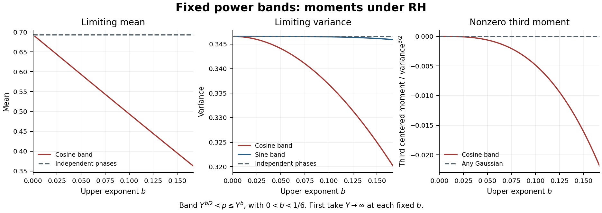

# A cumulative Gaussian law and non-Gaussian arithmetic bands

18 November 2026. The strongest new deductions in this checkpoint distinguish two fluctuation regimes for a specific derivative-weighted distribution of zeta zeros. Cumulative prime sums have a Gaussian limit over a substantially larger cutoff range. Fixed bands between two positive powers of the height have an explicitly negative third centered moment, which excludes Gaussian weak limits. Their means, covariance and cosine cubic match a precisely specified rooted random-matrix model.

These arithmetic conclusions assume RH and use matched published shifted-moment inputs. They are not progress toward proving RH by themselves. Publication priority is unestablished. The archive also now has an unconditional practical derivative-series enclosure, an exact integer finite-spectrum certificate, and a fourth complete version-pinned source audit. The coverage table distinguishes the nearly thousand selected works from the much smaller number read completely.

## The exact sampling measure

Draw a signed ordinate gamma with |gamma|>Y with probability proportional to

```text
|zeta'(1/2+i gamma)|² / (1/4+gamma²).
```

Both signs are included and multiple zeros have zero mass. All arithmetic results in the next sections use this measure under RH. They concern one weighted zero, not ordinary zero counting or neighboring spacings. The distinct multiplicity-weighted real-line law studied in the preceding checkpoint is summarized later.

## Cumulative sums really do become Gaussian

For a prime cutoff P put

```text
W_P = sum_(p<=P) cos(gamma log p)/sqrt p,
H_P = sum_(p<=P) 1/p,
V_P = (1/2) sum_(p<=P) (1/p−1/p²).
```

Under RH, if P(Y) tends to infinity with log P=o(log Y), every fixed moment of (W_P-H_P)/sqrt(V_P) tends to the standard Gaussian moment. For each fixed 0<theta<1/2, the same standardized statistic at P=Y^theta converges weakly to N(0,1). Moments through order2k also converge when k theta<1/2. No endpoint theta=1/2 or all-order assertion at fixed positive theta is included.

The mathematical improvement comes from applying Heap–Li–Zhao's shifted quadratic formula to the full Dirichlet polynomials BEFORE expanding the arithmetic main term. Coefficients of D(s)^j, with D(s)=sum p^(-s), are bounded by j!. Fixed positive padding on divisor-closed supports makes polarization meet the theorem's coefficient hypotheses. This avoids multiplying an arbitrary log-saving error by exponentially many individual-character coefficients. A near-power low cutoff and an upper-band Lp bound handle the fixed polynomial range. [Precise statement and proof architecture](../audits/adversarial_reviews/director_polynomial_bands_round11.md)

The earlier fixed-dimensional array criterion and Brownian process remain useful for more general weights. With L=log Y, b=log L and H=log b, the process

```text
sqrt(2/H) sum_(p<=exp(b^u)) [cos(gamma log p)/sqrt p−1/p]
```

converges under RH to Brownian motion on each fixed [u0,1], including u0=0, in the Skorokhod J1 topology. Its proof supplies a uniform fourth-moment bound for every subset of primes p<=log Y, proportional to the square of its reciprocal-prime mass. An exact clock interpolation and an all-time modulus establish tightness. Finite-dimensional convergence alone would not suffice. Effective conditional bounded-Lipschitz onset exists for computable fixed parameters, but no numerical threshold was computed. Vassaux's continuous-height Brownian theorem and Fazzari's weighted prime moments are genuine antecedents with different observables or measures. [Joint and functional adjudication](../audits/adversarial_reviews/director_joint_brownian_round11.md)

## Fixed polynomial bands are different

Fix 0<a<b<1/4 and let Delta_j=b^j-a^j. For the unnormalized cosine and sine sums over Y^a<p<=Y^b, under the same law,

```text
mean_cos -> log(b/a)−4Delta_1+(2/3)Delta_3,
var_cos  -> (1/2)log(b/a)−4Delta_1²+4Delta_1 Delta_3−(4/9)Delta_3²,
mean_sin = 0,
var_sin  -> (1/2)log(b/a)−(3/2)Delta_2²,
cov_cos_sin = 0.
```

The variances are below the independent Poisson-circle model values. The covariance correction for general cosine tests is the rank-two kernel

```text
C(x,y)=−4xy+6x³y+6xy³−4x³y³,
```

integrated against dx/x dy/y. The sine correction is the rank-one kernel-6x²y². The full covariance remains positive; a direct factorization supplies a positive operator lower bound. Product frequencies require support below Y^(2b), explaining the strict b<1/4 restriction.

For 0<a<b<1/6 the centered cosine third moment tends to

```text
−8Delta_1³+24Delta_1²Delta_3−8Delta_1Delta_3²+(16/27)Delta_3³ < 0.
```

For [a,b]=[1/20,1/10], the exact value is -818904257/864000000000. The calculation includes the repeated-prime contribution(3/2)H times the mean; that term cancels the corresponding second-moment diagonal after centering. Uniform fourth moments make the cubic powers uniformly integrable. Therefore no subsequence of this correctly centered band can converge weakly to a Gaussian. This conclusion concerns a finite-variance band and is compatible with the divergent-variance cumulative Gaussian theorem.



Independent symbolic extractions from HLZ, including different shift directions and phase allocations, agree. Separate director replays reproduce the kernels and the rational cubic witness. The aggregate remainder, strict tail boundary, distinct and repeated primes, and fourth-moment bound are separate checked parts of the proof. The absence of a complete band law is an actual remaining problem. [Adjudication and source equations](../audits/adversarial_reviews/director_polynomial_bands_round11.md) · [Third independent reconstruction](../audits/adversarial_reviews/analytic76_hlz_third_skeptic.md)

## A precise random-matrix connection

In Hughes–Keating–O'Connell's derivative-square rooted CUE, normalize the JOINT law of a Haar unitary and a uniform root label by the derivative-square weight. After rotation to the selected root1, the other N-1 eigenvalues have density Vandermonde-squared times product|1-z|^4. This is different from retaining an unweighted Haar matrix and normalizing root weights separately inside it.

The resulting determinantal projection is the space of polynomials of degree<=N with value and derivative zero at1. It is the full Fourier projection with two modes removed: the constant coefficient vector and the centered linear vector. Its exact shift and covariance traces give the same arithmetic band means and covariance, and the same centered COSINE third moment. A joint third-moment tensor has not been calculated.

The comparison uses the negative Fourier-band statistic with weights1/k, includes the deterministic root, and identifies k/N with log p/log Y. The two harmonic measures converge to dx/x. This is a mathematical match of explicit kernels, not a thematic analogy. It does not transfer the complete model distribution to arithmetic. Separate completed candidate proofs identify the intrinsic CUE limiting law and shrinking-band Gaussian crossover; those await director integration in the next checkpoint. [Primary model and independent trace derivation](../audits/adversarial_reviews/weighted73_rooted_cue_band_match.md)

The next precise question is whether the arithmetic band converges to that compensated determinantal linear statistic. The known moment formula allows only finitely many orders at a fixed positive exponent. A full law needs an additional uniform high-order or characteristic-function estimate. Matching a few moments, even exactly, cannot replace it.

## A better unconditional numerical certificate

For Q2(s)=2*2^(-s)-1, let C2 be the two-sign sum |zeta'(rho)Q2(rho)|²/|rho|² over distinct critical-line zeros. The whole series is now rigorously enclosed by

```text
0.61649875288731141829 < C2 < 1.075561.
```

This is unconditional for that critical-line series. The finite partial through10000 exhausts an independent all-zero count of10142 positive simple zeros. No new census was run. The remaining tail is below0.45906151 by one global vector-variation estimate for a cutoff times Q2Z/t, weighted Hilbert bounds and a complete infinite geometric remainder. Rational parameter choices, signed cubic endpoint terms and192-bit replay are recorded. The search proves no optimality.

Under RH this is the tapered prime-array limit. The conditional quartic splice near0.65339 remains observational, with its numerical error constants unallocated. A one-percent enclosure would follow from a future complete finite package at2.8 million of width below0.00025 and the existing analytic tail there; that package was not computed. Coefficient-series tails must not be substituted for the distinct finite-length approximation remainder. [Proof, independent audit and pins](../audits/adversarial_reviews/director_global_hardy_round11.md)

## Exact finite certificates and a structural obstruction

For a monic integral q-reciprocal polynomial P of degree d with no zero root, write t_n=sum alpha^n. Its roots all have modulus sqrt(q) exactly when the INTEGER matrix

```text
K_ij=q^min(i,j)*t_|i−j|,  0<=i,j<d,
```

is positive semidefinite. Newton identities and exact rational elimination give a polynomial-bit algorithm using traces through d-1. Negative inertia counts DISTINCT off-circle reciprocal-conjugate pairs; multiplicities affect positive weights and nullity. Pure repeated roots can give a singular matrix. Individual short power tests and nonnegative leading minors alone are insufficient.

This is an arithmetic specialization of Heinig–Rost's documented classical power-sum Toeplitz criterion, with a Vandermonde proof and exact edge-case computations. The earlier astronomical single-power progression is a different certificate. Neither construction supplies a global compatible trace for classical zeta. [Proof and antecedent](../audits/adversarial_reviews/director_integer_trace_round11.md)

Deninger's complete eight-page preprint is now independently audited, with a separate full journal comparison. A quaternionic Artin constituent with odd central order cannot occur with the required multiplicity in the complexification of a real equivariant space. Actual Q8 fields give the obstruction. Thus an ordinary-real functorial cohomology covering those fields and satisfying the central Artin axiom is impossible. An isolated spectral realization over Q remains outside the conclusion. The proposed positive quaternionic star that would imply RH is still conjectural; existing height positivity on a subspace does not construct it on every spectral component. [Whole-work audit](../audits/adversarial_reviews/director_deninger_whole_round11.md)

## What the wider investigation has learned

The historical conceptual transitions remain: Riemann's explicit formulas and analytic continuation; zero-free arguments and the prime number theorem; critical-line and mean-value methods; finite-field cohomological purity; positive equivalent criteria; spectral and random-matrix models; and increasingly precise computational and formal interfaces. The archive traces these through actual sources, while acknowledging that most selected works have only targeted readings. The original memoir's claimed and proved portions require historical interpretation, not a modern expectation of a complete RH proof.

The best near-term targets are explicit interfaces: stronger shifted-moment uniformity, the arithmetic band law, practical error constants, signed correlation estimates and weighted-tail tightness. These offer meaningful incremental theorems. The archive gives no basis for predicting that any strategy is close to resolving RH.

Older methods worth reconsidering include Selberg's logarithmic taper, classical trace forms and the quaternionic alternative to naive real descent. The strongest new-to-this-investigation interaction is the exact aggregate-moment, non-Gaussian-band and rooted-CUE chain. Classical antecedents and bounded priority searches remain attached to it. Independent reconstruction is not automatic publication novelty.

Repeated obstacles are changes of sampling measure, support growth before error summation, misplaced normalization, missing positivity on an entire spectral space, arithmetic mass escape, and uncontrolled orders of limits. Negative knowledge now includes the failed independent-phase model at fixed polynomial scale and the impossibility of a Gaussian band limit even after correcting its mean and variance. An apparent HLZ decay error was withdrawn after the original subscript was read correctly as an iterated logarithm. That episode is preserved as a reason to inspect typeset sources before alleging an error.

Credible version-specific source issues remain local and explicit. The new Suzuki compensated-drift sign witness changes only deterministic translation and leaves the screw kernel intact. Earlier central regularization, Lagarias auxiliary displays and Manzur–Noor covariance phases retain their scopes and valid main results. Complete agent reviews of Riemann, Li, Báez-Duarte and HLZ have recovered primary editions and additional qualifications; their corpus-level promotions and findings remain pending director adjudication. No public author assessment follows from an unadjudicated review. [New drift adjudication](../audits/adversarial_reviews/director_suzuki_drift_round11.md)

The program independently established the conditional deductions and finite certificates described above. It did not prove RH or improve the best zero-density, zero-free or critical-line exponents. Failed tests, source-access limits and corrected internal extractions remain in the archive. The [25 current problems](top_25_research_opportunities.md) give explicit next steps.

A new team should first rerun the three arithmetic kernel calculations, inspect the aggregate coefficient padding and sharp continuous-moment replacement, and verify the cubic uniform-integrability step. Then it should attack the full band characteristic function or a practical approximation error budget, while an independent group completes the pending whole-work source adjudications. Broader bibliography and complete readings must continue as distinct tracked tasks.
