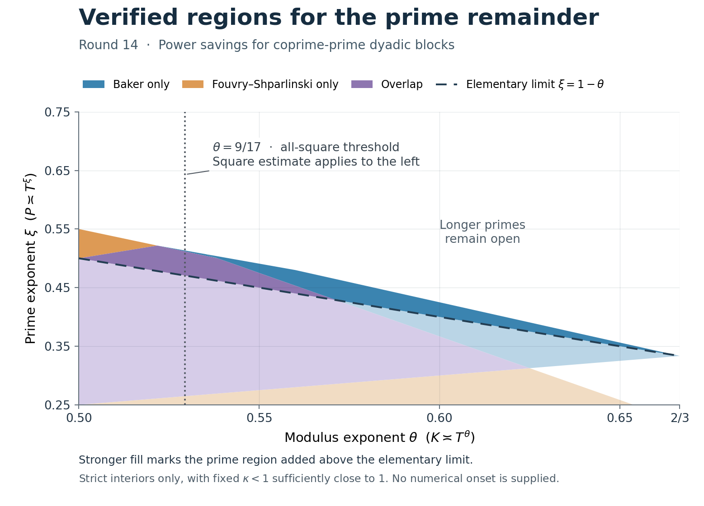

# Round 14 — partial arithmetic cancellation and finite positivity certificates

Literature cutoff: 18 November 2026 UTC. The current catalogue has 1,007 selected works, 962 accessed full texts, 13 additional excerpt-only sources, 126 complete substantive readings, seven whole-work Level 3 audits, and 108 scoped adjudicated claim groups. It contains 461 theorem, conjecture and exercise records and 88 connections. Six source-specific proof dependencies were added; no additional complete reading or whole-work audit is claimed. No proof or disproof of RH, improved zero-free or zero-density exponent, or established publication novelty is reported.

The principal advance in this round is a collection of unconditional estimates for pieces of the explicit arithmetic obstacle isolated in Round 13. All square factors can now be removed in a strict range, and averaged inverse-prime theorems remove further prime ranges. The remaining long-prime sum is still open. A separate campaign makes the random-matrix positivity obstruction finite and quantitative, while giving positive finite approximations to the exact determinant factors.

## What remains of the fourth-moment problem

Recall D(s)=sum p^(−s) over Y^a<p≤Y^b, with 0<a<b and 1/8<b<1/6. Under RH, the symmetric strict derivative-square zero tail has an exact fourth-cosine reduction: the mixed 3+1 and 2+2 arms are already covered, and only the pure 4+0 arm remains. Its sufficient missing estimate is

```text
Re sum_(k≤Y^(4b)) (c_k/k) sum_m C_*(m) w_T(2πm/k)
 [e(−m/k)−mu(k/gcd(m,k))/phi(k/gcd(m,k))]
   =o(T log^4 T),
C_*=d_2*(Lambda log²), T comparable to Y.
```

Here c_k are the bounded coefficients of D^4 and w_T has two smooth transitions of width H=T^kappa, with kappa fixed below one and sufficiently close to one. The Round 13 continuous-moment, smooth-saddle, divisor-removal and strict-tail arguments are inputs. The estimates below concern this signed arithmetic sum itself and are unconditional. Their transfer to the weighted-zero statistic still uses RH.

Opening the Mangoldt factor nu=p^j gives a centered divisor twist at the exact modulus q=k/gcd(k,nu). Modulus one cancels; the divisor variable need not be coprime to q. Two independent proofs give a short-factor saving when nu/gcd(k,nu)^2 is less than H²/(kT) by a fixed power. A separate weak pointwise bound, obtained after choosing the taper near the height scale, removes every factor sharing a prime with k and every power p^j with j≥3. The latter aggregate is O(Y^theta T^(1/3+epsilon)log^C T), theta=4b<2/3. These estimates keep every gcd case and every logarithmic weight.

Genuine primes and squares had remained after that first reduction. A primary theorem of Ghosh, checked in the actual 1981 thesis, bounds quadratic Mangoldt prefixes at an exact reduced rational phase. Swapping the square base and the divisor variable, then using bounded variation of the taper, gives the block estimate

```text
T^epsilon (KT/X) [K^(−1/4)+X^(−1/8)+K^(1/4)X^(−1/2)]
```

for k≈K and square base p≈X. Its combination with the small-base estimate removes the **entire square stratum** with a power saving for

```text
1/2<theta<9/17, or 1/8<b<9/68.
```

The endpoint is excluded. This does not remove the genuine primes. It is an incremental estimate for a precise remainder, rather than a new full fourth-moment formula.

## Two verified regions for the remaining prime factors

For a coprime genuine prime p, ordinary divisor Voronoi summation transforms the remaining divisor variables. The main integral cancels exactly under unit-numerator averaging. The two dual phases are e(±l inverse(p)/k). This matches published estimates of Baker and Fouvry–Shparlinski over all integer moduli.

There are two points where an informal transfer would fail. First, an average of fixed-endpoint prime estimates does not give a free separate endpoint maximum for every modulus. The proof instead bounds the common weight and derivative, and integrates the source estimate at common endpoints. Second, the dual length grows with p. A uniform Bessel envelope, including its first prime derivative, has total mass O(T^epsilon delta^(−5/2)), delta=H/T, with no power loss in the dual length. The factor U^(−1), U=KP/T, cancels the density of dual indices. Nonunit indices are reduced by d=gcd(k,l), q=k/d; published bounds or a triangle estimate cover every resulting modulus.

Consequently, at K≈T^theta and P≈T^xi, 1/2<theta<2/3, coprime-prime blocks save a power in either open region:

```text
Baker:
 theta/2<xi<theta,
 (11/10)theta+(4/5)xi<1,
 theta+(11/12)xi<1.

Fouvry–Shparlinski:
 0<xi<(3/2)theta,
 (13/10)theta+(3/5)xi<1,
 (13/12)theta+(5/6)xi<1.
```

No least-prime-factor cutoff on the dual indices is needed in this gcd-resolved argument. The constants are uniform on compact subsets after choosing a fixed taper for those margins. At theta=0.60 the Baker region reaches xi<0.425, beyond the earlier limiting short-factor exponent 0.40. At theta=0.51 the second region reaches xi<0.537 and includes P>K. These are strict interior asymptotic bounds, with no effective numerical onset supplied.



The figure uses exact rational polygon clipping. Its [code](../experiments/code/geometry118_prime_region_plot.py), [machine-readable inequalities and hashes](../experiments/results/prime_regions_round14.json), and [vector export](../experiments/results/prime_regions_round14.svg) reproduce byte-for-byte. The director replayed and inspected it. The plotted boundaries show limiting inequalities; the theorems apply to their strict interiors.

An independent route using Korolev's homogeneous 2018 inverse-prime theorem controls a local band near P=T^(1−theta) for theta<10/17. Its primary length range and the extra vertical loss from prime partial summation were checked. It is weaker than the averaged construction in relevant overlaps and supplies a useful separate interface. The later inhomogeneous theorem with two unit coefficients cannot be substituted by setting one coefficient to zero.

Longer primes outside these regions remain, potentially up to a constant multiple of KT. The verified pieces do not imply the full sufficient estimate. A useful next result would bound their signed aggregate, preserving the Gauss or inverse phases and the four-prime structure of c_k.

[Director arithmetic proof and source passages](../audits/adversarial_reviews/director_arithmetic_strata_round14.md) · `LEM-CSTAR-ALL-PRIME-SQUARES-BELOW-9-17` · `LEM-CSTAR-GCD-RESOLVED-INVERSE-PRIME-WINDOWS`.

## A precise obstacle to applying one transform to the entire sequence

The character-twisted Dirichlet series for C_* is L(s,chi)²(−L'/L)''. At a simple zero rho it has residue −2L'(rho,chi)². At multiple zeros of order at least two the potential singularity is removable. A contour shift treating the full sequence as an ordinary divisor/Eisenstein twist would therefore miss zero residues. Freezing the prime factor before applying the divisor formula is a valid different operation.

This identifies a concrete limit of a tempting shortcut. It does not estimate the residue sum, assume Dirichlet GRH, or prove that another transform is impossible. The progression-distribution theorems inspected so far also require their actual residue and factorability hypotheses; products of four large primes do not automatically give the phase-weighted input required here.

## How late can positivity fail in a formal moment sequence?

The all-rank obstruction from Round 13 gave a positive real zero of the formal cosine continuation M(z). A quantitative Cauchy argument now gives an explicit finite witness. With 0<t_*≤1/d a zero, R=2/d and B≥1 bounding |M| on |z|=R, take

```text
L=ceil(log_2(8B(B+1))).
```

The degree-L Taylor polynomials of exp(±t_*x/2) have a strictly negative two-by-two formal moment determinant. Thus a negative polynomial square exists using raw moments only through degree 2L. The director note gives an explicit, conservative B in the rank and band parameters. The construction does not assume this high degree lies in the true moment window.

At rank one, sigma²=log(b/a)/2, the formal generating function is exp(sigma²z²/2)(1−dz). Its degree-L moment form is congruent to I−(d/sigma²)T_L, where T_L is the Hermite Jacobi matrix with adjacent entries sigma sqrt(k). The least negative witness order is exactly the first L for which the largest zero of the probabilists' He_(L+1) strictly exceeds sigma/d. Equality gives singular positive semidefiniteness, not a negative square.

For a=b/2 and b→0 the least witness degree is (log 2)/(2b²)+O(1/b), while the first raw-moment discrepancy is on the scale 1/b. A discrepancy in a moment and a failure of a finite positivity test can therefore occur at quite different degrees. This is a useful obstruction to a proposed finite test strategy, without contradicting the actual intrinsic law.

Two exact rational fixtures check the strict threshold. For exp(z²/2)(1−z/2), the cubic 2x³+9x²+6x−3 has formal square expectation −30, and every lower-order principal minor is nonnegative. At the rescaled equality fixture, the order-two form is singular and a cubic has value −27. The code, direct coefficient calculations and all principal minors were independently replayed. No numerical eigenvalue approximation is used in these certificates.

## The exact determinant factors remain positive and computable

The Petrov factorization has a different positive behavior. For real Laplace parameter z, its oblique tail splits into the ordinary ambient tail plus a J-dimensional complement. Their determinant quotient is exactly a positive J-by-J Schur determinant, evaluable with finite matrices. If M=U*L^(−*)L^(−1)U for the finite triangular factor L and deleted-mode basis U, then

```text
L_obl/L_n=det[M^(−1/2)(U*A_n^(−1)U)M^(−1/2)],
det Gamma(z)/det Gamma(0)=det M.
```

The quotient lies between exp(−H_N z²/4) and one. The Gram and complementary determinants have two-sided exponential bounds uniform in matrix size at a fixed band and bounded real z. In particular the exact mass-removed complementary determinant stays bounded below by a positive constant at the zero of the formal polynomial. No exact factor needs to lose positivity there.

There is a corrected continuum Gram with independent compound-Poisson shifts p,q: integrate the two shifted Legendre profiles from max(p,q) to one, and set the entry to zero if either shift exceeds one. This true cutoff differs from the oriented formal interval. It explains the quadratic discrepancy already witnessed in Round 13. A weighted Fourier estimate also gives factorial convergence when the infinite Hankel operator is truncated after a prescribed number of bandwidth blocks. Empty bands are handled directly by identity factors.

These results give a controlled finite route to the exact factors. They should be used to study higher frequency chambers, rather than continuing a finite polynomial beyond its proved range.

[Director quantitative proof](../audits/adversarial_reviews/director_quantitative_rmt_round14.md) · `THM-ROOTED-CUE-RANK-ONE-HERMITE-WITNESS` · `LEM-PETROV-ROOTED-CUE-FINITE-SCHUR-TAIL`.

## What was established and what should happen next

The most valuable reconstructed connections are divisor Voronoi with the averaged inverse-prime bounds, the quadratic prime theorem with exact gcd reduction, and the formal positivity obstruction with finite Hermite forms. They meet matching domains and quantified error budgets, rather than sharing only terminology. Independent reviewers checked their source hypotheses and central estimates. Their publication priority remains unresolved.

The recurring obstacles are phase cancellation, genuine cutoffs, common-endpoint uniformity and the difference between a finite coefficient formula and an actual law. No new alleged author error is added in this round. The earlier version-specific findings remain separately documented. The historical source-wide adjudications of Riemann, Gonek and von Mangoldt still require director work; their complete readings are not counted again.

The first research task is a bound for the remaining long primes, with a precise phase-sensitive statement. Next are higher-rank least witness orders, higher intrinsic frequency chambers and certified evaluation of the positive exact factors. The [25 current problems](top_25_research_opportunities.md) specify additional tasks. New working attempts, including limits of phase-blind progression bounds, remain separate until reviewed and integrated.

The six new dependencies are Baker, Blomer–Harcos–Michel, Ghosh's doctoral thesis, Ren, Korolev and Fouvry–Shparlinski. Five full PDFs are retained privately. Korolev's actual journal passages were read through the remote primary reader; no local byte hash is invented. Ren's two manifestations count as one work and retain the provider-candidate crosswalk. The archive now has 881 selected Level 0 works, 119 at Level 1 and seven at Level 3. Reading and reconstructing that large unfinished corpus remains part of the mission; the selected count does not indicate completion.
