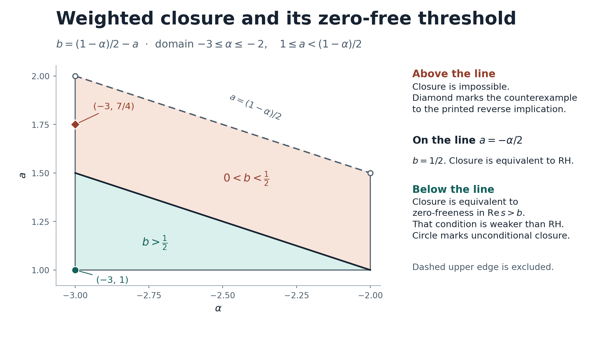

# What the investigation has established so far

This report answers the research questions using the accumulated evidence. It does not claim that the literature is exhaustively mapped, that a reconstructed theorem is new to mathematics, or that RH has been resolved. Exact current counts come from the generated coverage table. Source-dependent results below explicitly retain the source hypotheses and audit limits.

## 1. The conceptual transitions

The central historical transitions run from analytic continuation and the explicit formula, through boundary zero-freeness and the prime number theorem, to critical-line proportions, equivalent approximation/positivity criteria, spectral models, and the modern study of moments and zero statistics. Finite-field geometry supplied a successful purity mechanism with hypotheses that do not yet have an established classical-zeta counterpart. Modern work increasingly isolates uniformity, rare large values and clusters, rather than treating individual zeros as interchangeable.

The original-source work adds important qualifications. Hadamard's1896 argument concerns a zero-free boundary, not a quantitative modern zero-free region. Mangoldt's inspected originals explicitly control the growing grouped sums criticized later; a rigorous local reconstruction survives adversarial review. Riemann's known prime-formula constant correction is credited to its historical sources, and a modern transcription error is distinguished from the correct original. The archive's source histories make these claims traceable, but many landmark works remain unread.

## 2. The most concrete routes to incremental progress

The current strongest arithmetic target is the signed higher-moment inequality for the exact prime-side matrix, with D=84m3-16m4. The premises are the matched source window, d/N→1, m1→1, m2→4/3, relative-Hilbert–Schmidt error→0, and the separate block-counting inequality s1>=2n_+(G)-N+o(N). Under those premises, liminfD>31699883/275355 would beat the cited simple-critical fraction1669159/2478195. A complete sine-process model gives116, but that supplies no arithmetic bound. The useful next step is to expand this signed combination before estimating its terms separately.

A second concrete route is quantitative Nyman–Beurling approximation using modern reciprocal-zeta estimates. The investigation independently reconstructed a classical-norm shifted Möbius array with a source-dependent conditional rate, described below. This is meaningful conditional approximation progress, with priority still open; it is not evidence of unconditional convergence or an RH proof. The latest preprint sources are recorded as preprints and are not substituted for full independent technical audits.

Spectral and geometric programs need exact domain, measure and trace identities before they can be ranked as near an RH proof. No such claim of closeness is justified by this archive. The new operator control below eliminates one particularly natural candidate rather than providing the desired operator.

## 3. Ideas worth reconsidering

The useful historical recovery is methodological: grouped residues and grouped limit errors often remain controlled when individual inverse derivatives or termwise limits become misleading. Likewise, old fixed-distance estimates can become effective at shrinking distances only after their constants and low-height behavior are reconstructed. The program supplied a fixed-parameter Borel–Caratheodory bridge and a separate finite-height patch; it did not pretend that inaccessible Littlewood originals were fully audited.

No forgotten idea is promoted merely because it resembles a modern formula. The appropriate next question is whether its exact conclusion supplies a missing hypothesis, with matching parameters and a summable tail. The grouped BCF residue identity leaves the zero-removed arithmetic factor uncontrolled; this remains a real missing lemma.

## 4. The strongest precise connections

### Modern reciprocal estimates give a classical approximation rate

Let L=logN and epsilon_N=A/sqrt(LlogL). For the classical shifted array

P_N(s)=Sum_(n<=N)mu(n)n^(-s-epsilon_N),

use s=1/2+it and d_q(P)^2=(2pi)^(-1)integral_R |1-zeta(s)P(s)|²dt/|s|^(2q).

assume RH and the stated Bui–Florea/Bui–Florea–Heycock reciprocal estimates, including |M(x)|<=Ksqrt(x)exp(Csqrt(logx/loglogx)). For every fixed A>C and every fixed real q>=1, the adjudicated transfer gives

d_q(P_N)=O((logN loglogN)^(-1/4)).

Moreover d_q(P_N)^2 is asymptotic to epsilon_N times

S_q=Sum_(distinct gamma)m_gamma[1-binomial(2m_gamma,m_gamma)/4^(m_gamma)]/(1/4+gamma²)^q.

Both signs are counted separately. This is an explicit full-sequence statement. The converse for any fixed A>0 follows even from a subsequence by the Hardy zero witness. Forward convergence is proved only in the stated A>C range; no moving-parameter or optimal-distance assertion is made.

The q=1 endpoint requires substantially more than the Mertens envelope. Two independent reviewers reconstructed the complete twisted Perron contour, checked the original pointwise estimate and first reciprocal moment, and verified the all-height split. The contour's near-t shift is optimized; moments are used only away from that ordinate. The high-height estimate is the part of Balazard–de Roton that has no lower shift threshold. The original q>1 argument uses Plancherel and a bounded multiplier; a modulated bump disproves its unrestricted q=1 extension. This failed shortcut is retained as negative knowledge.

Credit and limits matter. Báez-Duarte/Balazard–de Roton already used this array and decomposition. The program combines later input with them; it does not claim authorship of the array. The substantial2026 first-reciprocal-moment theorem is an explicit source input whose complete proof has not been independently audited end to end. The proof files state exactly what has been checked. No current-best or publication-priority claim is made.

### A weighted criterion needs an a-dependent boundary

The inspected published Theorem5.5 of Gallardo–Gutiérrez–Seco asserts a weighted closure equivalence with zero-freeness in Re(s)>t, t=-(alpha+1)/2, for a range of a. At(alpha,a)=(-3,7/4), the premise is the true zero-free region Re(s)>1, but a bounded Mellin functional separates the target from the exact closed span. It supplies a positive analytic distance bound, using only existence and reflection of a nontrivial zero. This is a verified version-specific counterexample, separate from the auxiliary operator endpoint error.

For the same parameter range and norm, the independently reconstructed correct threshold is

b=(1-alpha)/2-a.

The target closure is equivalent to zero-freeness in Re(s)>b. The RH line is a=-alpha/2. Above it the closure is impossible; below it the condition is weaker than RH; the corner(-3,1) is unconditionally true by the separate Bergman argument. This is a correction to an approximation criterion, not a new zero-free region.

The arithmetic weighted-step core has antecedents: Dimitrov–Oliveira arXiv1608.07887v1, Theorem2, and rStation paper63v3, Section1 and Proposition3, whose criticism of the printed proof predates this investigation. The latter's on-site reviewer marked Accept; that is not journal refereeing. Those core proofs were inspected independently. The specific norm transport, parameter correction and explicit counterexample remain separate; no exact prior source for their combination was located in the bounded search, and priority remains unresolved.

### Boundary atom detection becomes a general analytic identity

For the compensated positive-real representation

G(w)=a w+i b+integral[1/(w-i gamma)-i gamma/(1+gamma²)]mu(dgamma),

with a>=0, real b and positive mu satisfying integral(1+gamma²)^(-1)dmu<infinity, form H_epsilon=exp(-integral_0^epsilonG(w+r)dr). Fix x>0 and P_x(t)=x/[pi(x²+t²)]. The quantity integral_R|1-H_epsilon(it)|²P_x(t)dt divided by epsilon tends to

2ax+Sum_atoms 2x alpha_gamma[1-Gamma(alpha_gamma+1/2)/(sqrt(pi)Gamma(alpha_gamma+1))]/(x²+gamma²).

This ordinary analytic theorem allows infinite total mass, accumulating atoms and singular continuous measure. The continuous component contributes zero at first order; the linear term contributes energy at infinity. A Wiener/autocorrelation proof and an independent nonlinear modulus-deficit proof agree. Under RH, the xi logarithmic derivative has atomic masses equal to zero multiplicities and no linear term, recovering the earlier zeta-ratio slope after a completion correction.

This connection is exact, not a shared-vocabulary analogy. Its classical linear Wiener and Herglotz antecedents are cited. The nonlinear formula's historical priority remains open. Positivity of the actual xi generator has not been established independently of RH.

### A natural Hardy-space spectral candidate has the wrong spectrum

Assuming RH, put F(w)=xi(1/2+w) and W_tau f(w)=F(w)f(w+tau)/F(w+tau) on ordinary right-half-plane H2. This is a strongly continuous contraction semigroup. Every positive-time operator is compact, injective and quasinilpotent, and its actual generator has empty spectrum. Its maximal domain is{f inH2:fprime-(Fprime/F)f inH2}.

Two independent operator proofs checked this conclusion. A sufficiently wide fixed ordinate window contains increasingly many zeros by Riemann–von Mangoldt; each contracts the paired quotient, yielding compactness after a finite boundary cutoff. Any proposed nonzero eigenvalue contradicts superexponential xi growth and the Hardy evaluation bound. The resolvent is constructed directly for every complex parameter. The boundary-energy identity gives the exact square-root displacement of normalized evaluation kernels, which lie outside the generator domain.

This is negative knowledge for one precisely specified candidate. Other norms and domains may behave differently. It is not a general obstruction to Hilbert–Pólya or a proof of RH. It shows why a formal logarithmic-derivative differential expression cannot simply be declared to have the zeros as its spectrum.

## 5. Repeated obstacles

The recurring obstacles are uniformity in moving parameters, unjustified interchange of two limits, boundary domains, clusters and multiplicities, and unbounded arithmetic tails. Finite positivity, formal reciprocal symmetry, a smooth positive kernel or a random-model moment can all hold without the desired arithmetic conclusion. Relative-Hilbert–Schmidt control transfers bounded clipped tests; it does not transfer unbounded polynomial moments through rare outliers. Fixed spectral weights do not remove the simplicity obstruction of the fixed Selberg array. These are distinct, explicitly witnessed failures.

## 6. Credible technical issues

Two source statements have director-adjudicated counterexamples: the inclusive bounded-inverse endpoint of E012 Proposition5.1, and its Theorem5.5 reverse implication at a different permitted parameter. Both have explicit replacements. These findings do not refute the earlier sufficient zero-free implications.

Other inspected works have localized estimates, normalization questions or compressed arguments with separate repairs. The Rodgers–Tao reviews provide replacements for the consequential far-field and mixed-domain uses; they do not refute its main theorem. Retaining a horizontal denominator repairs the inspected BGSTB strong-density route, while an author follow-up documents a different published remainder correction. Recent BFH variance and ABR cutoff/measure notes retain their exact local and downstream scopes; they are not automatically counted as whole-theorem refutations. Historical correction searches remain bounded and version-specific.

## 7. What was independently established

The archive contains complete scoped proofs of conditional shifted-array rates and exact slopes, the corrected weighted equivalence and its counterexample, the general positive-real energy formula, the specific spectral obstruction, and several finite-model results. The scalar taper coalescence maximum is proved for every degree at M=2 and in an explicit larger-window region. Global coalescence outside that region remains open here.

The shared-support arithmetic certificate proves the Lagarias inequality through720720, using the already proved global concavity and two endpoint calculations. The exact support proof excludes all larger primes analytically; it does not assume that consecutive CA ratios must be prime. Independent directed arithmetic backends agree. This is finite verification, with no infinite endpoint argument or claim that the numeric range itself is novel.

The exact pinned Solution.Multiplicity target has now actually compiled in8887 Lake jobs. All12 requested type/axiom queries exited successfully and reported only propext, Classical.choice and Quot.sound. The checked declarations cover eight zeta statements and four dyadic fixed-primitive-character statements; the latter are not uniform-conductor or cumulative Dirichlet claims. This is a replay of the authors' formal artifact, not a new proof attributed to this program. The independent semantic comparison and raw results are preserved. Separate K839 formal compilation, external independent-kernel replay and unfinished continuum searches are not inferred from it. Whole-paper Level2/3 audit counts remain distinct.

## 8. Failed proposals preserved

The archive preserves failures of a moving-root triangular window, naive positivity of higher-degree Laurent coefficients, unrestricted Christoffel-to-inertia inference, finite-Li-prefix RH inference, a generic q=1 multiplier bound, contractivity-only exhaustion of boundary energy, inverse closure transport through a vanishing multiplier, and an operator-norm-zero inference from a weaker trace approximation. None is represented as a counterexample to actual RH. Each failure identifies the extra hypothesis a successful route would need.

## 9. The actionable problem list

The25 problems in top_25_research_opportunities.md are a research queue, not25 discoveries. The new priorities are effective constants and publication comparison for the classical shifted array; an independent end-to-end audit of the reciprocal-first-moment source; a signed arithmetic higher-moment bound; quantitative boundary-energy remainders under specified concentration assumptions; and an alternative spectral realization with a proved domain and arithmetic trace formula. Completed window, weighted-core and finite-certificate tasks must not be repeated as if still open.

## 10. What a new team should do first

Start with the current director adjudications and their exact source inputs. Have one group independently recheck the classical endpoint proof and its recent reciprocal-moment dependency, and another attack the signed arithmetic moment target. The pinned formal target/type/axiom queries are completed; finish the remaining computational certificate searches and separately assess the next formal artifact. An active manuscript audit also examines a stronger claimed optimized-distance theorem, which is not yet promoted on the strength of its on-site review. Compare the corrected weighted criterion and general boundary-energy theorem with their primary antecedents before making any publication claim. Continue source-grounded corpus expansion, especially families and historical strata still thinly represented.

The intended1000 substantive readings and200–300 deeper reconstructions are still far away. The current archive lowers the cost of continuing this work by preserving exact statements, failed assumptions, independent proofs, source hashes, executable certificates and a live queue. It does not replace the unfinished program with a completeness claim.
