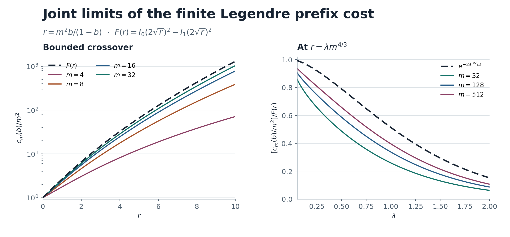

# Round six: adaptive arithmetic approximation and exact finite transitions

This update contains scoped reconstructions and proofs. It does not announce a resolution of RH or establish publication novelty. The complete-paper Level2/3 counts remain separate from these adjudications.

## The arithmetic upper-bound obstacle has an alternative route

The primary manuscript RST048v2, posted24October2026, claims an RH-only optimal Nyman–Beurling rate. The director and independent advocate/skeptic reviewers reconstructed its main theorem through equation78, with an explicit qualification filling a compressed local step. For the full norm dt/[2π(1/4+t²)],

    lim_N (logN) inf_{A(s)=Σ_{n≤N}a_n n^(-s)} ||1−ζA||_*²
      = Σ_{distinct nontrivialρ} mρ²/|ρ|²,

under RH, allowing arbitrary complex coefficients and multiplicities. The same constant holds when the polynomial multiplyingζ is restricted to value0 at1. Both ordinate signs are included. Coefficients depend on zeros. This differs from a prescribed shifted Möbius array or fixed logarithmic taper, whose stronger convergence/rate questions retain their exact hypotheses.

The source proof groups poles on a fixed fine mesh, bounds their Newton coefficients on good reciprocal contours, and cancels the derivative factorial against a divided-difference simplex volume. Delayed smooth profiles give a subset-uniform squared tail of orderY^(-99/100)/logN, even with growing multiplicities. Shared-edge contour telescoping controls the uncorrected high strip. Collective integer quadrature realizes the continuous correction as an actual length-at-mostN Dirichlet polynomial. Finally, finitely many local profiles are optimized before exhausting the zeros. No inverse Gram estimate for the full growing zero set is needed.

The local qualification matters: the complement of separate zero neighborhoods can still lie inside a cluster's full ordinate hull, where the stated far estimate does not apply. For a fixed set, expand into individual Laurent terms and apply the estimate to each repeated singleton. Its constants are independent ofN but may depend on that fixed set. This closes the step without imposing uniform zero separation. The source theorem is credited to its author; platform Accept is not journal refereeing. Its prefix lower-bound and finite-off-line extensions have extra dependencies and remain outside this adjudication. See THM-RST048-OPTIMAL and director_rstation48_main_theorem_round6.md.

## A finite matrix simplifies to a classical special-function integral

Starting only from the source finite matrix definition, two independent derivations and director reconstruction prove

    c_m(b)=m²+2∫_1^{(1+b)/(1−b)}[P′_(m−1)(x)]²dx,

where P_n is the Legendre polynomial normalized byP_n(1)=1. This gives strict increase inb for m≥2,c1=1,c2=4/(1−b), and an exact rational c3. The fixed-m endpoint blow-up has power2m−3, rather than a naive2m−1. At m3,b1/2 the exact cost165 refutes two plausible simpler bounds. Each independent exact rational implementation passed72 inputs; the proofs, rather than these finite checks, establish the identity.

The joint regimes are now also independently proved. Put r=m²b/(1−b) and Φ(r)=I0(2sqrt r)²−I1(2sqrt r)². Uniformly on boundedr, c_m/m²=Φ(r)+O(1/m), with a sharperO(1/m²) statement under the natural m(m−1) scale. Along every growing m sqrt b regime, including b→0 or1,

    c_m(b)~(1−b)²[(1+sqrt b)/(1−sqrt b)]^(2m−1)/(8πb).

The relative Bessel approximation holds for r=o(m^(4/3)). At r~αm^(4/3) the exact/Bessel ratio instead tends exp(−2α^(3/2)/3), and beyond that scale it tends0. These are precise finite-model limits using classical Legendre/Bessel methods. They do not establish arithmetic uniformity for a moving prefix b(N). See OBS-PREFIX-CLOSED, OBS-PREFIX-BESSEL and OBS-PREFIX-MATCHING-BOUNDARY; priority remains unassessed.

## An effective-input certificate replaces a purely qualitative upper limit

The source construction has a fixed-height quantitative corollary. For each fixedY, its scaled squared distance is bounded by a bracket involving the finite optimal constantS_Y, squared delayed-tail boundBY^(-99/100), explicit decaying local and arithmetic remainders, and fixed-Y constants. A pointwiseO_Y(1/logN) tail on the isolated finite zero windows controls cross terms; taking a triangle bound alone would lose this refinement.

This gives a one-sided tolerance algorithm *if* certified global analytic majorants, complete finite zero clusters/multiplicities and local bounds are supplied. None of those numerical input constants was instantiated in this campaign. Two-sided certification additionally needs an effective lower bound. There is no bound on the local constants asY grows and no universal convergence rate. See EFFECTIVE-CLUSTER62-UPPER, equation(A) of effective_cluster62_proof.md and its independent/director reviews.

## A weighted density premise and its exact limitation

ForL=logT, define D_T(y)=N(1/2+y/L,T) with inclusive endpoints and r_T(y)=e^(2y)D_T(y)/T. The condition

    r_T(1/2)+∫_(1/2)^(L/2) r_T(y)/(1+y²)dy →0

suffices for the inspected BGSTB far-pair error to be o(TlogT). It is equivalent to smallness of its nonnegative horizontal majorant, not necessary for the actual signed sum. The boundary term is indispensable. Moving-atom profiles show that local scaled convergence, unweighted averages and the quoted broad Guth–Maynard power bounds do not imply it. They are logical test profiles, not actual zeta-zero counterexamples. A closed height endpoint and separately sourced horizontal-grouping consequences were also checked. The numerical proportions from that older fixed test are conditional and are not current-best claims.

## Stronger recent claims remain evidence-gated

The contemporary search added primary statements on short-strip density, a registered formal39/17 uniform density coefficient, and a November manuscript claiming a much stronger global fixed zero-free half-plane for HeckeL-functions. The registry's reported Lean/nanoda/con-ron checks were preserved and its declarations interpreted, but a local replay is a separate task. The old toolchain cannot reuse the new compiled cache across different pins.

For the fixed-half-plane manuscript, independently checked scalar margins and supporting lines do not settle the analytic theorem. Detailed audits identify the precise remaining signed exceptional-family transport, reference moment ledger and original compensated Mellin comparison that must be reconstructed. No definite error or counterexample to its printed starred assertion was found. The source's global claim is not adopted as established progress. Follow-up citations to the same source are not independent validation.

## What should be attempted next

First, independently verify the declared analytic interfaces of the consequential recent sources, and make the optimized arithmetic upper certificate effective from actual supplied constants. The fixed-character DirichletL transplantation has now survived independent advocate, skeptic, further adversarial and director reconstruction. Assuming GRH for each fixed primitiveχ, the optimized ordinary integer distance has the same multiplicity-squared limit with the zeros ofLχ. Positive/negative heights are chosen independently and a central zero is included once. De Roton's2006 published lower theorem matches the norm and cutoff exactly. This is not a prescribed-coefficient, anchored or conductor-uniform theorem; historical priority remains open. See THM-ADAPTIVE-DIRICHLET-OPT and director_dirichlet_transfer_round6.md.

The main pinned Multiplicity Lean target already built and all12 actual queries report the standard three axioms; do not repeat it as an unfinished target. Remaining continuum searches use a separately reviewed checkpoint adapter preserving the exact author predicates and LIFO traversal. Its resumed-versus-uninterrupted controls agree, including affine acceptances and actual killed-process recovery. These runs remain incomplete until their final counters and outputs match. A checkpoint is trusted local continuation, not a certificate of an arbitrary externally supplied prefix.

The archive's useful outcomes are exact interfaces, source credit, scoped repairs, mathematical negative controls and reusable proofs. The approximately1000-work goal remains far from complete. None of the conditional, finite-model or artifact results is an unconditional proof of RH.
