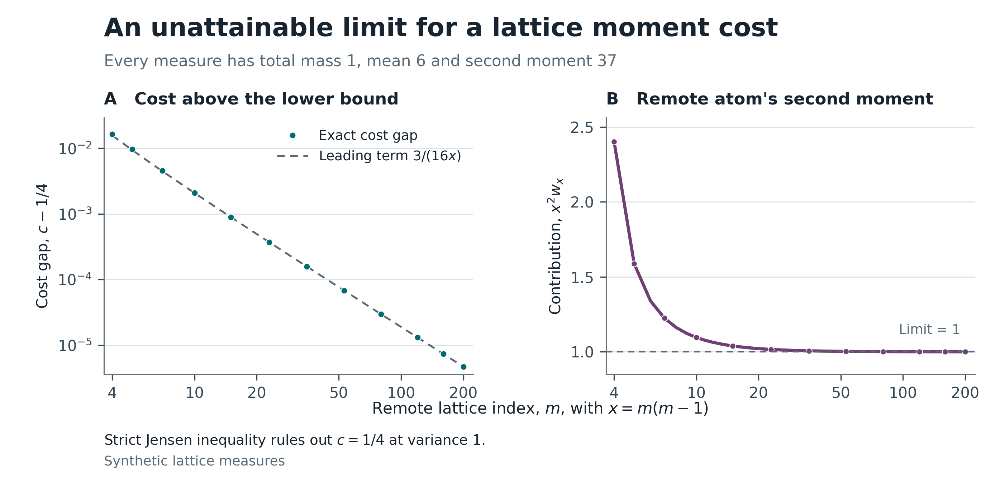

# What the latest investigation established

This round connects a Hardy-space RH criterion to a prescribed prime array, identifies the arithmetic content of its error constants, and records precise limits on what finite data can reveal. It also completes the first whole-paper adversarial audit. Every mathematical conclusion below has its own hypotheses; no RH resolution, new unconditional bound on zeros or established publication novelty is claimed. The graph and director adjudications contain the detailed proofs and source passages.

## 1. The most useful new chain of deductions

In the unit-cell space L²([1,infinity),dx/x²), put f_k(x)=k floor(x/k)−floor x. The source vertical group multiplies the jump at integer n by n^(it). Its exact strong generator is G=i(D−H), where D multiplies cell n by log n and H is the bounded triangular summation operator in THM-JUMP-GENERATOR-DOMAIN. For every fixed k>=2, membership G f_k in the closed Nyman–Beurling span is equivalent to RH. The reverse implication uses the first nonzero derivative jet at an off-line zero, so it handles all multiplicities without assuming simplicity.

This criterion is useful because its target is explicit. Removing the harmless factor i, its cell values are

```text
R_k(n) = log[(floor(n/k)!)^k k^(k floor(n/k))/n!].
w_k(d) = k·1_(k divides d) Lambda(d/k) − Lambda(d)
         + k log k·1_(d=k).
A_N(s) = sum_(d<=N) w_k(d)(1−log d/log N)d^(−s).
B_N(s) = A_N(s)−A_N(1).
```

For fixed k, under RH the prescribed array and the best anchored or unrestricted ordinary polynomial have the same leading squared error:

```text
(log N) ||MR_k − zeta B_N/s||²  →  C_k,
C_k = sum_(simple critical rho) |zeta'(rho)(k^(1−rho)−1)|²/|rho|².
```

Both ordinate signs are included. Multiple zeros contribute zero. The proof uses an exact logarithmic Perron formula, regularization before integration near zeros, an approximate identity and a summable full-height tail. It requires no inverse-derivative moment and no simplicity conjecture. The first-generator criterion has a general jump-series antecedent in Balazard; Selberg's explicit formula supplies the contour identity. The exact norm statement was not located in the bounded priority search, which leaves publication priority unassessed. [Primary proof and review](../audits/adversarial_reviews/director_tapered_prime_array_round9.md)

An explicit upper bound also holds under RH for every N>=3: E_N(2)<=10²⁷/log N, and E_N(k)<=10⁴⁴ k⁶/log N simultaneously for all k>=2. These are coarse global constants, not practical estimates of C_k. They imply a prescribed moving-index convergence criterion when k_N⁶/log N tends to zero. They do not justify exchanging the target-index and length limits in the leading asymptotic. [Effective proof and finite checks](../audits/adversarial_reviews/director_prime_array_effective_round9.md)

## 2. Arithmetic moments identify the high-zero covariance

Heap–Li–Zhao's published Theorem 5 has precisely the complex-shift uniformity needed for double differentiation. Its coefficient hypotheses require care: the two-term polynomial k^(1−s)−1 fails the stated support condition for composite k. Padding its divisor-closed support by a fixed large positive polynomial and cancelling by a quadratic identity repairs the application. With real fixed Q(s)=sum a_m m^(−s), RH gives

```text
sum_(0<gamma<=T) |zeta'(rho)Q(rho)|²
 = [sum_(m,n) a_m a_n/lcm(m,n)] T(log T)^4/(24 pi)
   + O_Q(T(log T)^3).
```

Partial summation, retaining the strict-tail endpoint, yields for fixed k,l

```text
sum_(|gamma|>Y) |zeta'(rho)|² Q_k(rho)overline(Q_l(rho))/|rho|²
 = (gcd(k,l)−1)(log Y)^4/(12 pi Y)
   + O_(k,l)((log Y)^3/Y).
```

The raw derivative moment has log power four; its average per zero has power three. An earlier internal draft confused those normalizations, and the source recheck corrected it before adoption. For k=2 the tail coefficient is 1, not 3. Distinct prime indices are orthogonal in this high-tail limit. The divisor decomposition gcd(k,l)−1=sum_(d|k,d|l,d>=2)phi(d) explains positive definiteness and arithmetic resonance. [Source-based derivations](../audits/adversarial_reviews/director_hlz_prime_torus_round9.md)

Normalize the measure nu=sum_simple |zeta'(rho)|²/|rho|² delta_gamma above height Y. For each fixed rational m/n its Fourier coefficient tends to gcd(m,n)/sqrt(mn). On the prime torus these are exactly the coefficients of independent Poisson circle laws with radii p^(−1/2). This is a law for a derivative-weighted draw of one high ordinate. It says nothing by itself about unweighted zero statistics or neighboring spacings.

The topology is essential. The limiting function on log-positive-rationals is discontinuous at zero in the ordinary real topology and cannot be the Fourier transform of a real-line probability. For each fixed Y the actual tail transform is continuous. Arbitrarily close large prime ratios force an all-prime discrepancy supremum of at least 1, even though every fixed prime block converges. The separately adjudicated uniform extension covers every prescribed block of primes below (log Y)^D, for fixed D. Its centered covariance, normalized by sqrt(p−1), differs from identity by O_D((loglog Y)²/log Y) in operator norm. Three source-based reconstructions track coefficient envelopes, local factors and complex shifts; Siegel makes the onset ineffective. This controls second moments, not an unrestricted growing-dimensional joint law. [Uniform theorem and trust boundary](../audits/adversarial_reviews/director_hlz_uniform_round9.md)

## 3. What the limiting errors reveal about simple zeros

Let B be the total mass of nu and F its Fourier transform. The constants obey C_k=(k+1)B−2sqrt(k)F(log k), so B=lim C_k/k. Cross forms recover F(log(k/l)) on a dense subgroup. More strongly, the singleton constants alone determine every atom by logarithmically weighted Cesaro quadrature, hence determine this purely atomic measure. One can use only C_2,...,C_K in the Kth estimator; estimating B by C_K/K adds O(B/log K). [Inverse theorem](../audits/adversarial_reviews/director_prime_array_inverse_round9.md)

This is an infinite-data identification theorem. The arithmetic length limit must be taken first at each fixed target. It recovers neither multiple zeros nor derivative phases. Finite data can match different positive atomic supports and even different total masses. Diffuse measures can share every singleton datum. Errors of order sqrt(k) can conceal distinct atomic profiles. A useful numerical recovery theorem therefore needs a certified length remainder, tail bound and separation information in addition to the exact inverse identities. The separately completed remainder now supplies an explicit interface from a complete finite zero list, local disk bounds, disjoint windows and elementary tails. An unconditional Hardy-Z/Rolle argument proves a critical-line derivative tail at most 2.1×10^7 log^4(4Y)/Y for Y>=16. The complete 29-positive-zero certificate through100 gives a finite sum in[0.25253801685456458,0.25253801685456460] and a full-series enclosure[0.25253801685456458,1.716×10^8]. RH identifies this series with C_2. The interval is wide; the proof does not pretend otherwise. [Explicit remainder and tail](../audits/adversarial_reviews/director_prime_remainder_round9.md)

The unconditional finite experiments are modest but complete: for k=2 the full squared errors at N=10,30,100 are enclosed respectively in [0.342801539918328691,0.343111054662620134], [0.247656566621497315,0.247904631616511935] and [0.179598089981701525,0.179908683595524940]. Interval summation includes an analytic infinite tail; an independent 224-bit replay agrees. The log-scaled values are not monotone. These points do not prove convergence. Original computation code and the later hardened version remain separately pinned.

## 4. Negative results that eliminate tempting shortcuts

A renormalized hard von Mangoldt cutoff matches R_k on every cell below M but its squared norm error grows as Theta_k(M), with lower bound M(log k)²/68. An elementary binomial estimate proves this without the PNT. Matching more initial cells does not guarantee weighted norm convergence; the taper and anchor are structural parts of the successful array.

The logarithmic jump group has an exact older realization in Sklyar–Marchenko. Its generator has compact resolvent and eigenvalues i log n, not zeta ordinates. Spectral projections have norm sqrt(2n); there is no Schauder eigenbasis in any ordering and no bounded invertible invariant positive metric. Every bounded injective invariant form weakens the topology. The arithmetic information lies in the distinguished subspace and Mellin annihilators. Treating this integer spectrum as a Hilbert–Pólya construction would discard that distinction.

A removed preprint clause about all difference-vector subsequences is contradicted by sparse Riesz subsequences. The latest v4 omits it; the inaccessible journal text is not declared erroneous. The replacement theorem is exact for all fixed orders k: selected (I−T)^k e_n form a Riesz sequence precisely when consecutive index runs are uniformly bounded. [Operator and historical audit](../audits/adversarial_reviews/director_jump_generator_round9.md) · [Replacement theorem](../audits/adversarial_reviews/director_shift_difference_subsequences_round9.md)

For prefix multiplicity inversion, adding C(0) to finitely many derivatives changes the positive moment geometry. The data (mass,first moment,second moment,cost)=(1,6,37,1/4) lie in the closure of feasible lattice data but are infeasible. A tiny remote atom carries a nonvanishing second moment to infinity. Exact Jensen equality detects what nonnegative continuous separating tests alone miss. The rational certificate CLI explicitly assumes positive-profile feasibility; it does not certify that assumption. [Augmented moment proof](../audits/adversarial_reviews/director_moment_certificates_round9.md)



Combined zero-density bounds have a related obstruction. Fixed meshes remove compact slabs above 3/4, and local bounds give weighted o(T) in every fixed T^b window for b<13/15, with a separately accepted upper-tail input. But one fixed all-height counting model satisfies all inspected global/local inequalities, Riemann–von Mangoldt counts and proportion lower bounds while its positive weighted mass divided by T tends to 2. No actual-zeta explicit formula is imposed in this model. A uniform dyadic mean estimate for the scaled horizontal tail, or a signed pair estimate bypassing the positive majorant, is still needed. [Exact frontier and countermodels](../audits/adversarial_reviews/director_density_synthesis_round9.md)

Finite screw-line data have a similar boundary: a remote off-axis quartet can preserve arbitrarily accurate bounded-window norms and kernels in a symmetric polynomial model. Canceled prime-side formulas make finite norms effectively computable, but positivity of those norms does not provide the arithmetic model-space identity or the all-time deficit bound. The earlier author-issued Suzuki correction remains credited as a correction, not a new discovery. [Finite-model audit](../audits/adversarial_reviews/director_suzuki_finite_models_round9.md)

## 5. Source scrutiny: one whole-work audit and a target qualification

Two independent agents and the director reconstructed every internal mathematical claim in Manzur–Noor's seven-page arXiv 2610.03568v1. This is the archive's first explicit whole-work Level 3 promotion. The classical density equivalence and fixed-strip Ingham theorem remain named upstream inputs; the original 1940 proof was inaccessible, and adequate primary corroboration is recorded. Theorem 5.1 survives the audit.

Both auxiliary covariance exponents in §6 have the wrong sign. With n=2, tau=pi/(2log2) and e_0, the printed direct law gives e_0+e_1=−e_0−e_1. Replacing both exponents by n^(−i tau) repairs them; the printed matrix already agrees with the correction. The issue is local to that exact version and does not characterize the main result as false. The motivation asks for a rightward shift while the displayed family is vertical; a separately verified Copson-row construction answers the rightward question. [Complete adjudication and coverage](../audits/adversarial_reviews/director_manzur_noor_whole_round9.md)

Lee–Pańkowski's short-window universality statements omit nonvanishing although their proofs take log f. On a disc centered at 3/4, f(s)=s−3/4 provides an exact Rouché obstruction under RH to the literal conditional conclusion. The intended zero-free target class repairs that issue. Global density estimates do not refute the unconditional limsup over exceptional short windows, and the archive does not claim they do. No external author message or public error flag was sent. [Versioned scope analysis](../audits/adversarial_reviews/director_lee_pankowski_scope_round9.md)

The finite-off-line extension in RST048 Theorem 6 has also been independently reconstructed. Its limiting constants use discrete projection targets evaluated at critical zeros, with no additional factor 1/|rho|². Both anchored and free-scalar baselines and their excess rates retain the unproved finite-exception premise. This is a scoped source-theorem audit, not a second whole-paper promotion. [Projection and contour proof](../audits/adversarial_reviews/director_rst048_finite_exceptions_round9.md)

## 6. Answers to the ten research questions

The important historical transitions run from Riemann's explicit formula to zero-free analytic estimates and the PNT; critical-line and mean-value methods; positive equivalent criteria; Weil's geometric success over finite fields; pair correlation and random matrices; and today's combination of adaptive approximation, sharp Dirichlet-polynomial estimates, validated computation and formal checking. The archive does not yet support a complete 1859–2026 historiography from fully read sources. Its historical reports preserve original-language and translation scope separately.

The most credible near-term work here concerns exact quantitative interfaces: useful numerical approximation remainders, arithmetic signed moments and positive-tail tightness. These have precise missing estimates and meaningful partial outcomes. None establishes that an all-or-nothing RH strategy is close to completion. The spectral and geometric programs still need a global arithmetic realization or trace identity beyond their analogies.

Ideas deserving reconsideration include exact jump-series holomorphy, Selberg's logarithmic taper as a constructive rather than merely formal device, and older logarithmic multiplier groups as sources of domain and basis information. These are documented antecedents, not forgotten ideas claimed without a literature comparison.

The strongest connections made in this investigation are the prescribed generator-target prime array, its derivative-weighted Fourier inverse, the Heap–Li–Zhao gcd/Poisson tail identification, and the augmented prefix moment geometry. They have explicit theorem hypotheses and independent reconstructions. Their publication novelty remains open.

Repeated obstacles are loss of uniformity when parameters grow, weighted mass escaping a finite observation window, changing Hilbert topology while claiming spectral equivalence, anchors that exclude the target, and failing to distinguish a prescribed array from an optimized infimum. Exact countermodels and negative experiments now mark those boundaries.

Credible source issues include the exact Manzur–Noor auxiliary sign error, the Lee–Pańkowski missing target restriction, previously adjudicated weighted-criterion/de Roton local assertions, the RST048 localization qualification and already published author corrections. Their severities and effects differ. The findings ledger gives exact versions, witnesses and repairs; it does not turn every local issue into a false main theorem.

The program independently established the scoped proofs stated above, including a prescribed-array asymptotic and effective bounds, finite lattice certificates, operator/domain classifications and negative inference results. These are ordinary mathematical reconstructions and deductions with recorded external inputs. There is no claim of a new unconditional RH consequence beyond those justified statements or of publication novelty.

Failed proposals include hard-cutoff approximation, global positive-density inference from local windows, bounded-window spectral certification, generic finite-data inverse uniqueness, a coercive invariant metric for the jump group, and a bare sparse-polynomial application of the shifted theorem. Each failure has an explicit witness or missing hypothesis; padding repairs only the last one.

The 25 current actionable tasks are listed separately. The first work for a fresh team is to sharpen and instantiate the fixed-target remainder, make the growing-prime uniformity calculation effective, and obtain a genuine arithmetic input excluding the explicit weighted escape models. Source corpus expansion and correction/version review continue alongside that mathematics. The 1,000-work reading and 50–100 intensive-audit targets remain far from complete.
